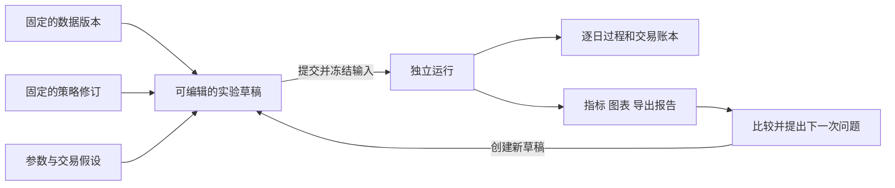

# Quanto 工作台：从研究想法到可复核的回测

这份说明面向第一次使用项目的人。先理解它怎么帮助研究，再看具体页面；暂时不需要了解 API、进程或数据库。

## 1. 现在做出来的是什么

Quanto 是一个在自己电脑上运行的策略研究工作台。你提出交易规则，选择历史数据和交易假设，系统按历史日期模拟执行，保存每次试验，并让你检查结果产生的原因。你和 Agent 使用同一套系统。

目前研究范围是 A 股场内股票型行业 ETF、日线、多头现金账户。你可以改变 Python 策略和参数，但仍需遵守工作台的接口和数据范围。股票逐只选股、做空、融资、分钟级交易、券商实盘下单都没有在首版实现。

“工作台已经完成”说明研究工具的闭环已经建立。策略是否有用、哪些参数合理、数据能否支持结论，仍要通过具体研究回答。内置模板用于开始试验，不能理解成已经验证有效的交易系统。

## 2. 先分清四个东西

| 名称 | 通俗解释 | 举例 | 能否修改 |
|---|---|---|---|
| 数据版本 | 本次试验使用的历史资料包 | 某批 ETF 行情、交易日历、基准和交易状态 | 登记后固定；更新产生新版本 |
| 策略修订 | 一份保存好的交易规则代码 | “趋势为正，再按动量选行业”这段 Python | 保存后固定；改代码产生新修订 |
| 实验草稿 | 一张可以修改的试验设置单 | 用哪些数据和策略、回测哪段时间、资金和费用多少 | 可以反复修改 |
| 运行 | 按某张设置单实际执行的一次试验 | 昨晚跑出的那份账本和报告 | 历史输入和产物不覆盖 |

策略参数描述规则怎么判断，例如回看 20 天还是 60 天。实验配置描述怎样评价和执行，例如本金、手续费、滑点、标的池、时间范围和仓位限制。两者都会影响结果，比较时都需要检查。

例如，先用参数 A 跑出运行 001，然后把草稿改成参数 B，跑出运行 002。运行 001 仍保留参数 A；不会因为编辑器里显示 B，就悄悄变成 B 的结果。

## 3. 网页的四个入口怎么用

### 数据版本：先弄清用什么资料做试验

这里可以生成演示数据、导入符合契约的数据包，或提交现有数据源的获取任务。登记的数据会显示来源、覆盖日期、包含的标的、基准、价格模式和限制。

“生成演示”使用合成行情，适合熟悉操作和检查代码。它不是实际市场走势。联网任务结束也不一定代表数据完整：覆盖不全时会留下失败原因或不完整诊断，不登记成可回测版本。

真实数据试抓已经做过一次有限检查：ETF 的五天行情取得成功，默认基准接口失败，因此那次结果没有登记为完整数据版本。不能把“页面上有获取按钮”理解成真实市场数据已经全面准备好。

### 策略与实验：把想法写成规则和设置

左侧或选择框中选择策略、数据和已有实验；编辑区域包含 Python 源码、策略声明和参数。参数声明决定网页表单展示哪些字段、哪些类型和取值有效。Agent 可以替你修改这些文件并注册成新修订，你也可以直接编辑。

常见工作是：选择模板 → 保存代码修订 → 填写参数及实验配置 → 验证当前策略与参数 → 保存实验。接口验证主要检查策略能否按约定工作，不能证明策略盈利，也不能取代完整历史回测。

保存过程中继续输入的新内容会保留。代码没有保存时，当前草稿的克隆按钮会要求先保存或明确放弃源码修改，避免把编辑器重置后丢失内容。

### 回测任务：提交运行，并检查发生了什么

选择实验后提交一次运行，也可以提供一份有限的参数组合列表。一次批量最多 100 组；默认工作进程同时执行一个任务，其余排队。

详情显示排队或执行状态、模拟日期、完成交易日数、日志、冻结输入和交易过程。离开网页或刷新不会取消任务。可以请求取消；失败、取消或中断会保留已经完整写出的部分记录，但不会伪装成成功报告。

### 对比：解释差异，而不是只挑最高收益

选择 2–20 次运行后，页面并列展示指标和冻结输入差异。符合直接比较条件时可以叠加曲线；不同评价口径不会被静默裁剪成“看起来一样”。

即使系统允许并列比较，标的池、初始资金、风险设置等差异仍需要解释。例如少投入一半资金通常会改变回撤，不能仅凭回撤变小就认定选股规则更好。

## 4. 一天的模拟交易怎样发生

历史时间逐日推进，顺序很重要：

1. 处理当天已知的账户事件，以及之前生成、今天可以执行的订单。
2. 在开盘模型下尝试成交，检查价格、费用、现金、可卖份额和交易状态。
3. 到收盘计算现金、持仓市值和账户权益，检查风险；到达策略评估时间时调用策略。
4. 策略用截至此刻的资料提出目标；风控按配置批准、缩小或改变该目标。
5. 根据批准目标生成订单，常规订单最早在下一个交易日开盘执行。

例如，某日收盘策略希望把 70% 的账户投入一只 ETF，而实验设置的单标的上限是 60%。系统会分别记录“原始目标 70%”“批准目标 60%”，再按批准目标形成订单。次日价格变化、交易单位和费用可能让实际持仓比例与目标略有不同；若不能成交，还会记录原因。

这里的 70% 和 60% 只是说明软件行为，不是账户配置建议。

策略有两种不同意思的输出：`Hold` 表示不提出新的常规调仓；完整目标组合则明确每个标的的目标，空目标表示申请全部现金。两者不能混用。风险检查仍然独立进行。

订单与成交也不同：订单是尝试交易的指令，成交才真正改变现金和份额。常规订单未成交的余量到期后不会自动在几天后补买；已确认停牌的持仓可以按配置使用旧估值并标记陈旧，不能用补出来的价格假装成交。

## 5. 两个内置模板分别是什么

| 模板 | 实际行为 | 在研究中的用途 |
|---|---|---|
| `buy_hold` | 第一次评估对当时合格标的提出等权目标，之后不再主动提出常规调仓；风控仍生效 | 建立简单参照，判断复杂规则增加了什么 |
| `trend_rotation` | 当前价格高于趋势窗口之前的价格才进入候选；按动量排序，已有持仓享有保留缓冲，选中的标的等权；可按日或周评估 | 作为可修改的趋势轮动起点 |

趋势模板中的 `trend_window` 是趋势回看长度，`momentum_window` 是排名回看长度，`entry_rank` 是新进入的排名范围与目标名额，`retain_rank` 是已有持仓的保留范围，`evaluation` 是评估频率。

例如已有持仓从第 3 名降到第 4 名，若保留范围设为前 5 名，它可能继续保留，减少边界来回换仓。这个例子只说明缓冲逻辑，不说明这些数值最优。

当前模板不是策略设计文档中所有未来研究规则的完整实现。成分广度、头部贡献、热度、景气度和 GRU 没有因为工作台建好就自动变成买卖信号。

## 6. 结果应该怎样看

建议先看输入和交易过程，再解释收益。顺序可以是：

1. **资料是否可信**：是不是演示？价格模式是什么？日期、标的和基准是否符合研究问题？
2. **配置是否符合预期**：本金、费用、滑点、仓位限制、区间和参数是否正确？
3. **交易是否真的发生**：原始信号是什么，风控改变了什么，订单是否成交，没有成交为什么？
4. **收益来自哪里**：是否长期空仓、只集中在少数标的、只靠某段上涨，费用和换手多大？
5. **比较是否公平**：除了想研究的那一项，是否还有其他假设变化？

| 结果 | 它回答的问题 | 容易误读的地方 |
|---|---|---|
| 权益曲线 | 账户的钱随时间如何变化 | 当前是金额曲线，起点是实际本金，不默认从 1 开始 |
| 累计收益 | 期末权益比初始本金变化多少 | 先检查是否包含成本、采用什么价格口径 |
| 最大回撤 | 从此前高点到后续低点最深跌多少 | 历史回撤不能当成未来亏损上限 |
| 年化收益、波动、夏普 | 按明确口径概括回报和波动 | 短样本年化容易夸大；不可计算时显示不可用 |
| 月度/年度收益 | 好坏表现发生在哪些时期 | 总收益可能集中在很少几个月 |
| 持仓、现金、成本和换手 | 实际承担多少暴露、为交易付出多少代价 | 低仓位带来的低风险不等于策略识别能力强 |
| 订单、成交、信号和风控表 | 每笔交易或不交易的原因 | 原始策略意图不等于批准目标，更不等于实际成交 |

例如本金 10 万、期末权益 10.5 万，对应累计收益 5%。另一次本金 20 万、期末 20.8 万，期末金额更大，但累计收益为 4%。这说明为什么比较时既要看曲线单位，也要看输入差异。

网页展示后端计算好的指标，只进行单位和精度格式化；缩放图表不会偷偷重算收益。需要独立核对时，CSV/JSON 用于读取明细和来源，独立 HTML 用于离线阅读。

## 7. 怎样反复修改，才不丢失研究线索

有三个容易混淆的动作：

- **修改当前实验草稿**：调整下一次要运行的设置，已运行的历史不变。
- **从历史运行创建实验**：从那一次冻结的输入分支，适合继续研究某个旧结果；之后改代码或参数，产生新运行。
- **按原快照重跑**：尽量复现同一份历史输入与代码；环境不一致会明确阻止精确重跑，不能假装完全相同。

例如先比较同一数据、同一费用下的两个动量窗口，再单独研究手续费提高后的效果，会比同时改窗口、池子、成本和仓位更容易解释。系统会保存差异，研究问题仍需你和 Agent 明确。

工作台提供有限参数列表的批量执行，不包含自动寻找最优参数、自动划分样本内外、自动发现有效策略的研究流程。挑选很多组合中最高的一次，也不能直接当作有效结论。

## 8. 它与此前三个研究问题的关系

| 研究问题 | 现有工作台能提供什么 | 仍要补什么 |
|---|---|---|
| 收益持续时间是否支持周评估与中期持有 | 修改评估频率、回看参数及退出规则，运行并比较实际账本 | 研究方案、事件诊断、样本外评价与对照实验，不是自动生成结论 |
| 行情广度、头部贡献和热度是否有增量价值 | 保存策略版本和对照运行，使用已支持的数据与策略接口 | 可靠的历史成分/权重/可用时间，以及需要时扩展辅助研究表访问 |
| 多只 ETF 是否仍会一起亏损 | 配置仓位、分组和预设压力约束，检查风险调整及组合损失 | 历史穿透、联动和压力研究，以及经验证的限额依据 |

目前没有“识别庄家”或自动识别市场情绪的模块，也没有证据表明某个模板已经回答了这些问题。研究文件可以登记并随快照冻结，但这本身不是任意研究表都能直接传入策略的通用接口。

## 9. 程序、数据和报告放在哪里

日常使用时，浏览器负责操作；本机 Python 服务负责保存实验和管理任务；独立工作进程负责模拟交易；本地文件和数据库保存数据与结果。你不需要分别操作这些组件。

合并后的代码位于 `D:\Projects\quanto`，当前开发分支为 `v2`。几个重要位置：

- `strategies/`：可注册的策略模板与参数声明。
- `src/quanto/backtest/`：统一模拟执行、现金持仓和指标核心。
- `web/`：网页源码；日常启动使用构建好的页面。
- `data/workbench/`：当前目录下的本地工作台数据、实验和快照。
- `outputs/workbench/`：当前目录下运行产物的默认位置。

SQLite 保存版本索引、实验设置和任务状态。新登记的数据表统一为 Parquet，CSV 导入仍然支持。新回测的策略和配置各自保存，行情则引用 `data/workbench/dataset_objects/` 中的一份共享数据对象；反复修改参数不会每次复制整份行情。旧回测仍使用自己的原快照，不改写历史文件。

运行时只读取选中标的、截至结束日的行情。起点前历史仍保留，因为策略可以使用更早的数据，资格判断也需要累计历史。完整性检查仍会读取共享对象的文件字节，所以按需加载不等于完全不扫描其他数据。备份时要同时保存工作区、共享对象和结果目录；不能单独备份 SQLite 或只拷贝某个运行目录。

Git 合并带回源码和文档，不会自动搬回被忽略的 `.venv`、`node_modules`、`web/dist`、数据库或回测产物。2026-09-30 已将 `8765` 预览切到主仓 `v2` 源码，同时保留此前 worktree 的 Python 环境和历史工作区。因此网页仍能看到旧记录，也能使用新存储；该 worktree 仍在使用，应予保留。在主目录启动默认工作区会得到独立数据，不能把“没有旧运行”误认为合并丢了代码。具体路径见[切换记录](superpowers/plans/2026-09-30-preview-cutover.md)。

## 10. 第一次使用的顺序

当前本机可直接打开已升级的 [8765 工作台](http://127.0.0.1:8765)。另建工作区时按[使用指南](05_回测工作台使用指南.md)准备依赖并选择空闲端口；继续使用已有历史记录时，按切换记录中的命令启动同一工作区。

第一次只做一个演示实验：生成演示数据 → 选 `buy_hold` 和 `512480` → 设置 `2018-01-02` 至 `2018-01-31` 的区间及演示本金 → 检查费用/风险假设并保存 → 提交运行 → 从一笔信号追到订单和成交 → 查看权益和导出。

熟悉后，从这次运行创建新实验，修改一项明确设置再比较。接着才考虑真实数据和趋势模板。当前最需要你判断的，是系统是否把一次试验的设置、执行原因和结果表达清楚；真实策略研究应建立在可用数据和明确问题之上。
