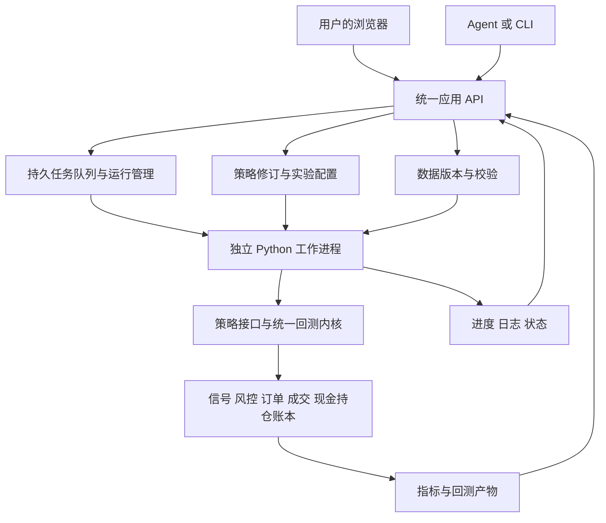

# Quanto 网页回测工作台设计

> 更新日期：2026-09-29
> 状态：本机 Windows 首版已实现；实际验证、模型假设与限制见[实施计划](../superpowers/plans/2026-09-29-web-backtest-workbench.md)及[使用指南](../05_回测工作台使用指南.md)。
> 本稿替代此前仅面向命令行研究的架构规划。交易假说仍以 [策略设计](../02_策略设计.md)为准，系统完成不代表策略已被验证。

## 1. 目标、假设与完成定义

用户明确需要：完整执行策略回测；本人和 Agent 均可修改策略逻辑或参数并反复运行；通过网页清楚查看回测过程和结果。网页应覆盖日常操作，而不仅是最终报告的查看器。

首版采用本机单用户部署：Python 服务在本机运行，浏览器作为前端，当前本机 Agent 通过同一套 API 或 CLI 使用系统。2026-09-29 按认可的本机方案分阶段实现；若以后改为远程或多人使用，需要重新设计认证、代码执行隔离和任务资源管理。

首版聚焦 A 股场内股票型行业 ETF 的日线、多头、现金账户回测。策略逻辑可用 Python 自由编写，包括自定义因子、资格筛选、排名、持仓保留、退出和日/周等评估日程；参数通过网页表单或 JSON 编辑。扩展策略不应要求修改回测引擎，但策略必须遵守数据时点、订单、现金和持仓的统一语义。

完成的标准是一条真实运行的闭环：选择数据 → 编辑或复制策略 → 设置参数和研究假设 → 提交任务 → 查看进度与原因 → 查看交易及绩效 → 与历史运行比较 → 修改后再次回测。更改策略、刷新网页、任务失败或服务重启均不能悄悄改变已有运行记录。

系统支持研究假设的变更，不要求每次试验先证明策略有效。实验风险参数与真实账户政策分开：研究可以比较不同配置，但必须显示其配置差异，不能把实验配置解释为获准用于实盘。首版不包含实盘下单、多人协作权限、分钟或逐笔撮合，以及全自动策略搜索。

## 2. 技术方案选择

| 方案 | 适合之处 | 对本需求的取舍 |
|---|---|---|
| Python API + 独立网页前端（推荐） | 人和 Agent 共享任务服务；代码编辑、运行详情和多实验比较可独立演进 | 初始工程量高于简单看板，但符合完整工作台目标 |
| Streamlit 等 Python 页面 | 很快展示参数和图表，维护语言较少 | 仍需独立实现持久任务、策略快照及 Agent 接口，不能依赖页面会话维护回测生命周期 |
| 先保留 CLI，仅生成网页报告 | 最快改善结果阅读 | 无法满足网页编辑、任务管理和完整操作流程 |

使用 FastAPI 提供应用 API，React + TypeScript + Vite 构建中文网页，SQLite 保存策略修订和任务索引，本地不可变文件保存数据、代码与回测产物。浏览器用 ECharts SVG 展示折线图、回撤图、热力图并配套可筛选明细表。

前后端职责分离，日常启动仍是一套本地应用：前端构建后由 Python 服务同源提供，用户无需日常启动两个开发服务器。回测由独立子进程执行，首版默认单任务运行，其余排队。先使用本地队列，不引入 Redis、Celery 或分布式集群。

## 3. 网页操作与信息组织

### 3.1 数据集

支持生成演示数据、通过现有数据源获取 ETF 行情、导入符合契约的 CSV/Parquet，并将通过校验的数据注册为新版本。演示数据始终醒目标记，不能与真实数据的研究结论混淆。

展示来源、版本、日期覆盖、标的清单、基准、复权和分红口径、缺失与异常记录、采集失败及适用限制。获取数据是独立任务，先展示实际覆盖再创建回测；不在每次运行时静默联网更新数据。网络失败可使用用户明确选择的已有版本，不把不完整缓存伪装为完整数据。

### 3.2 策略与实验编辑

从模板新建或复制已有策略，网页同时提供 Python 文件编辑器、参数表单和结构化参数编辑。策略声明参数名称、类型、范围、默认值和说明；新增参数无需逐个修改前端。保存前检查语法与结构，运行前在工作进程中加载和验证接口。

首版策略修订包含一个入口文件及同目录内明确列出的 Python 辅助文件，不建设通用插件市场。只使用项目已安装并锁定的依赖；缺少依赖要明确报错，网页不自动安装任意包。Agent 可编辑本地策略文件，再通过命令注册为新修订；网页与 Agent 对同一草稿保存时使用修订号检测冲突，不能后写覆盖先写。

一次实验还需设置数据版本、标的池、起止时间、预热区间、基准、初始资金、费用与滑点、执行模型、风险配置、随机种子及样本用途。提供“复制为新实验”和参数差异查看。研究参数的示例值只用于演示，不标为最优取值或已批准账户限额。

### 3.3 运行列表与任务详情

列表展示策略修订、参数摘要、运行时间、数据版本、状态和关键指标，可按状态及实验分组筛选。每次提交生成独立运行 ID，不复用目录覆盖已有结果。

运行详情区分当前阶段、已处理交易日/总交易日、模拟日期、耗时、事件日志和错误。数据读取或自定义策略初始化无法估算时显示阶段，不编造百分比。用户可取消任务，离开页面或刷新后仍可继续查看。小规模参数列表可作为同组任务排队，每个组合保留独立快照、状态和结果。

逐日过程支持回看信号 → 策略意图 → 风控调整 → 订单 → 实际成交/未成交 → 持仓与净值。点击交易可追溯信号日、参考数据、目标变化、费用和执行原因；日志不能只输出“正在计算”。

### 3.4 结果与比较

结果页包括净值与基准、回撤、年度/月度收益、仓位和现金、换手及成本，以及交易、订单、持仓、信号、风险事件和数据质量明细。运行中可展示已完成日期的曲线，但明确标为部分结果；完成前不计算并展示为最终业绩。

选择多个运行进行曲线叠加、指标对照及代码/参数/数据差异比较。默认只对相同绩效区间和评价口径的运行做直接比较；不同数据版本、标的池、资金、基准或成本的差异持续可见，不自动归因于策略更优。不静默裁切日期重算排名；需要统一区间时生成新的对照运行。

导出包含元数据的 CSV/JSON 和可独立阅读的 HTML 报告。显示失败、取消和负收益实验，不默认只保留最好结果。

## 4. 共同服务与模块边界

| 模块 | 职责 | 不承担的职责 |
|---|---|---|
| 数据服务 | 导入、获取、校验、版本及可用时间 | 在运行中悄悄替换数据 |
| 策略管理 | 源码与参数契约、草稿、不可变修订 | 修改历史运行快照 |
| 实验与任务服务 | 输入冻结、排队、进度、取消、结果索引 | 在 HTTP 请求线程中执行长回测 |
| 策略接口 | 使用当时可知信息产生目标意图和诊断 | 自行成交、修改现金或净值 |
| 回测内核 | 时间推进、风险、撮合、账本、估值、事件 | 绑定某套因子或强制所有策略周频 |
| 评价与报告 | 一致口径的指标、曲线、比较与导出 | 挑选回测最优参数并宣称策略有效 |

当前 `run_backtest` 通过统一策略协议接收意图，风险与账本独立执行；pandas 因子和数据适配按现行契约使用。旧原型固定因子、周目标和旧交易语义已迁移，不保留过时双套接口。

## 5. 策略扩展契约

策略修订至少声明入口、参数契约、必要数据、预热长度及评估日程；每次运行创建独立策略实例。内核每天推进时间，在声明的评估时点调用策略，并每天独立检查研究风险配置。

策略上下文只提供截至当前决策时点的数据视图、历史可新增标的资格、实际持仓、现金、未完成订单、风险状态和已解析参数。已持有标的即使不再具有新增资格，也仍在估值与退出视图中。预热数据可用于指标计算，不能计入绩效期间或提前建立持仓。

策略返回以下两种明确结果之一：

- `Hold`：不发起新的常规调仓，已有仓位和订单仍按执行及风险规则管理。
- `TargetPortfolio`：给出完整目标组合、逐标的原因及诊断。未列出的已有标的目标为零；空目标表示申请全部现金。禁止用空表同时表示“没信号”和“清仓”。

目标权重须为有限非负数，总和不超过首版现金账户允许的投入比例；非法标的、重复目标、未知参数或未来时点请求直接拒绝并给出错误。参数契约声明的功能必须实际生效，不能接受但忽略频率、退出或熔断设置。

内核根据策略意图与研究风险配置生成最终订单。策略可以改变计算逻辑和信号，不得向引擎直接写入成交价、手续费、现金或净值。日风险处置优先于常规持仓与新增意图，挂起退出不能被随后的普通买入覆盖。

首版提供至少两个使用同一接口的可运行样例：简单买入持有/等权基准，以及可配置的趋势资格、动量排名和保留缓冲策略。模板用于证明系统扩展能力并支撑研究，不预设策略有效。成分广度与真实拥挤等缺少输入数据的功能不伪装为已实现。

## 6. 回测时间、成交与账本

采用明确的日线事件顺序：处理已知账户事件与可执行订单 → 记录开盘成交和未成交 → 收盘估值 → 每日风险检查 → 到期的策略评估 → 生成最早在下一可交易时点执行的订单。交易日程使用明确的交易日历，不因回测恰好结束于周三，就把周三伪装成已知的周末。

收盘决策使用当时已知权益和参考价格形成订单数量；次日开盘模型按开盘价格及滑点撮合，并检查资金与交易约束。不得读取次日收盘、高低价来决定开盘订单数量，也不能用收盘检查生成的风险信号回填为同一收盘价成交。

同一时点先处理可成交卖单，再分配买单资金。买单资金不足时按预设比例和交易单位缩减，用固定余量分配规则处理舍入；输入文件或标的排序改变不能随意改变投资结果。卖出未成交时不能先假定已经获得现金。

撮合模型明确交易单位、可卖份额、费用最低值、滑点、停牌与价格限制处理、订单有效期和取消/替换规则。元数据缺失时使用何种简化必须在数据版本和报告中显式说明；不把日线触价视为真实成交保证。首版采用下一开盘模型，不提供虚构的盘中止损或逐笔流动性回放。

首版常规订单只参加指定的下一交易日开盘撮合，未成交余量到期并记录原因，不自动在数日后补买。新的完整目标撤销尚未执行的常规订单，按实际持仓重新生成，空目标同时撤销未执行买单；Hold 不新增或替换常规订单。风险处置意图按照配置持续生效并逐日生成减险订单，直至达到处置目标或满足解除条件；它优先于普通目标，不与旧单重复卖出。订单的创建、成交、部分成交、拒绝、撤销和到期分别留痕。

持续维护现金、份额、可卖份额、订单、成本和估值。未复权现金账本模式按数据事件处理分红及份额变更，执行用未复权价格，信号价格与复权因子分开。只有前复权 OHLC 的旧数据可注册为复权价格简化研究模式：份额代表合成研究单位，不重复计入分红，不宣称符合真实交易单位或真实现金损益；与未复权现金账本模式分组比较。

停牌或已确认的无交易日使用最近可靠估值并标记陈旧，不将持仓计零，也不以填充值撮合。无可解释原因的数据缺失、首次估值缺失或超出事前设定的陈旧上限，使运行停止并报告数据问题；不借助未来价格填充。最后一个回测日仍持有的仓位按收盘估值并单独列示，默认不虚构末日强平；若有期末退出实验，须提前声明并遵守相同时间规则。

所有账本变动均有来源。净值始于实际初始现金；总收益包括绩效首日损益与费用。现金、持仓市值、账户权益及费用应可按事件逐笔复核。

## 7. 数据契约与版本

统一现有两套加载路径，校验日期、时区、标的代码、正价格、OHLC 关系、数量单位、重复日期/标的、区间和基准覆盖。重复或非法数据不能靠静默删除“修好”。记录标的上市、历史候选资格、交易状态、行业映射和数据来源；当前静态池的回测必须披露选择偏差。

新增资格过滤生成单独的时点资格表，不删除估值所需行情；获取到的数据、信号可用数据、可新增资格和可成交状态各自有清楚定义。指数自身成交额不能自动解释为全市场成交额，策略声明需要的字段必须有匹配口径。

未复权现金账本数据需提供未复权价格、复权/账户事件口径及其覆盖说明；首次数据接入应验证数据源是否能可靠提供所需字段。不能获取的字段支持显式导入，缺失时限制适用模型。仅有前复权日线的数据可以跑简化研究，但报告不得标记为已验证真实交易约束。

首版须用可逐笔核对、含分红和份额变更的确定性数据集验收未复权现金账本，同时用现有前复权数据验收简化研究模式。真实行情接入只标记已验证的能力：若数据源不能提供完整事件与交易状态，不宣称该数据源支持完整现金账本；用户导入满足契约的数据仍可使用该模式。这一限制在创建实验时展示，不能等运行结束才告知。

每次导入或更新形成新数据集 ID、清单与内容哈希，并保存不可变数据文件。运行引用冻结的版本，不只记录可变目录的路径。成分股广度需要历史成分、权重与可用时间，属于后续数据扩展，不阻塞 ETF 日线工作台交付。

## 8. 实验快照与复现

`strategy_revision` 表示不可变代码修订；`experiment` 表示可编辑的实验草稿及来源关系；`run` 表示一次冻结输入的执行。复制历史运行产生新草稿，新运行从新 ID 开始，不修改原运行。

提交任务时、进入 `queued` 前完成快照与清单的原子发布，再创建可领取的任务。若冻结失败则提交失败，不产生引用不完整输入的排队任务。清单至少保存：

- 策略入口与全部声明源码文件、参数契约、原始参数及完整解析后的有效配置。
- 数据版本、实际时间覆盖、标的池、基准、交易日历、价格与分红口径。
- 回测和风控假设、预热与绩效区间、样本用途、随机种子及指标定义版本。
- 引擎 Git commit，以及运行用源码的内容快照/哈希；有未提交改动时冻结有效源码，不能仅依赖 commit。
- Python 与依赖锁文件/实际版本、系统信息、启动时间、来源（网页或 Agent）和父运行 ID。

共享数据和引擎快照可按内容哈希去重。清单不包含服务令牌、环境密钥或无关工作区文件。源码变更不会影响已排队或运行中的快照；工作进程必须从指定快照加载代码，不能再导入可变工作区版本。

源码快照覆盖项目执行依赖：引擎、风险、指标、数据处理、策略及其辅助模块，排除可变工作区和可编辑安装路径对这些模块的覆盖。策略额外研究文件必须先注册为数据版本，不能只保存文件路径。对动态导入或读取外部资源不能声称已自动完整识别：发现未声明本地依赖时拒绝可复现模式；明确依赖外部状态的研究标记为不可精确复现，不提供误导性的精确复现结论。

“按原快照重跑”验证数据与源码哈希并检查运行环境。环境或依赖不一致时，明确阻止精确复现，允许另建标明环境变化的运行；首版不承诺自动安装任意历史环境。稳定环境及确定性策略下，同一快照得到一致账本；具有随机性时固定种子并记录无法保证的来源。

## 9. 任务生命周期与本机执行

`queued` 可以进入 `running`，也可在尚未领取时直接变为 `cancelled` 并保留快照。`running` 可进入 `succeeded`、`failed` 或 `interrupted`；请求取消时进入 `cancel_requested`，工作进程确认停止并收拢产物后进入 `cancelled`。领取、完成和取消通过事务确定先后，终态拒绝后到的状态覆盖。进程失联或服务重启不能确认正常终止时记为 `interrupted`。`succeeded / failed / cancelled / interrupted` 均为终态，不默默续算。

首版一个调度器、默认一个工作进程。领取任务使用数据库事务，避免重复执行；请求使用幂等键，网页双击或 Agent 重试不会创建重复运行。SQLite 存状态、进度、元数据和索引，详细日志及大表写独立运行目录。浏览器按游标轮询增量日志和状态，无须保持页面连接来维持任务。

取消先在交易日边界协作退出，自定义代码卡住时允许超时终止该运行进程。记录心跳、最后完成日期和错误堆栈。服务退出或重启时识别遗留工作进程并清理，运行记为中断，排队任务保留；不宣称从不完整账本恢复成功。

只有所有必需产物校验完成且发布成功后，事务标记 `succeeded`。失败或取消保留输入、日志和完整写出的部分产物，但不纳入已完成业绩排名。磁盘不足、配置错误、数据错误和策略异常在页面说明所属阶段及可采取的下一步。

默认仅绑定本机回环地址，同源网页访问；写入 API 校验本机会话令牌及来源，Agent 使用同一凭据。策略代码按受信任本地 Python 执行；子进程提供任务隔离和取消能力，并不是恶意代码沙箱。首版不向公网暴露任意代码执行入口，也不把限制历史视图宣传为能阻止恶意策略从外部读取未来数据。

## 10. Agent 接口与统一入口

网页与 Agent 使用同一应用服务，不为 Agent 另写一套回测。CLI 支持机器可读 JSON、明确退出码及运行 ID，并可等待任务完成或立即返回。可做的操作包括：

| 对象 | 网页和程序接口共用能力 |
|---|---|
| 数据集 | 获取/导入、注册版本、校验、查询覆盖与异常 |
| 策略 | 查询、创建/复制、编辑草稿、带修订号保存、校验、注册源码修订 |
| 实验 | 新建/复制、设置输入、查看差异、提交单次或有限参数列表 |
| 运行 | 查询状态/进度/增量日志、取消、读取结构化结果、按快照重跑 |
| 比较与报告 | 比较可选运行、读取口径差异、导出报告及完整数据 |

API 以稳定对象 ID 为输入，不允许浏览器随意读写主机路径；本地 CLI 可显式导入用户指定文件。Agent 返回给用户的是可打开的运行详情链接和可复核的结果，而不是只给终端摘要。参数契约和 API 文档供 Agent 查询，新增策略无需自动化点击网页。

## 11. 指标、过程与实验纪律

固定并披露指标公式及口径：总收益、年化收益、最大回撤、波动、Sharpe、Calmar、基准及相对收益、换手、费用、平均投入比例和持有期。无定义或样本不足时显示不可用，不把除零结果伪装为零风险或高绩效。交易笔数与完整往返次数分开，未平仓收益与已实现收益分开。

首版默认现金利息与无风险利率假设写入配置，年化交易日数和自然日区间不可混淆。基准的价格收益/总收益类型明确可见。净值图可降采样以保持交互流畅，指标始终使用完整数据；表格分页，导出保留全量。

实验可以标记探索、训练、验证或测试区间，并记录这些区间是否被反复查看。系统保留全部尝试与参数差异，支持研究纪律，不因页面写了“样本外”就保证其未被用于选参。大规模优化、自动选最优参数和研究有效性判断不属于首版自动功能。

## 12. 首版验收

| 场景 | 必须观察到的结果 |
|---|---|
| 浏览器完整闭环 | 导入/生成数据，修改代码与参数，启动回测，查看过程、结果、比较和导出；关键操作不依赖终端 |
| Agent 使用 | 同一策略通过 API/CLI 提交并返回网页链接，结果口径与网页一致 |
| 策略可替换 | 至少两套不同策略通过同一接口运行；增加自定义策略无需编辑引擎；声明参数实际生效 |
| 无未来信息 | 改动未来数据不改变过去决策；交易日收盘价变化不改变该日开盘订单；截断样本不提前制造周末信号 |
| 账本与订单 | 买卖顺序不因输入排序变化；资金不足可解释，费用与现金守恒；Hold 与空目标行为不同 |
| 数据与价格模式 | 不合格持仓仍估值；停牌不假成交；未知缺价不能计零或从未来补值；分红/份额事件可逐笔核对；前复权简化模式不得声称真实成交损益 |
| 运行可靠性 | 双击不重复建任务，刷新不丢状态，可取消；异常、服务重启和部分产物不会伪装为成功 |
| 可复现与可比较 | 排队后改源码/数据不影响该运行；同环境按快照重跑的确定性账本及规范化产物哈希一致（排除运行 ID、时间等元数据）；环境差异明确；比较展示口径差异 |
| 无交易与边界 | 全现金、短样本、空交易表、末日未成交/未平仓均有有效报告或明确拒绝原因 |
| 研究风险 | 每日检查、超限动作与恢复按照显式配置执行；不接受无作用的风控参数，不宣传硬性损失保证 |

测试先审查现有用例是否符合这些要求，再修订或移除过时测试。用确定性小数据验证账本和时间语义，用集成测试验证任务与快照，用浏览器验收完整操作流程。真实行情只验证接入与运行可行性，不以某次收益漂亮作为系统正确性的证据。

## 13. 交付阶段与提交纪律

1. **可信回测内核**：统一数据与策略契约，修复时点、估值、空目标、现金及指标问题，形成两个可运行样例和关键账本验证。
2. **实验运行服务**：完成策略/数据版本、不可变快照、任务队列、进度、取消、API/CLI 及复现验证。
3. **网页完整流程**：完成数据、编辑、运行、过程、结果、比较及导出，接入真实服务并做浏览器验收。
4. **交付检查**：明确安装和一键启动方式，提供演示数据及可重跑示例，验证服务重启、失败路径和完整闭环。

每阶段通过对应验收后立即独立 commit，不自动 push。阶段划分服务于同一完整首版，不把只展示静态图表或运行按钮的页面当作交付完成。任务、接口和验收命令见[实施计划](../superpowers/plans/2026-09-29-web-backtest-workbench.md)。

## 14. 当前限制与资料

时点、现金分配、缺价估值、空目标、收益基数、配置生效和不可变运行已由对应行为测试覆盖，包括未来数据扰动、除息应收、取消与重启。当前边界是受信任本地 Python、非恶意代码沙箱；快照哈希冻结输入/源码并比较发行包名/版本，不逐文件校验第三方安装内容，也不自动完整发现动态外部依赖。Windows Job Object 生命周期经过验证，非 Windows 两个根进程同时消失后的任意辅助进程清理仍有窗口。

真实行情有限检查仅确认 ETF 512480 的 2024-01-08..12 五日返回，默认 sh000300 基准 ConnectionError 导致覆盖不完整且未登记数据；不宣称全面就绪。研究模式与原始现金模式分开；主线的三个研究问题仍由工作台承载，没有被网页功能替代。详细操作和模型时序示例见使用指南。

技术参考：

- [FastAPI 后台任务](https://fastapi.tiangolo.com/tutorial/background-tasks/)说明请求内的小型后台任务与较重计算的区别；本方案据任务持久性与取消需求选择独立本地工作进程。
- [React 构建独立应用](https://react.dev/learn/build-a-react-app-from-scratch)列出 Vite 等构建方式及需要自行处理的应用能力；本地工作台采用客户端页面和已有 Python 服务，不需要服务端渲染。
- [Streamlit 执行模型](https://docs.streamlit.io/develop/api-reference/execution-flow)说明交互与脚本重跑机制；其适合作为轻量展示选项，不能代替本方案的持久实验记录。
