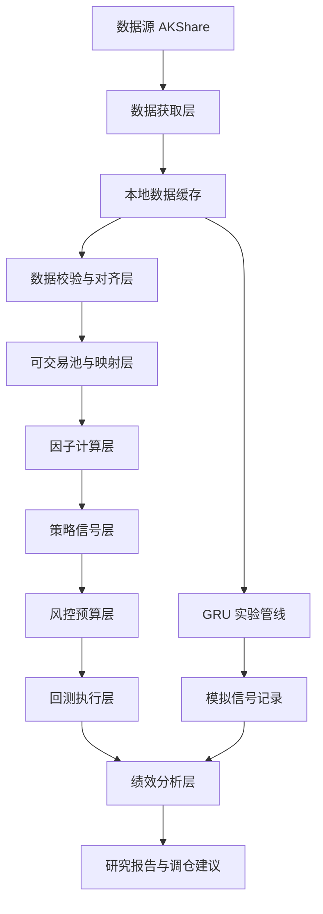

# Quanto 技术架构规划

## 1. 架构目标

本架构用于支撑一套 A 股行业 ETF 轮动量化交易系统，从研究回测逐步演进到模拟盘和小资金实盘。系统的第一目标不是自动交易，而是形成可复现、可审计、可验证的研究闭环。

核心目标：

- 用稳定的数据管道支撑行业 ETF、行业/板块指数、沪深 300 和市场成交额数据。
- 将策略信号、风控规则、回测执行和报告输出分层，避免规则互相污染。
- 优先完成传统多因子行业轮动的最小可验证闭环。
- 为后续 GRU 模型、模拟盘信号记录、信号推送预留接口，但不在第一阶段实现复杂自动化。

非目标：

- 第一阶段不做自动下单。
- 第一阶段不做 Web UI。
- 第一阶段不将 GRU 纳入实盘执行链路。
- 第一阶段不做高频或分钟级策略。

## 2. 关键架构决策

| 编号 | 决策 | 选择 | 理由 | 后续影响 |
|------|------|------|------|----------|
| ADR-001 | 运行形态 | 本地离线研究脚本优先 | 当前目标是验证策略有效性，本地脚本更简单、可控、易复跑 | 后续可平滑加定时任务和推送 |
| ADR-002 | 数据源 | AKShare 为主，文件缓存为系统事实源 | 免费覆盖 A 股数据，适合个人研究；缓存可保证回测可复现 | 需记录数据拉取日期和源字段 |
| ADR-003 | 回测方式 | 第一版用 pandas 事件循环回测，BackTrader 作为第二阶段增强 | 行业轮动是周频策略，pandas 回测更透明，便于排查未来函数 | 若策略复杂化再接 BackTrader |
| ADR-004 | 策略与风控关系 | 策略只生成目标标的和理论权重，风控负责缩放仓位 | 交易宪法高于模型，仓位必须由风险预算倒推 | 所有下单建议必须经过风控层 |
| ADR-005 | 仓位表达 | 策略层等权，执行层按 VaR、ATR 和名义上限缩放 | 避免“Top3 等权”被误读为账户满仓三等分 | 报告需同时展示策略权重和执行权重 |
| ADR-006 | GRU 定位 | 独立实验管线，先只记录模拟信号 | 深度学习过拟合风险高，不应污染主线策略验证 | 共享数据层，不共享实盘执行层 |
| ADR-007 | 配置管理 | YAML 配置 + 代码默认值校验 | 参数必须显式、可审计，避免散落在代码里 | 后续可固定实验快照 |
| ADR-008 | 输出物 | CSV/Markdown/图片报告并存 | 便于人读、复盘和版本管理 | 第一阶段不需要数据库 |

## 3. 系统分层



### 3.1 数据获取层

职责：

- 从 AKShare 拉取行业/板块指数、行业 ETF、沪深 300、市场成交额。
- 保留原始字段，做最小清洗。
- 将数据写入本地缓存，供所有研究任务复用。

边界：

- 不计算策略信号。
- 不做风控判断。
- 不做回测。

建议输出：

| 文件 | 内容 |
|------|------|
| `data/raw/industry_index/*.parquet` | 行业/板块指数原始日线 |
| `data/raw/etf/*.parquet` | ETF 原始日线 |
| `data/raw/benchmark/hs300.parquet` | 沪深 300 日线 |
| `data/raw/market/turnover.parquet` | 市场成交额 |
| `data/metadata/fetch_log.csv` | 每次拉取的数据源、时间、行数 |

### 3.2 数据校验与对齐层

职责：

- 统一日期索引、字段名、数值类型。
- 检查缺失值、重复日期、停牌/无成交日。
- 处理 ETF 上市不足样本的问题。
- 生成因子计算可直接使用的标准数据集。

关键规则：

- 回测只使用调仓日前已知数据。
- 周五信号只能用周五收盘及以前的数据。
- 下周一调仓价使用下周一可交易价格，不能用未来收盘价。
- ETF 上市不足 120 个交易日时，不进入可交易池。

建议输出：

| 文件 | 内容 |
|------|------|
| `data/processed/prices.parquet` | MultiIndex: `date, symbol` 的 OHLCV |
| `data/processed/benchmark.parquet` | 沪深 300 与成交额环境数据 |
| `outputs/data_quality/latest.md` | 最近一次数据质量报告 |

### 3.3 可交易池与映射层

职责：

- 维护行业/板块信号与场内 ETF 的映射关系。
- 定义哪些 ETF 可交易、是否有替代标的、优先级如何。
- 根据上市时间、流动性和数据完整性生成当期可交易池。

建议配置：

```yaml
universe:
  min_history_days: 120
  min_avg_turnover_20d: 50000000
  max_symbols: null

mapping:
  - industry: 消费电子
    signal_index: BK1037
    etf: 561600
    priority: 1
```

第一阶段可以先用手工维护的 `configs/universe.yaml`，待数据稳定后再考虑自动发现。

### 3.4 因子计算层

职责：

- 计算并标准化行业 ETF 的横截面因子。
- 输出每个调仓日、每个标的的因子值、因子分位和综合得分。

第一阶段因子：

| 因子 | 权重 | 第一阶段实现方式 |
|------|------|------------------|
| 中期动量 | 40% | `(20日收益率 + 60日收益率) / 2` |
| 低波动稳定性 | 25% | `-20日日收益率标准差`，横截面标准化后越高越好 |
| 成交量确认 | 20% | `5日均量 / 20日均量` |
| 景气度边际变化 | 15% | 第一阶段保留接口，可暂设为缺失或配置为 0 权重实验 |

重要设计：

- 因子方向必须显式声明。
- 只在启用因子集合内做权重归一化；第一阶段关闭景气度因子时，前三个量价因子的有效权重按 `0.40:0.25:0.20` 重新缩放。
- 横截面标准化必须只在当期可交易池内进行。
- 缺失因子不应默默填 0，必须在报告中暴露。
- 景气度因子进入前，应单独验证数据滞后和可得性，避免财报未来函数。

### 3.5 策略信号层

职责：

- 根据因子综合得分生成排名。
- 产生策略层目标持仓，不直接决定最终仓位。
- 处理策略出场条件。

传统多因子策略规则：

- 每周五收盘后生成排名。
- 下周一开盘执行信号。
- 策略层选择综合得分 Top3。
- 持仓跌出全市场前 10，下周一出清。
- 收盘价跌破 20 日均线，次日开盘清仓该品种。
- 大盘进入危险状态，全部清仓。

策略层输出字段：

| 字段 | 说明 |
|------|------|
| `signal_date` | 信号生成日期 |
| `trade_date` | 计划执行日期 |
| `symbol` | ETF 代码 |
| `rank` | 综合排名 |
| `score` | 综合得分 |
| `strategy_weight` | 策略层理论权重 |
| `exit_reason` | 若需退出，记录原因 |

### 3.6 大盘环境层

职责：

- 判断市场是否允许持仓。
- 生成总仓位上限。

规则：

| 状态 | 条件 | 总仓位上限 |
|------|------|------------|
| 可操作 | 沪深300在200日均线上方且两市成交额 > 8500亿 | 由风控预算决定 |
| 危险 | 沪深300在200日线下方且两市成交额 < 7000亿 | 0% |
| 谨慎 | 未满足可操作，且未触发危险 | 30% |

注意：

- “可操作”不等于满仓，只表示允许执行策略目标仓位。
- 市场环境层只控制上限，不改变标的排名。
- 三档状态按“可操作 -> 危险 -> 谨慎”的顺序判断，确保任意交易日都有唯一状态。

### 3.7 风控预算层

职责：

- 将策略层理论权重转换为执行层目标权重。
- 独立执行交易宪法，不允许策略绕过。

规则来源：

- 组合单日 VaR 或压力测试亏损不得超过账户权益 2%。
- 单只 ETF 最大风险暴露不得超过账户权益 0.5%。
- 单只 ETF 名义仓位上限 15%。
- 账户净值回撤达 15% 时，暂停实盘至少一个月。
- 极端市场环境触发时，清仓并观察至少 3 个交易日。

仓位缩放顺序：

1. 接收策略层目标权重。
2. 应用大盘环境总仓位上限。
3. 应用单只 ETF 名义仓位上限。
4. 根据 ATR/波动率计算单品种风险上限。
5. 根据组合 VaR 计算总风险上限。
6. 输出最终执行权重。

第一阶段回测可使用简化风险模型：

```text
组合风险估算 = 总仓位 × 持仓标的20日平均波动率 × 2.33
要求组合风险估算 <= 2%
```

后续增强：

- 使用协方差矩阵估算组合 VaR。
- 增加压力情景：沪深300单日 -5%、持仓 ETF 同步放大波动。
- 对高相关行业 ETF 做集中度惩罚。

### 3.8 回测执行层

职责：

- 将信号和风控权重转化为历史交易。
- 计算持仓、市值、现金、净值、交易成本。
- 防止未来函数。

第一阶段回测规则：

- 初始资金：配置项，默认 100000。
- 调仓频率：周频。
- 信号日：周五收盘。
- 执行日：下一个交易日开盘或 VWAP 替代价，第一阶段用开盘价。
- 手续费和滑点：配置项，默认单边 0.05% 作为保守估计。
- ETF 不收印花税，但仍应保留交易成本参数。
- 无法成交或缺失执行价时，跳过该标的并记录异常。

输出：

| 文件 | 内容 |
|------|------|
| `outputs/backtests/{run_id}/equity_curve.csv` | 净值曲线 |
| `outputs/backtests/{run_id}/trades.csv` | 交易明细 |
| `outputs/backtests/{run_id}/positions.csv` | 每日持仓 |
| `outputs/backtests/{run_id}/signals.csv` | 历史信号 |
| `outputs/backtests/{run_id}/metrics.json` | 绩效指标 |
| `outputs/backtests/{run_id}/report.md` | 人类可读研究报告 |

### 3.9 绩效分析与报告层

职责：

- 计算策略是否值得进入下一阶段。
- 让每次实验可复盘。

核心指标：

- 总收益率、年化收益率。
- 最大回撤。
- 夏普比率。
- Calmar 比率。
- 胜率和盈亏比。
- 年度收益。
- 月度收益热力表。
- 换手率。
- 单标的贡献。
- 市场环境分段表现。

验收重点：

- 最大回撤是否低于 15%。
- 收益是否依赖单一年份或单一行业。
- 交易成本后是否仍有收益。
- 熊市和震荡市是否能有效降仓。
- 是否存在明显未来函数或幸存者偏差。

### 3.10 GRU 实验层

职责：

- 共享数据层。
- 独立训练、验证和输出模拟信号。
- 不影响传统多因子实盘链路。

设计边界：

- 训练数据必须按时间顺序切分。
- 每个 fold 独立 fit scaler，避免泄漏。
- 保留最后至少 1 年作为最终样本外测试集。
- 输出模拟信号与传统策略一起进入报告层做对比。

升级条件：

- 模拟盘连续运行不少于 6 个月。
- 经历趋势上涨、震荡、单边下跌三类市场环境。
- 滚动 12 个月样本外夏普不低于传统多因子同期。
- 最大回撤不超过 15% 熔断线。

## 4. 推荐目录结构

```text
quanto/
  configs/
    strategy.yaml
    universe.yaml
    data_sources.yaml
  data/
    raw/
      industry_index/
      etf/
      benchmark/
      market/
    processed/
    metadata/
  docs/
    planning-artifacts/
      architecture.md
    implementation-artifacts/
    test-artifacts/
  notebooks/
    exploration/
  outputs/
    backtests/
    data_quality/
    reports/
    signals/
  src/
    quanto/
      __init__.py
      config.py
      data/
        fetcher.py
        cache.py
        validators.py
        schemas.py
      universe.py
      factors/
        base.py
        price_volume.py
        prosperity.py
        scoring.py
      strategies/
        multi_factor_rotation.py
        gru_rotation.py
      risk/
        market_regime.py
        position_sizing.py
        constitution.py
      backtest/
        engine.py
        broker.py
        metrics.py
      reports/
        backtest_report.py
        signal_report.py
      cli.py
  tests/
    unit/
    integration/
```

## 5. 配置规划

`configs/strategy.yaml`：

```yaml
strategy:
  rebalance_frequency: weekly
  signal_weekday: friday
  execution_timing: next_open
  top_n: 3
  exit_rank_threshold: 10
  ma_break_window: 20

factors:
  normalize_active_weights: true
  momentum:
    weight: 0.40
    enabled: true
    windows: [20, 60]
  low_volatility:
    weight: 0.25
    enabled: true
    window: 20
  volume_confirmation:
    weight: 0.20
    enabled: true
    short_window: 5
    long_window: 20
  prosperity_delta:
    weight: 0.15
    enabled: false

risk:
  portfolio_var_limit: 0.02
  single_symbol_risk_limit: 0.005
  max_symbol_weight: 0.15
  drawdown_circuit_breaker: 0.15
  cautious_total_weight: 0.30

backtest:
  initial_cash: 100000
  commission_rate: 0.0005
  slippage_rate: 0.0005
```

`configs/universe.yaml`：

```yaml
universe:
  min_history_days: 120
  min_avg_turnover_20d: 50000000

symbols:
  - etf: "512480"
    name: 半导体ETF
    category: 半导体
    signal_index: null
    enabled: true
```

## 6. 数据模型

### 6.1 标准行情表

| 字段 | 类型 | 说明 |
|------|------|------|
| `date` | date | 交易日 |
| `symbol` | string | ETF 或指数代码 |
| `open` | float | 开盘价 |
| `high` | float | 最高价 |
| `low` | float | 最低价 |
| `close` | float | 收盘价 |
| `volume` | float | 成交量 |
| `amount` | float | 成交额 |
| `adj_factor` | float/null | 复权因子，若可得 |
| `source` | string | 数据来源 |

### 6.2 因子评分表

| 字段 | 类型 | 说明 |
|------|------|------|
| `signal_date` | date | 信号日期 |
| `symbol` | string | ETF 代码 |
| `factor_name` | string | 因子名 |
| `raw_value` | float | 原始因子值 |
| `z_score` | float | 横截面标准化值 |
| `weighted_score` | float | 加权分数 |

### 6.3 交易明细表

| 字段 | 类型 | 说明 |
|------|------|------|
| `trade_date` | date | 交易日期 |
| `symbol` | string | ETF 代码 |
| `side` | buy/sell | 方向 |
| `price` | float | 成交价 |
| `shares` | int | 股数 |
| `notional` | float | 成交金额 |
| `cost` | float | 手续费和滑点 |
| `reason` | string | 调仓、破位、风控等原因 |

## 7. 运行流程

### 7.1 研究回测流程

```text
拉取数据 -> 数据校验 -> 生成可交易池 -> 计算因子 -> 生成信号 -> 风控缩放 -> 回测执行 -> 绩效报告
```

建议命令：

```bash
python -m quanto.cli fetch-data
python -m quanto.cli validate-data
python -m quanto.cli run-backtest --config configs/strategy.yaml
python -m quanto.cli report --run-id latest
```

### 7.2 每周模拟盘流程

```text
周五收盘后拉取数据 -> 生成下周信号 -> 风控校验 -> 输出调仓建议 -> 记录模拟执行
```

建议命令：

```bash
python -m quanto.cli generate-signal --date latest
```

## 8. 测试策略

第一阶段测试重点不是覆盖率数字，而是防止研究系统犯结构性错误。

必须测试：

- 因子计算不会使用未来数据。
- 调仓日和执行日严格错开。
- 横截面标准化只使用当期可交易池。
- 单 ETF 仓位不会超过 15%。
- 组合风险缩放后不超过总 VaR 上限。
- 大盘危险状态下目标仓位为 0。
- 缺失价格不会生成虚假成交。
- 回测结果在相同输入下可复现。

建议测试目录：

```text
tests/unit/test_factors.py
tests/unit/test_market_regime.py
tests/unit/test_position_sizing.py
tests/unit/test_metrics.py
tests/integration/test_backtest_no_lookahead.py
```

## 9. 实施路线

### Phase 1：传统多因子最小闭环

交付：

- 项目代码骨架。
- 配置文件。
- 数据拉取与缓存。
- 三个量价因子：动量、低波动、成交量确认。
- 周频回测引擎。
- 风控缩放第一版。
- 回测报告。

验收：

- 至少 5 年历史回测可复跑。
- 输出净值、最大回撤、夏普、交易明细。
- 无未来函数检查通过。
- 最大回撤、仓位、风险预算均可解释。

### Phase 2：策略研究增强

交付：

- 景气度边际变化因子研究。
- 行业 ETF 映射优化。
- 市场环境分段分析。
- 交易成本敏感性分析。
- 参数稳健性分析。

验收：

- 因子加入前后有清晰对照实验。
- 样本外表现未显著劣化。
- 报告能解释收益来源。

### Phase 3：模拟盘

交付：

- 每周信号生成脚本。
- 模拟持仓账本。
- 周报输出。
- 传统多因子与 GRU 信号并行记录。

验收：

- 连续运行至少 3 个月。
- 信号、执行、偏差均有记录。
- 人工不能绕过风控输出。

### Phase 4：GRU 实验

交付：

- GRU 数据集构造。
- 滚动 TimeSeriesSplit 训练。
- 样本外测试报告。
- 与传统策略的信号一致性分析。

验收：

- 无数据泄漏。
- 各 fold 验证损失稳定。
- 至少 6 个月模拟盘后才评估实盘资格。

### Phase 5：小资金实盘辅助

交付：

- 实盘信号报告。
- 风控校验报告。
- 手工执行清单。
- 季度样本外复验流程。

验收：

- 只执行传统多因子策略。
- 所有实盘建议都能追溯到信号和风控计算。
- 触发宪法熔断时系统给出明确停止建议。

## 10. 主要风险与缓解

| 风险 | 表现 | 缓解 |
|------|------|------|
| 数据质量风险 | 缺失、复权错误、字段变化 | 数据质量报告、缓存快照、异常中断 |
| 未来函数 | 回测过于漂亮，实盘失效 | 信号日/执行日分离，测试覆盖调仓路径 |
| 幸存者偏差 | 只回测当前仍活跃 ETF | 记录历史可交易池，至少暴露样本限制 |
| 过拟合 | 参数调到历史最优 | 样本外验证、参数敏感性分析 |
| 流动性不足 | 回测可买，实盘难买 | 最低成交额过滤，滑点敏感性分析 |
| 风控绕过 | 策略直接输出仓位 | 风控层作为唯一执行权重来源 |
| GRU 过早实盘 | 模拟不足就投入资金 | 架构隔离 GRU，只输出模拟信号 |

## 11. 开放问题

1. 行业 ETF 初始池采用哪些标的，是否以流动性优先而非行业覆盖优先？
2. 第一阶段是否暂时关闭景气度因子，将其作为 Phase 2 独立研究？
3. 回测执行价使用下周一开盘价，还是使用下周一 VWAP 近似？
4. 市场成交额数据采用两市总成交额的哪个 AKShare 接口作为事实源？
5. 是否需要保存每次实验的 Git commit hash 和配置快照？

## 12. 下一步

建议 BMAD 流程下一步进入 `Create Epics and Stories`，把本架构拆成可实施的 epics 和 stories。第一批 stories 应聚焦 Phase 1：

- 初始化 Python 项目骨架。
- 建立配置文件和数据目录。
- 实现 AKShare 数据拉取缓存。
- 实现可交易池与 ETF 映射。
- 实现三因子计算和排名。
- 实现周频回测与基础绩效报告。
