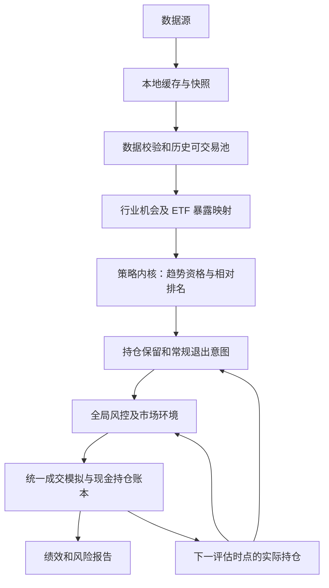

# Quanto 技术架构规划

## 1. 范围与状态

本规划描述如何研究 [行业 ETF 中期趋势策略](../02_策略设计.md)，并为未来独立方案留出最小边界。近期目标是本地、可复现、可审计的回测闭环；模拟盘和人工执行辅助须在研究规则稳定后推进。本文件是目标架构，不表示全部模块已经实现，也不批准交易参数。

仓库当前有 AKShare 数据获取与本地缓存、pandas 回测、因子评分、市场分档和仓位缩放代码。本稿要求的自身趋势资格、持仓保留缓冲、每日持仓风险检查、相关行业合并约束和暂停恢复流程均不能视为已实现。GRU、统一多策略接口、模拟盘账本和真实指令生成尚未形成闭环。

## 2. 架构决策

| 决策 | 目标 | 理由 |
|---|---|---|
| 运行形态 | 本地 pandas 研究与回测优先 | 与当前代码和策略频率相称，便于检查交易时点与账本 |
| 数据 | 原始数据与本地快照分开，记录获取和可用时间 | 历史实验可复现，避免未来信息进入信号 |
| 策略边界 | 窄接口输出候选、保留/退出意图和诊断 | 策略不绕过全局风控，也不复制回测引擎 |
| 风控边界 | 统一处理账户、组合、行业与相关暴露 | 多只 ETF 或多个方案不能各自用满同一风险预算 |
| 执行与报告 | 统一成交模拟、现金与持仓账本、成本和绩效口径 | 不同研究方案才能公平比较 |
| 研究扩展 | 景气度和 GRU 独立验证后再考虑接入 | 模型复杂度不等于新增收益或分散风险 |

第一阶段不包括自动下单、Web UI、分钟级交易或通用插件平台。架构不预设持仓数、趋势窗口和风险限额的最优值；这些属于经过验证后固定的研究版本。

## 3. 目标数据流

策略意图依赖已有持仓，因此回测不能把每周排名当作无状态的全量换仓指令。风控可以削减、暂停或否决新增风险；账本保留未成交后的真实持仓状态。

## 4. 分层职责

### 4.1 数据与可交易池

- 获取 ETF 日线、成交量与成交额及研究所需市场观察数据；记录来源、快照和时间口径。
- 成分广度、头部贡献与穿透暴露研究另需历史成分、权重、成分价格及公布、可用和生效时间，现有 ETF 日线输入不足以支持。区分指数结构与基金实际披露持仓，报告覆盖率和滞后，不用当前成分回填历史；缺失不解释为中性或低风险。
- 校验日期、复权、重复记录、缺价、停牌和异常成交。信号只使用决策时点已知信息。
- 按历史时点确定可新增的 ETF，不以当前静态名单代替历史候选池。
- 维护行业机会到代表 ETF 的映射；同一行业和相似主题合并识别风险暴露。候选资格不合格不等于可忽略已有持仓。

### 4.2 策略内核

- 首轮以每周最后一个实际交易日收盘后为评估基线，判断标的自身中期趋势资格，再对合格行业按相对动量排序；收益持续时间能否支持该节奏须先验证。
- 根据实际持仓判断保留、常规退出与新增；保留范围比入场范围宽，满额时不因小幅排名变化强制换仓。
- 输出候选、策略层意图、信号时间与原因，不输出未经风控的最终指令。无合格机会时允许现金。
- 波动率主要交给仓位和风险层；成交量、成交额首先服务于流动性与异常检查。景气度和 GRU 单独做增量研究。
- 行情广度、头部贡献与热度先输出为诊断，未经独立验证不参与交易意图；热度不是投资者实际持仓拥挤或操纵证据。

入场趋势窗口、排名范围、持仓数及替换阈值需要在具体研究版本中固定，不能由本架构中的示例暗示已获批准。

### 4.3 全局风控与市场环境

- 在每次常规决策前检查实际持仓、现金、单标的、行业合并及相关暴露和组合风险，输出允许的目标仓位。
- 每日收盘检查风险预算、持仓异常与数据状态；紧急事件在可确认时按预设流程处置。风险处置优先于常规周评估。
- 普通市场环境主要调整可承担的风险，不能仅用沪深 300 和固定全市场成交额门槛机械决定所有行业是否可持有。
- 对暂停新增、减仓、清仓分别定义触发、执行、记录和恢复条件。账户熔断后的恢复需复核，不能仅凭时间经过自动恢复。
- VaR、ATR、历史波动和压力测试是估计，均不能保证最大亏损；跳空、相关同跌及无法成交需作为剩余风险报告。
- 以实际组合权重检查共同暴露、下跌期联动和压力损失；情景包括行业冲击叠加成本上升及成交受限。每项约束配套数据与窗口、阈值、检查频率、动作和恢复条件；风险控制验收不以提高收益为必要条件。

具体风险限额和治理动作应依据交易宪法，由账户负责人确定。策略方案不能自行放宽，当前配置数值也不代表本稿已确认的风险参数。

### 4.4 回测与报告

回测统一管理交易日历、信号日和实际可交易时点、费用、滑点、未成交、现金、持仓、净值。周评估和每日风险检查进入同一账本；日线系统不假设盘中成交能力。报告记录数据与规则版本、策略意图、风控调整、交易原因和实际风险暴露。

评价扣除成本后的收益、回撤、换手、持有期、现金占比、行业集中度、不同市场环境和重大亏损情景。用相同风险水平或股票暴露的简单基准区分选行业收益与降低仓位的效果。样本外数据不能反复用于选择参数。

周期报告区分信号回看窗口、未来观察期限、评估频率和实际持有期，记录后续分段收益及最大不利变动。研究登记数据覆盖、预设实验范围、验收标准、全部尝试与独立样本结果；处理重叠未来收益及跨样本边界泄漏。诊断结果不替代包含退出、仓位和未成交的完整回测。

## 5. 最小接口草案

未来支持多个研究方案时，策略仅需声明必要数据、评估节奏，并在给定当前持仓及可用数据后生成目标意图和诊断。框架统一完成数据校验、全局风控、成交模拟、账本及报告。接口字段以实际第二个方案接入时的需求收敛，当前不建设通用插件平台。

目标意图至少应可追溯方案、信号时间、计划执行时间、标的或行业、动作及原因。最终仓位及未成交状态由风控与执行层形成；不能把策略目标直接当作可执行订单。

## 6. 验证与演进顺序

1. **周期与基线研究**：先固定简单趋势与动量基线，在可交易时点和成本下比较日/周/月级持续性，判断是否支持周评估与中期持有；不支持时缩小范围或否定方案，不自动改做短线。通过后检验持仓缓冲、现金及完整策略。
2. **同步建立风险闭环**：周期研究期间明确实际权重下的共同暴露和压力损失约束，将每日风险检查与常规周评估区分，验证超限处置、暂停及恢复记录。
3. **增量与稳健性研究**：逐项比较仓位方法、市场环境、行情广度、头部贡献与热度；补足成分研究的数据后再开展相关实验，检验样本外增量、参数稳定性和失效情景。
4. **模拟盘与人工辅助**：只有在规则和数据口径固定后，记录实际信号、持仓、现金、执行偏差和风控结果。
5. **独立方案研究**：景气度或 GRU 如显示样本外增量价值，再接入共享数据、风控和账本；是否使用真实资金另行决定。

这些是目标阶段，不表示相应软件或交易能力已经交付。后续实施任务应依据研究结论拆分，避免先建设与当前策略无关的平台能力。
