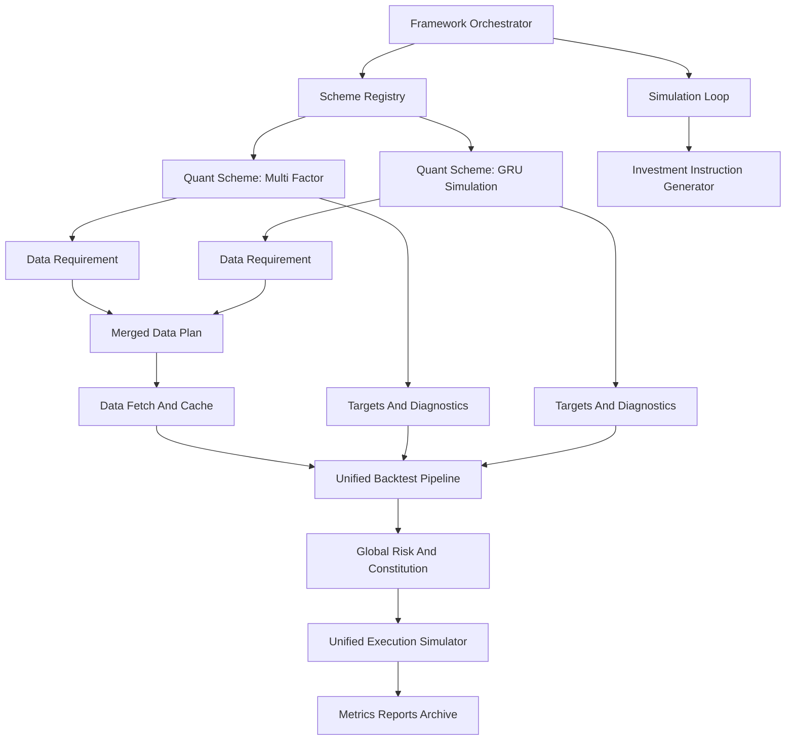

# 多策略量化框架演进计划

## 1. 背景

Quanto 当前是一个 A 股行业 ETF 轮动量化研究项目，核心目标是先完成传统多因子行业轮动的可复现回测闭环，再逐步进入模拟盘和小资金实盘辅助。

经过重新思考，项目不应长期绑定单一量化机制，而应演进为：

- 外部框架层负责数据、回测、模拟盘、投资指令、审计与报告。
- 策略内核层挂载多个量化方案，每个方案通过统一接口声明自身需求并生成策略目标。
- 全局风控和交易宪法始终由框架统一执行，策略不能绕过。

本计划先用于更新架构设计文档，不直接改代码。

## 2. 核心结论

多策略架构方向可行，但必须避免过早平台化。当前阶段不应设计成“每个策略拥有半套回测系统”的通用插件平台，而应采用：

> 统一框架强约束 + 策略窄接口 + 受控扩展点。

框架必须统一控制可比性、审计性和风险边界；策略内核只负责研究逻辑和目标生成。

## 3. 目标架构

## 4. 分层职责

### 4.1 外部框架层

框架层负责所有跨策略必须统一的基础设施：

- 策略方案注册与选择。
- 合并多个策略的数据需求。
- 拉取、缓存、校验和快照数据。
- 管理交易日历、信号日和执行日映射。
- 执行基础可交易过滤。
- 执行全局风控和交易宪法。
- 统一成交模拟、手续费、滑点、现金和持仓账本。
- 统一绩效指标、报告、归档和审计字段。
- 运行模拟盘调度。
- 生成带方案标识的投资指令。

### 4.2 策略内核层

策略内核通过统一接口挂载到框架中，只负责策略自身逻辑：

- 声明所需数据。
- 声明操作频次和触发条件。
- 计算特征、评分、预测或排名。
- 生成策略层目标持仓。
- 输出策略私有的退出原因和诊断信息。
- 可选收窄 universe，但不能放宽框架基础过滤。

策略不能直接决定最终仓位，也不能跳过全局风控。

### 4.3 共享基础设施层

共享基础设施包括：

- 数据缓存。
- 回测执行器。
- 风控预算。
- 绩效计算。
- 报告输出。
- 运行记录和审计。

这些模块应保持策略无关，使不同量化方案能在同一口径下比较。

## 5. 回测职责拆分

回测不再被视为一个黑盒函数，而拆分为多个步骤。

| 步骤 | 默认归属 | 是否允许策略扩展 | 说明 |
|------|----------|------------------|------|
| 数据需求声明 | 策略内核 | 是 | 策略说明需要哪些标的、字段、粒度、复权、benchmark 和 warmup。 |
| 数据需求合并 | 外部框架 | 否 | 多策略同时运行时由框架合并，避免重复拉取和口径漂移。 |
| 数据拉取与缓存 | 外部框架 | 否 | 框架维护数据事实源和快照。 |
| 数据字段校验 | 外部框架 | 否 | 策略只能使用已声明且已校验的数据。 |
| 交易日历处理 | 外部框架 | 否 | 信号日、执行日、节假日必须统一。 |
| 基础可交易过滤 | 外部框架 | 否 | 上市天数、缺价、停牌、成交额等基础约束统一执行。 |
| 策略私有过滤 | 策略内核 | 是 | 只能进一步收窄可交易池，不能放宽基础过滤。 |
| 特征计算 | 策略内核 | 是 | 多因子、GRU、其他机制可各自实现。 |
| 信号与目标生成 | 策略内核 | 是 | 输出策略层目标，不输出最终执行仓位。 |
| 全局风控缩放 | 外部框架 | 否 | 交易宪法、VaR、单标的限制、熔断由框架统一执行。 |
| 成交模拟 | 外部框架 | 默认否 | 第一阶段统一执行，保证跨策略可比。高级自定义执行模型必须明确标注不可横向比较。 |
| 现金和持仓账本 | 外部框架 | 否 | 账本必须统一，否则绩效不可比较。 |
| 绩效指标 | 外部框架 | 否 | 最大回撤、夏普、Calmar、换手率等统一计算。 |
| 结果归档 | 外部框架 | 否 | 按方案、run_id、数据快照和配置快照归档。 |

## 6. 策略接口草案

### 6.1 QuantScheme

`QuantScheme` 是一个量化方案的最小研究协议，而不是完整平台插件。

建议包含：

- `scheme_id`：唯一方案标识，例如 `multi_factor_rotation`。
- `display_name`：人类可读名称。
- `version`：方案版本。
- `get_data_requirement()`：返回数据需求。
- `get_operation_policy()`：返回操作频次和调度窗口。
- `generate_targets()`：生成策略层目标。
- `generate_diagnostics()`：可选输出研究诊断。

暂不建议让 `QuantScheme` 拥有完整 `run_backtest()`。

### 6.2 DataRequirement

第一版 `DataRequirement` 应保持克制，只声明框架真正能校验和满足的字段。

建议包含：

- `universe` 或 `symbols`。
- `required_fields`，例如 `open, high, low, close, volume, amount`。
- `bar_frequency`，第一阶段以 `daily` 为主。
- `start_date` / `end_date`，或由运行参数传入。
- `warmup_days`。
- `adjustment`，例如 `qfq`。
- `benchmark`，例如 `sh000300`。

不建议第一版支持任意 provider、任意字段语义、任意数据变换。否则数据需求会变成策略私有后门，破坏数据可审计性。

### 6.3 Target Output

策略输出应是策略层目标，而不是最终交易指令。

建议最小字段：

| 字段 | 说明 |
|------|------|
| `scheme_id` | 方案标识 |
| `signal_date` | 信号生成日期 |
| `trade_date` | 计划执行日期 |
| `symbol` | 标的代码 |
| `strategy_weight` | 策略层理论权重 |
| `score` | 可选，策略评分 |
| `rank` | 可选，策略排名 |
| `reason` | 入场、调仓或退出原因 |
| `diagnostics_ref` | 可选，诊断输出引用 |

框架后续会将 `strategy_weight` 转换为 `target_weight`。

## 7. 模拟盘和投资指令接口

模拟盘和投资指令不能简单复用回测接口。

回测是历史批处理；模拟盘是当前时点决策和审计，必须包含当前账户状态和最新可用数据。

### 7.1 模拟盘输入

模拟盘激活某个方案时，框架应提供：

- 当前日期和调度触发原因。
- 最新可用数据时间戳。
- 当前持仓和现金。
- 当前数据快照 ID。
- 当前配置快照 ID。
- 方案操作频次和上次运行记录。

### 7.2 投资指令输出

投资指令应由框架在策略目标和全局风控之后生成。

建议包含：

| 字段 | 说明 |
|------|------|
| `scheme_id` | 方案标识 |
| `generated_at` | 指令生成时间 |
| `data_as_of` | 最新数据时间 |
| `symbol` | 标的代码 |
| `current_weight` | 当前权重 |
| `target_weight` | 风控后目标权重 |
| `delta_weight` | 需调整权重 |
| `side` | buy、sell、hold 或 skip |
| `reason` | 指令原因 |
| `risk_notes` | 风控说明 |
| `skip_reason` | 若不交易，说明原因 |
| `run_id` | 运行 ID |
| `data_snapshot` | 数据快照 |
| `config_hash` | 配置快照 |

指令必须明确来自哪个方案，且必须展示是否经过全局风控缩放。

## 8. 多策略组合风险

多策略框架会自然诱导同时运行多个方案，但多个单独安全的策略叠加后，不一定整体安全。

文档必须补充组合层风险控制：

- 不同策略推荐同一 ETF 时，持仓需要合并。
- 不同策略给出相反方向时，必须有冲突消解规则。
- 多个策略集中在同一行业或高相关行业时，需要组合层集中度控制。
- 总账户风险预算不能按策略各自独立使用后简单相加。
- GRU 策略在未满足实盘条件前，只能输出模拟信号，不能进入真实指令。

第一阶段可以只支持单策略实盘辅助，多策略并行先用于研究和模拟盘对比。

## 9. 当前项目迁移路径

### Phase 1：文档和边界统一

- 更新详细架构文档，明确多策略框架方向。
- 修正高层架构文档中 BackTrader 与 pandas 事件循环的冲突。
- 明确当前传统多因子策略是第一个内置方案。
- 明确 GRU 是第二个模拟方案，不是主线策略的特殊分支。

### Phase 2：最小接口重构

- 将当前多因子策略接入 `QuantScheme` 概念。
- 将 `run_backtest` 改为框架编排。
- 消除 `backtest/engine.py` 和 `strategies/multi_factor_rotation.py` 中的重复信号逻辑。
- 保持输出结果与现有回测一致。

### Phase 3：数据需求驱动拉取

- 引入最小 `DataRequirement`。
- 由方案声明数据需求。
- 框架合并需求并生成数据拉取计划。
- 保留现有 `prices.csv` 和 `benchmark.csv` 兼容路径。

### Phase 4：模拟盘和投资指令

- 引入模拟盘状态。
- 按方案操作频次激活策略。
- 由框架生成风控后的投资指令。
- 输出方案标识、风险说明和审计字段。

### Phase 5：多策略研究对比

- 将 GRU 作为第二个方案接入。
- 同一数据快照下对比多因子和 GRU 信号。
- 只在模拟盘记录差异，不进入真实执行链路。

## 10. 文档更新清单

下一步应更新：

- `docs/planning-artifacts/architecture.md`
  - 新增多策略框架目标。
  - 新增框架层与策略内核层职责。
  - 新增回测职责矩阵。
  - 新增 DataRequirement 和投资指令接口草案。
  - 调整路线图，将 GRU 定位为独立方案。

- `docs/03_量化系统架构.md`
  - 修正 BackTrader 表述，与当前 pandas 事件循环优先保持一致。
  - 将“双轨策略并行”改为“多方案框架下的两个内置方案”。

## 11. 关键原则

- 策略只生成理论目标，不生成最终仓位。
- 全局风控和交易宪法不能被策略覆盖。
- 回测账本、成交模拟和绩效指标必须统一。
- 模拟盘和投资指令必须带审计字段。
- 第一阶段不做自动下单。
- 第一阶段不做完整通用插件平台。
- GRU 在通过长期模拟验证前不能进入真实执行链路。
