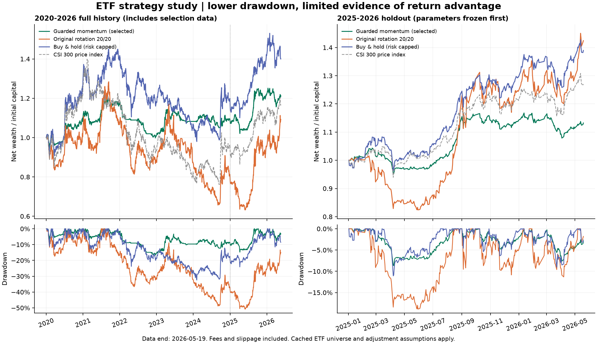

# ETF 策略与参数研究：2026-10-01

本轮找到了比默认轮动更保守的候选，但没有找到证据充分的高收益策略。候选的全时期净年化为 **3.21%**、最大回撤 **16.65%**；默认轮动为 **1.46% / 50.75%**。候选在留出段达到预设绝对门槛，但同段简单买持的收益和 Sharpe 更高，因此不能宣称已经发现选股或择时优势。

## 结果

所有策略使用同一数据集、100 万元初始资金、相同的外部风险上限与成本。下表为已包含佣金和滑点的账本结果。策略自身目标仓位不同，**外部风险上限相同不等于实际风险敞口相同**。

| 区间 | 策略 | 净年化 | 最大回撤 | Sharpe | 平均持仓 |
| --- | --- | ---: | ---: | ---: | ---: |
| 开发：2020—2022 | 候选 | 0.32% | 16.65% | 0.08 | 25.1% |
| 开发：2020—2022 | 默认轮动 | -4.32% | 36.62% | -0.09 | 70.8% |
| 开发：2020—2022 | 买持对照 | 5.84% | 23.78% | 0.40 | 78.2% |
| 验证：2023—2024 | 候选 | 3.42% | 9.32% | 0.46 | 27.5% |
| 验证：2023—2024 | 默认轮动 | -6.35% | 43.86% | -0.16 | 70.8% |
| 验证：2023—2024 | 买持对照 | 2.99% | 26.09% | 0.25 | 77.1% |
| 留出：2025-01-02—2026-05-19 | 候选 | **9.96%** | **8.68%** | **1.07** | **34.4%** |
| 留出：2025-01-02—2026-05-19 | 默认轮动 | 31.02% | 18.87% | 1.20 | 74.0% |
| 留出：2025-01-02—2026-05-19 | 买持对照 | 28.57% | 11.07% | 1.63 | 79.1% |
| 连续全时期：2020-01-02—2026-05-19 | 候选 | **3.21%** | **16.65%** | **0.41** | **28.0%** |
| 连续全时期：2020-01-02—2026-05-19 | 默认轮动 | 1.46% | 50.75% | 0.18 | 71.8% |
| 连续全时期：2020-01-02—2026-05-19 | 买持对照 | 5.65% | 32.43% | 0.41 | 76.7% |



全时期包括开发、验证数据，是选定后的描述性诊断，不能替代留出验证。各分段从现金重新开始，保留起点前历史预热；连续全时期则保持账户连续。买持只在首日买入当时合格的标的，之后不补入新上市 ETF，且仍受每日风险上限约束，并非不发生任何交易的静态篮子。

## 固定候选与参数

研究名称：`guarded_momentum_200_v0.1`，实现见 [研究策略](../../../scripts/research_rotation_candidates.py)。它是独立研究候选，没有替换正式策略或改变引擎。

```json
{
  "trend_window": 200,
  "momentum_window": 60,
  "selection": "momentum",
  "target_volatility": 0.10,
  "entry_rank": 3
}
```

- 每周最后交易日收盘评估，次一交易日开盘成交。
- ETF 收盘价必须高于包含当日的 200 日均线，且过去 60 日收益为正。
- 按 60 日收益排序，每个配置行业最多选一只，最多三只。行业分类比实际相关性更粗，仍可能存在相近风险暴露。
- 用过去 60 日日收益波动率的倒数分配权重；假设资产完全正相关估计组合波动，并以年化 10% 作为预算参数。**这是估计预算，不是实际波动或最大亏损保证。**
- 策略总目标最多 70%，每只最多 30%；不足三只时按名额比例缩减预算，剩余资金留作现金。无合格候选时空仓。
- 外部风险上限统一为总仓 80%、单只 35%、单行业 50%。未启用“触发后永不恢复”的回撤暂停。
- 成本为单边佣金 0.02%、最低 5 元、单边滑点 0.05%；现金与无风险利率均为 0。未建模冲击成本随交易量变化。

## 成本与收益来源

候选留出段累计净收益 **13.24%**，290 笔成交，双边换手约 19.42 倍（整个区间口径，非年化），佣金与滑点合计约 15,053 元。成本已经计入净值，不重复扣减。

将佣金、最低佣金和滑点同时翻倍后，候选留出净年化降至 **8.76%**、最大回撤 **8.81%**、Sharpe **0.95**，仍满足事先固定的“年化为正、Sharpe ≥ 0.7、回撤 ≤ 20%”绝对门槛。该门槛不包含“战胜买持”，不能把通过门槛解释成优于买持。

候选留出年收益为 2025 年 **+14.20%**、2026 年截至 5 月 19 日 **-0.84%**；开发段的 2022 年为 **-14.14%**。它并非每年稳定赚钱。留出段相对买持少赚约 18.61 个百分点年化，仅减少约 2.39 个百分点回撤。低回撤有很大可能与低仓位有关，本轮尚未隔离现金配置与信号本身的贡献。

## 搜索顺序与复现证据

先比较原模板的 12 组参数：趋势/动量窗口 `(20,20)、(60,60)、(120,120)、(200,200)、(120,60)、(200,60)`，分别持仓 3/5 只、保留排名为入选数加 2，均按周评估。该轮开发结果不佳，之后在**未查看验证和留出结果**时加入 8 组候选：200/120 日均线、动量/回调排序、10%/15% 波动预算的组合，60 日动量和三只持仓固定。

因此本轮属于**开发集上的适应性研究**，不是宣称全部 20 组都在首次查看开发数据前预先规定。原始试验保存在本机 `outputs/strategy-research-20261001/pilot`；13 个原试验（含买持）重新运行后，全部指标完全一致。

开发段按 `年化收益 - 0.5 × 最大回撤` 选前三个轮动候选；验证段按同一分数固定唯一候选。参数及 26 条开发/验证证据在提交 `b39f875` 冻结之后才运行留出段。留出结果之后没有继续扩网格或重选参数。

所选候选的开发得分约 **-0.0800**、验证得分约 **-0.0124**，均低于本实验零利息现金的 0 分。流程没有把“得分大于 0”设为硬门槛，因此这里的“选定”只是有限候选内的排名，不意味着已有部署价值。继续打开留出段用于检验冻结规则，不改变这一开发证据偏弱的事实。

- [实验协议与输入/源码哈希](protocol.json)
- [数据审计与剔除清单](source_audit.json)
- [开发和验证的完整证据](selection_evidence.json)
- [固定选择](selection.json)、[候选名单](shortlist.json)
- [分期与成本测试汇总](results.csv)

在仓库根目录，使用当前依赖环境：

```powershell
.venv\Scripts\python.exe scripts/prepare_strategy_research_data.py --output outputs/strategy-research-replay
.venv\Scripts\python.exe scripts/research_strategy_parameters.py --root outputs/strategy-research-replay --phase initialize
.venv\Scripts\python.exe scripts/research_strategy_parameters.py --root outputs/strategy-research-replay --phase development
.venv\Scripts\python.exe scripts/research_strategy_parameters.py --root outputs/strategy-research-replay --phase validation
.venv\Scripts\python.exe scripts/research_strategy_parameters.py --root outputs/strategy-research-replay --phase freeze
.venv\Scripts\python.exe scripts/research_strategy_parameters.py --root outputs/strategy-research-replay --phase holdout
.venv\Scripts\python.exe scripts/research_strategy_parameters.py --root outputs/strategy-research-replay --phase stress
.venv\Scripts\python.exe scripts/research_strategy_parameters.py --root outputs/strategy-research-replay --phase full
```

已完成目录会跳过完成的运行，并核验数据、审计和源码哈希。重放历史研究并不会产生新的独立样本外证据。原始试验使用的版本和精确指标已单独保存，应先核对输入与版本再比较。

## 数据边界与判断

原 8765 工作台中的已有回测使用合成演示数据，不能评价真实策略。本轮另使用仓库中的历史缓存：32 只 ETF 中 27 只通过覆盖筛选；5 只存在无法解释的缺日而整只剔除，另外 18 个配置标的没有文件。没有补价，也没有把缺日虚构成停牌。

缓存缺少独立的来源和复权证明；`qfq` 是根据历史采集代码推定的研究假设，不是逐文件核实的事实。数据未覆盖完整历史可选 ETF，存在存续与可获得样本偏差；首次观测日、100 股一手、T+1、观察日可成交均为研究假设。沪深300对照是价格指数，不含与策略完全一致的分红、成本和起点口径；成交额单位未核实，因此未使用绝对成交额筛选。留出仅约 17 个月，且可能在本轮之前已被其他研究者查看过。

目前更值得保留的是这套降低集中度与仓位的防守规则，而不是“高收益最优参数”的结论。后续最有价值的比较是预先固定**相同资金敞口的现金加买持基线**，再检验信号是否提供净收益增量，并用新收集且未参与此次选择的数据验证。本轮已经看过的留出数据不能再次充当调参后的独立证据。

## 本机工作台与验证

独立研究工作台位于 [127.0.0.1:8767](http://127.0.0.1:8767/runs)，解释器使用本仓库 `.venv`，工作区为 `data/research-20261001`，产物在该工作区的 `artifacts` 中。数据版本 `acc8a941-75f8-4e27-ac8b-0594d62a43d1` 为上述经过审计的历史缓存；候选以独立策略修订登记，保留了原策略代码作为辅助模块。

- [候选留出回测](http://127.0.0.1:8767/runs/b1c1ddfd-c956-47be-ac8a-459ffb4e84dc)
- [候选全时期回测](http://127.0.0.1:8767/runs/794f810a-8861-49ab-b096-31691b8b3510)
- 默认轮动和买持的留出、全时期对照也已在同一工作台成功完成；全部六条运行的每项指标均与离线结果完全一致，运行 ID 和核对记录见 [工作台验证记录](workbench_verified.json)。

如需重启研究工作台，在仓库根目录运行：

```powershell
.venv\Scripts\python.exe -m quanto.cli serve --host 127.0.0.1 --port 8767 --workspace data/research-20261001 --frontend-dir web/dist
```

已有 8765 服务依赖的旧 worktree 环境缺少依赖和有效虚拟环境配置，曾产生导入及环境指纹校验失败；历史记录保留，未绕过指纹验证。停止并切换该服务的操作被执行策略拒绝，未执行。上述独立研究工作台不依赖旧环境，也没有中断旧服务。

验证包括研究策略 6 项行为测试及原策略、风控、指标、防前视相关测试，共 47 项通过；数据校验及 Parquet 回读逐表相等；13 条开发试验重放的全部指标相等；原始数据、研究源文件与冻结哈希一致。所有实验都使用正式逐日账本计算，没有使用简化的向量化收益替代成交与成本。

关于趋势研究和多次搜索的背景，参考 [AQR 的长期趋势研究](https://www.aqr.com/-/media/AQR/Documents/Insights/Journal-Article/AQR-JPM-Fall-2017.pdf) 和 [Bailey 等人的回测过拟合研究](https://www.davidhbailey.com/dhbpapers/backtest-prob.pdf)。这些文献提供方法背景，并不能验证本项目的行业 ETF 参数。
