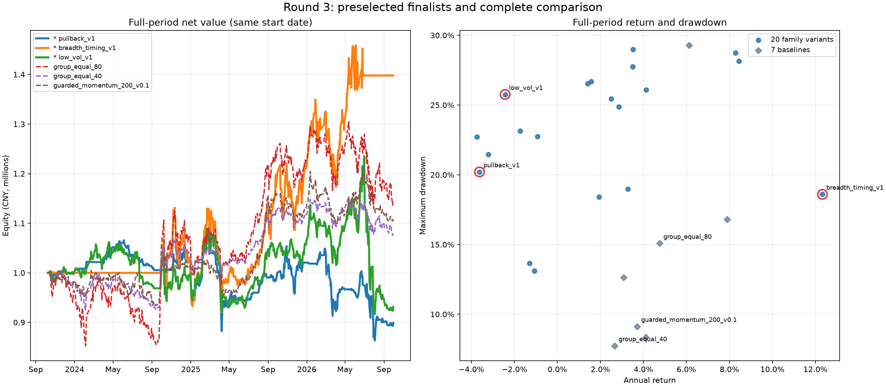

# 第三轮：305 只 ETF、十类策略与两组参数

**本轮保留 `breadth_timing_v1`（200 日趋势、120 日动量、50% 分组宽度开关）作为后续验证候选。** 同一 305 只 ETF 数据包、同一成本下，全期年化 12.33%、最大回撤 18.60%、Sharpe 0.691，优于默认 20 日轮动的 6.13% / 29.28% / 0.364；但回撤高于买入持有和旧防守方案，不能说在所有风险偏好下都更好。

10 类 × 2 参数 × 4 时段，加 7 个对照 × 4 时段、10 次双倍成本，共 **118 次主研究回测**。结果完整保留，没有因亏损追加或替换参数。发现费用改变调仓路径后，另做 4 次事后资金敏感性检查，不用于重新筛选。

## 怎样执行这个方案

1. 每周最后一个交易日收盘评估，下一交易日开盘成交。候选必须满足基础上市/历史资格，有当日价格、至少 201 条自身价格观测，最近 20 个观测日平均成交额至少 1000 万元。
2. 每个研究分组先选一只当时 20 日平均成交额最高的 ETF；同额按代码排序。用这些分组代表计算宽度：收盘价高于自身 200 日均线的分组占比。
3. 宽度 **低于 50% 时目标仓位归零**；达到 50% 时，从高于 200 日均线且 120 日收益为正的代表中，按 120 日收益选前 5 只。
4. 每只目标权重 **16%**，最多 80%；不足 5 只时空缺留现金，不把剩余仓位集中到少数标的。总仓位、单只和分组的外部风控仍每天执行。

调用参数为 `Round3Strategy(family="breadth_timing", variant=1, gross_target=0.8)`，实现见 [研究策略](../../../scripts/research_round3_candidates.py)。这并非“305 只 ETF 每只分一点”：先选分组代表，再筛信号。本轮全部新策略共同采用该代表选择方式，分组资料也不是成分股穿透后的独立风险分类。

## 主要对照

全期为 **2023-10-09—2026-09-30，726 个交易日**。2026 检查段为 **2026-01-05—2026-09-30**，各分段都从现金重新启动，有此前历史预热；不等同全期净值的切片。表中全期收益为年化，2026 为累计区间收益，均已扣佣金和滑点。

| 方案 | 全期年化 | 最大回撤 | Sharpe | 全期平均仓位 | 2026 区间收益 |
|---|---:|---:|---:|---:|---:|
| **市场宽度 v1** | **12.33%** | **18.60%** | **0.691** | **45.11%** | **8.74%** |
| 默认 20 日轮动 | 6.13% | 29.28% | 0.364 | 59.40% | 3.17% |
| 旧 200 日防守动量 | 3.72% | 9.13% | 0.439 | 31.59% | -5.91% |
| 买入持有，上限 80% | 7.89% | 16.79% | 0.511 | 77.83% | -2.57% |
| 买入持有，初始 40% | 4.12% | 8.35% | 0.462 | 41.82% | -1.50% |
| 分组代表等权，80% | 4.75% | 15.08% | 0.349 | 79.25% | -10.76% |
| 分组代表等权，40% | 2.67% | 7.74% | 0.339 | 39.65% | -5.53% |

市场宽度 v1 全期累计收益 **39.78%**，100 万元变为约 **139.78 万元**；成交 1161 笔，佣金与滑点合计 **23,437.95 元**，平均持有 2.82 只。成本已体现在净收益里，不能再重复扣除。期末为空仓。

它的优势不只是比满仓对照少承担风险：与平均仓位约 40% 的两个对照相比，收益和 Sharpe 也更高。但这些对照并非每天严格同仓位或同波动，不能因此直接宣布已证明独立超额收益。

## 十类策略完整横向比较

下面每类的参数由 **2023–2024 开发段**事先选出，不是回头挑全期最好的参数。开发段：2023-10-09—2024-12-31；验证段：2025-01-02—2025-12-31。所有 20 组配置的精确公式、参数及结果见 [网页表格](dashboard.html)、[CSV](results.csv)、[冻结协议](protocol.json)。

| 策略类 / 开发段选出的参数 | 开发段累计 | 2025 累计 | 2026 累计 | 全期年化 | 全期回撤 | 全期 Sharpe |
|---|---:|---:|---:|---:|---:|---:|
| 单周期动量 v0：60 日 | -5.46% | 22.72% | -8.94% | 1.57% | 26.69% | 0.185 |
| 双周期动量 v1：120 / 200 日 | -5.09% | 37.57% | -3.46% | 8.28% | 28.73% | 0.444 |
| 均线趋势 v1：200 日 | -5.39% | 38.21% | -3.75% | 8.45% | 28.15% | 0.448 |
| 突破延续 v1：120 日新高 / 20 日持有条件 | -4.47% | 3.63% | -6.25% | -1.08% | 13.12% | -0.015 |
| 低波趋势 v1：200 日趋势 / 120 日波动 | -1.34% | 12.76% | -16.92% | -2.43% | 25.75% | -0.059 |
| 回归趋势 v0：60 日斜率 / 120 日趋势 | -6.46% | 19.21% | -4.71% | 2.86% | 24.87% | 0.238 |
| 趋势内回调 v1：200 日趋势 / 20 日回调 | -0.26% | 8.26% | -12.27% | -3.62% | 20.20% | -0.211 |
| 分组轮动 v1：组内 120 日收益中位数 | -5.62% | 29.90% | -11.82% | 2.50% | 25.45% | 0.223 |
| **市场宽度 v1：200 / 120 日 / 50% 开关** | **-0.42%** | **29.74%** | **8.74%** | **12.33%** | **18.60%** | **0.691** |
| 相关性约束 v1：120 日动量 / 相关系数 ≤0.7 | -5.29% | 28.09% | -14.22% | 1.95% | 18.42% | 0.198 |

先按开发段 `年化收益 - 0.5 × 回撤` 选每类参数，再按开发/验证两段评分的较小值选前三；前三为回调 v1、宽度 v1、低波 v1，已经在计算 2026 及全期表现前提交冻结。回调和低波在后段失效，如实保留。

宽度的另一个参数包 v0（120 日均线、60 日动量，弱宽度下保留一半预算）全期仅 **3.27% 年化、18.98% 回撤**，差异很大。这两组同时改变了周期与弱市预算，不能把改善归因于某一个参数，也不足以认定周边参数普遍稳定。

## 成本与执行敏感性

宽度 v1 双倍佣金、最低佣金及滑点后，全期年化 **11.53%**、回撤 **18.85%**、Sharpe **0.654**，仍明显好于默认轮动的原成本结果。2026 双倍成本区间收益为 **10.23%**，高于原成本的 8.74%，已逐日追查原因：

2026-05-22 收盘两次试验发出相同的换仓目标；原成本账户实际仓位为 **80.0069%**，触发当前引擎的超限减仓规则，先修整旧持仓，使新换仓推迟到 6 月 1 日。双倍成本账户当日仓位为 **79.9979%**，在 5 月 25 日正常换仓。期间新旧 ETF 的涨跌差异超过新增成本。详见 [执行路径诊断](cost-path-diagnostic.json)。

因此，双倍成本测试反映的是**费用扰动后的完整交易路径**，不能当作保持相同成交单后机械减掉更多费用；也不能解读为手续费越高越好。原始引擎的“先修整现有超限仓位”规则会推迟新目标，这是实际执行模型中的重要边界。

为排除初始资金恰好落在整手边界的偶然性，观察到上述现象后，保持策略与成本不变，仅追加 99 万 / 101 万元两档资金、full / late 两段，共 4 次诊断：全期累计约 **39.79%**，2026 累计约 **8.73%–8.74%**，回撤基本一致；不同本金的原始策略目标逐日相同。这个窄范围检查通过，不代表所有执行扰动都已验证。详见 [资金敏感性证据](execution-sensitivity.json)。

## 结论的边界

预设门槛是全期年化 ≥8%、回撤 ≤15%、Sharpe ≥0.7、三个分段收益均为正。本轮 **没有配置全部通过**。宽度 v1 的开发段为 -0.42%，回撤 18.60%，Sharpe 0.691，仍不达门槛；它是较好的研究候选，不应标记为已确认稳定盈利。

数据来自已审计共享缓存，305 只均为境内股票类 ETF。数据哈希、价格完整性和上市边界检查通过，但当前目录/规模/成交额筛选含幸存偏差和回看选择偏差；没有债券、黄金、海外资产来构成真正跨资产组合。真实停牌状态、复权锚点、分红拆分现金流和历史可得时间仍有已披露限制。

对领先方案又做了针对性价格核对：从成交记录重建持仓，726 个交易日损益全部与净值对齐；选取涨跌幅最大的各 5 天，以及 2026 年 3–5 月另外 4 天，用新浪独立历史核对 10 只关键 ETF。137 组同日收益比较中 93 组完全一致、44 组有差异；最大差异是 512400 在 2025-04-07 的 **0.9888 个百分点**，两源当日价格均下降 0.105 元，但前复权与原始价格的分母不同。该检查佐证关键大波动在独立行情中存在，不能当作 305 只全历史或复权现金流模型的全面认证。见 [价格核对证据](winner-price-audit.json)。

2025–2026 的部分结果此前已经看过，因此此轮是按固定顺序执行的历史探索，不能宣称获得全新独立留出样本验证。完整曲线、全部参数和失败方案均公开，避免只展示一个好年份。

## 验证与重现

- [118 次结果与身份校验](verification.json)：数据/来源/计算代码哈希一致，每次结果身份和曲线/权益/成交记录哈希通过，独立核算 11 项指标。与上一轮相同时间和数据的 5 个旧策略 × 2 个区间，全部指标字典精确复现。
- [实现与数据检查](implementation-verification.json)：适用测试 85 项通过；全仓 456 项通过、1 项跳过，两个既有时间戳精度警告。策略、协议、分阶段选择及结果按阶段本地提交。
- [完整图表与 20 组参数比较](dashboard.html)、[CSV 指标](results.csv)、[逐次机器结果](results.json)。全期图见下方。
- [网页重放校验](workbench_verified.json)：三个预选候选及两个分组等权对照，各 full/late 两段，共 10 次，全部指标字典与本地结果精确一致。导入的七个规范数据文件、六张表和 manifest 逐项核对一致；工作台额外生成的 `result.json` 作业回执导致整体目录哈希不同，已单独解释和核验，没有忽略输入差异。两次 Windows 心跳文件替换失败保留在 [重试记录](workbench_run_attempts.json)，各串行重试一次成功，没有修改生产引擎。

本地工作台已发布 [市场宽度 v1 全期结果](http://127.0.0.1:8767/runs/b4a88368-9d50-4fb4-887c-1f54f432a35d) 和 [2026 区间结果](http://127.0.0.1:8767/runs/9e4d8b6d-511a-473a-a9a8-91778be65384)。服务关闭后，可在仓库双击 `start-research-workbench.bat` 启动原研究工作区。

本机重现使用 `.venv/Scripts/python.exe scripts/research_round3.py --phase <阶段>`，阶段依次为 `initialize`、`development`、`select-training`、`validation`、`select`、`final`、`stress`、`audit`；运行阶段可指定 `--workers 3`。脚本验证冻结输入，发现哈希变化即拒绝复用，不覆盖旧研究。后续复现报告使用 `uv run --no-project --with matplotlib python scripts/report_round3.py`，图形依赖只在临时环境安装，不改变项目依赖。

