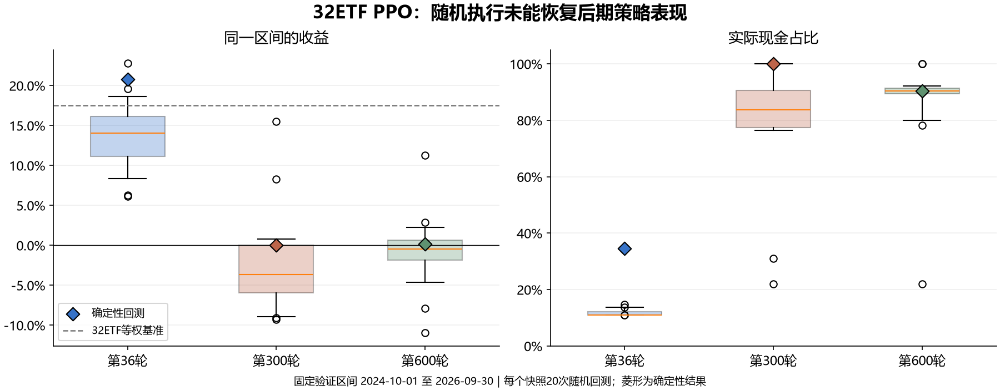
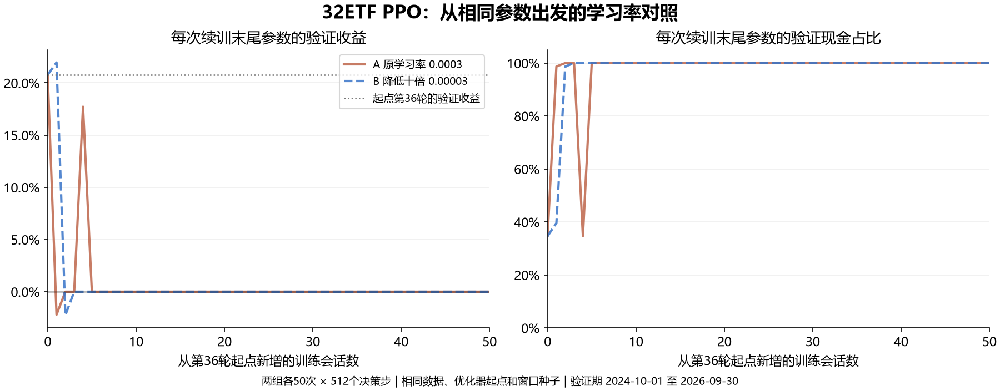

# 32ETF PPO：第 36 轮后验证停滞实验

对象：`32ETF PPO 300 rounds 20261006 [control]`，模型 ID `c682a296-7f3b-44c7-b919-492b729e7f9a`。实验于 2026-10-08 启动，按[预先固定的协议](../../superpowers/plans/2026-10-08-ppo-stagnation-experiment.md)执行。

**结论：训练参数持续更新，但后期快照在验证期退化为高现金、少交易。继续选用第 36 轮符合现有最佳验证 Sharpe 的规则。随机回放没有恢复后期表现；从第 36 轮恢复并将学习率降为十分之一，在本次固定预算内也未解决问题。** 两组均完成 50 次续训，正常退出，未追加训练预算。

## 快照诊断

训练会从最新的 `last.zip` 连同优化器状态继续；用于交付的 `policy.zip` 只在验证分数严格提高时替换。因此，保留第 36 轮与后续参数继续更新可以同时成立。本次分别加载第 36、300、600 轮的 `last.zip`，避免误将后两轮保存的历史最佳参数再次当作最新参数评估。

验证期固定为 2024-10-01 至 2026-09-30。每个快照做一次确定性回放，以及使用共同种子 1000–1019 的 20 次随机回放。收益均为扣除执行成本后的全期累计收益；随机结果按所有回放汇总，不挑选最优路径。

| 最新参数来自 | 确定性收益 | 确定性 Sharpe | 确定性平均现金 | 首次买入成交日 |
| --- | ---: | ---: | ---: | --- |
| 第 36 轮 | +20.78% | 0.7717 | 34.61% | 2025-04-21 |
| 第 300 轮 | 0.00% | 未定义 | 100.00% | 无买入 |
| 第 600 轮 | +0.18% | 0.0448 | 90.39% | 2026-07-20 |
| 同条件等权基准 | +17.53% | 0.5895 | 10.92% | — |
| 同条件现金基准 | 0.00% | 未定义 | 100.00% | — |

第 300 轮的 102 个决策全部选择 Hold；第 600 轮为 97/102 个。等权基准同样受到总仓位上限 90%、交易成本与风险约束，不能理解成无成本满仓基准。

| 最新参数来自 | 随机收益中位数 | 随机收益 P10–P90 | 随机 Sharpe 中位数（有定义数） | 随机平均现金中位数 | 零成交回放 |
| --- | ---: | ---: | ---: | ---: | ---: |
| 第 36 轮 | +14.03% | +8.17% 至 +18.74% | 0.5005（20/20） | 11.02% | 0/20 |
| 第 300 轮 | −3.67% | −8.94% 至 +1.56% | −0.2747（17/20） | 83.65% | 3/20 |
| 第 600 轮 | −0.47% | −4.97% 至 +2.29% | −0.0313（18/20） | 90.38% | 2/20 |



随机选择动作没有恢复后期快照的收益表现。第 300、600 轮在确定性回放的首次买入前，Hold 概率平均约为 98.85%、99.10%，并非只是接近 50% 的门控概率被确定性选择放大。随机回放同时改变 Hold 门控和各 ETF 的目标仓位档位，不能把全部差异单独归因于门控。

另外，将第 36、600 轮参数在完整训练日期（2022-07-08 至 2024-09-30）做确定性回放：收益分别为 −2.13%、+14.14%，Sharpe 分别为 0.0053、0.4693。这与验证表现下降形成分化，说明第 600 轮并非在所有日期都不交易。这里是训练日期上的重新回测，并非 PPO 训练时随机 126 日片段的实际收益或目标曲线；它与过拟合相容，但不能证明过拟合是唯一原因。

## 学习率对照

| 预先固定的比较项 | A：原学习率 0.0003 | B：学习率 0.00003 |
| --- | ---: | ---: |
| 完成会话 / 新增决策步 | 50 / 25,600 | 50 / 25,600 |
| 末 10 次 Sharpe 中位数（有定义数） | 未定义（0/10） | 未定义（0/10） |
| 末 10 次零成交次数 | 10/10 | 10/10 |
| 全部 50 次零成交次数 | 48/50 | 48/50 |
| 最终最新参数：收益 / 平均现金 / 最大回撤 | 0% / 100% / 0% | 0% / 100% / 0% |
| 新增会话中最高验证 Sharpe | 0.7197（第 4 次） | 0.7647（第 1 次） |
| 保留的最佳 Sharpe / 来源 | 0.7717 / 原第 36 轮 | 0.7717 / 原第 36 轮 |



B 第一次续训的收益曾达到 +21.96%，高于起点的 +20.78%，但 Sharpe 为 0.7647，仍低于起点的 0.7717，未达到预先选定的替换标准；B 从第 3 次开始至结束的确定性验证全部零成交。A 第 4 次曾短暂恢复交易，第 5 次至结束全部零成交。两组最终的零回撤来自全现金，并非本次试验所追求的风险收益改善。

因此，不能用“降低学习率后早期收益稍高”判断试验成功。两组在主要比较窗口都没有可定义的 Sharpe，降低十倍学习率没有在这次试验中带来持续改善。这个结果不支持直接追加相同配置的训练，也不支持用最新参数强行替换第 36 轮；奖励、训练片段分布、Hold 门控与状态泛化的作用仍需另外设计实验区分。

核验记录保存在[学习率试验证据](learning-rate-trial.json)：

- 两组均从 18,432 步走到 44,032 步；Adam 步数从 2,880 增至 6,880。逐次更新前后的优化器实际学习率均符合各组设置。
- 全部 50 对采样种子和训练日期窗口一致。A 的 50 次最新参数张量，以及收益、对数收益、Sharpe、最大回撤，均与原历史第 37–86 轮精确一致。由此确认对照脚本复现了原训练过程。
- 已核对 200 个逐次检查点哈希、2 个最终最佳检查点哈希，以及 71 个原始诊断文件哈希；第 36、300、600 轮来源产物和数据集通过完整性复验。


## 方法、证据和边界

- 两组从第 36 轮同一 `last.zip` 和优化器状态出发，起点累计 18,432 个决策步；A 的学习率为 `0.0003`，B 为 `0.00003`。每组固定新增 50 次训练会话，每次 512 个决策步，沿用原训练逐次保存、加载和重置随机数的语义。
- 两组均使用 CUDA；数据、奖励、动作、网络、成本与风险参数一致。训练窗口的种子均为 `42 + 本次开始时的累计步数`。每次训练后评估的是该次最新参数，而非一直保留的最佳参数。
- 主要判据为末 10 次验证中有定义的 Sharpe 中位数，必须同时报告有定义数量和零成交数量；全部未定义时保持 `null`，不填成 0。次要判据为是否超过第 36 轮的验证 Sharpe `0.7717247071642092`。
- 本实验只有一个训练种子，并且重复使用已有的开发验证期。20 次随机回放和 50 次训练会话不是独立市场样本，不能据此宣称样本外优越性或确定唯一根因。`train_scalars` 只包含每次会话最后一个 rollout 的部分训练统计，不代表整次会话，也未记录 `approx_kl`。
- 原始逐步动作、全部采样窗口和检查点保存在工作区 `outputs/ppo-stagnation-20261008`；该目录被 Git 忽略。提交的[诊断证据](diagnosis.json)记录全部 60 次随机回放的指标、确定性回放、训练日期回放、配置和原始文件哈希。

研究工具：[动作诊断脚本](../../../scripts/diagnose_policy_stagnation.py)、[学习率试验脚本](../../../scripts/run_policy_lr_trial.py)。两者读取原有训练产物，写入独立目录，不向模型注册表发布试验版本。

适用验证共 **30 项测试通过**，覆盖诊断回放、空 Sharpe 处理、真实优化器学习率、续训状态、检查点隔离及原有评估/续训行为：

```powershell
.venv/Scripts/python.exe -m pytest tests/test_policy_stagnation_diagnostics.py tests/test_policy_lr_trial.py tests/unit/test_investing_evaluation_device.py tests/unit/test_investing_continuation.py -q
```

复跑时使用新的空输出目录。以下示例从仓库根目录启动第 36 轮诊断；第 300、600 轮来源见协议和证据 JSON：

```powershell
$source = 'data/research-20261001/artifacts/94d667db-3ae3-45ca-ab75-cf0c4b3022ed/final/artifact'
$dataset = 'data/research-20261001/artifacts/acd41bfc-b9a1-433f-9109-960beb8ffd6c/final'
.venv/Scripts/python.exe -m scripts.diagnose_policy_stagnation --source $source --dataset $dataset --output outputs/ppo-stagnation-rerun/diagnosis/round-36 --label round-36 --device cpu --repeats 20 --seed-start 1000 --baselines
.venv/Scripts/python.exe -m scripts.run_policy_lr_trial --source $source --dataset $dataset --output outputs/ppo-stagnation-rerun/a-original --learning-rate 0.0003 --sessions 50 --timesteps 512 --device cuda
.venv/Scripts/python.exe -m scripts.run_policy_lr_trial --source $source --dataset $dataset --output outputs/ppo-stagnation-rerun/b-lower-lr --learning-rate 0.00003 --sessions 50 --timesteps 512 --device cuda
```
