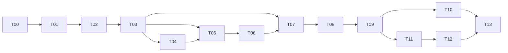

# ETF 与个股共用量化框架 Implementation Plan

> **For agentic workers:** REQUIRED SUB-SKILL: Use superpowers:subagent-driven-development (recommended) or superpowers:executing-plans to implement this plan task-by-task. Steps use checkbox (`- [ ]`) syntax for tracking.

**Goal:** 在保持现有 ETF 研究语义和历史产物的前提下，交付有类型的篮子、数据与定义契约，让固定策略和强化学习通过同一账户执行，并为后续个股研究提供可验证的接入边界。

**Architecture:** 复用现有数据版本、策略修订、SessionRunner、模型会话和作业快照。先完成公共身份及时间契约，再接通两路决策和统一能力解析，最后同步切换 API、CLI、四域页面与结果。不同任务可以分别测试和提交，但公共提交协议与客户端作为同一版本发布。

**Tech Stack:** 现有 Python 3.13、Pydantic、pandas/Parquet、SQLite、FastAPI、Gymnasium、SB3 PPO 2.9.0、PyTorch；React 19、TypeScript 5.9、Vite、Vitest、Playwright。本计划不升级依赖。

**Spec:** [框架设计细则](../specs/2026-10-08-multi-asset-framework-design.md)，[设计审核记录](../../research/2026-10-08-multi-asset-framework-review.md)。设计提交 `9494ea9`；规划期间核查至 `d8a371a`。执行前重新核对 HEAD 与并行改动。

状态：开发计划工程审核完成，见[规划审核记录](../../research/2026-10-08-multi-asset-framework-plan-review.md)。2026-10-09 开始实施：T00–T05 已完成；其余任务待执行。尚未迁移实际工作区或运行研究训练。

## Global Constraints

- 首版 A 股日线、人民币现金、多头与现金；运行限纯 ETF 或纯个股篮子，混合篮子返回 `MIXED_BASKET_UNSUPPORTED`。
- 公共身份为 `exchange:instrument_type:code`；指数仅作参考；运行内部使用被冻结绑定确定的局部代码。禁止凭六位代码或前缀猜身份。
- `framework_contract_version = multi-asset-v1`；AssetBinding 的 `schema_version = 1`。引用必须指定版本，有序成员不得自动排序。
- 新数据使用规范 symbol；旧数据、模型 zip、manifest、源码和报告不原位改写。不能证明身份或已知语义的旧对象保持只读。
- 固定策略和 RL 只输出 Hold/TargetPortfolio，共用 SessionRunner 风控、订单、账本。复用现有 PPO、现金动作、DSR、best/last 语义。
- 决策截止为上海交易日 15:00。披露日期保守规则与当日收盘 bars 的研究假设分别声明；下一日 open 不进入前一日观察。
- 参数只有一个来源；公共 BacktestInput 禁止 symbols，服务端从篮子生成；不维护兼容旧提交形状的旁路。
- 个股数据源、财务公式、买卖策略、观察/动作/奖励、实际交易规则由后续研究确定。合成股票只存在于测试夹具，不注册为可用方案。
- 保留“数据 / 固定策略 / 强化学习模型 / 回测”四域与历史只读深链；不新增实盘、自动选股、策略融合、插件平台或增量数据续训。
- 每项任务先审查相关旧测试是否仍有效；保护当前需求中的行为，不为过时测试添加兼容代码。适用检查通过且 diff 审核后立即单独本地 commit，不自动 push。
- 执行中的源码与资源来自作业快照；依赖不满足或文件损坏须失败，不回落工作树最新版。规划和测试不得修改用户真实研究产物。

## Review Focus

1. 相同六位代码属于不同证券、或同证券在不同数据集使用不同局部键：T01/T08/T10 必须证明不会混合身份、误续训或错误合并结果。
2. 晚发修订覆盖早期财报，披露时间恰好跨 15:00，或把 OHLCV 错延迟一天：T04 验证先按可知时间过滤再选修订，且 ETF 收盘观察不漂移。
3. 首训拟合成功后任务取消、重复提交或发布失败：T06/T08 验证拟合产物与成功版本原子关联，失败不会形成可用变换或覆盖模型头。
4. 用户预检查后修改篮子、队列运行前更新代码、两个编辑者同时保存：T02/T09 验证 CAS、输入冻结和源文件检查；旧预检查不能授权新配置。
5. 停牌或退出事件导致无法卖出、缺价格或缺实际规则：T05/T07 验证持仓不会消失、未知状态不会变成可交易，未支持事件不能发布完整成功结果。

## 阶段、依赖与发布边界

| 阶段 | 任务 | 可独立检查的成果 | 阶段通过条件 |
|---|---|---|---|
| I 基线、对象与数据基础 | T00–T05 | 原 ETF 行为证据、身份、版本存储、声明式数据入口、时点/特征接口 | 无代码猜身份；无未来信息进入视图；原文件不变 |
| II 决策与运行接线 | T05–T09 | 统一执行、ETF 学习定义、能力解析、模型关联、冻结提交 | 两路账本一致；ETF 行为等价；缺能力明确阻塞 |
| III 工作台闭环 | T10–T13 | 结果、四域页面、CLI、历史重用及发布验收 | A01–A18 有真实测试证据，前后端整套切换 |



T00 必须在所有产品行为改动前完成。T04 依赖 T03 冻结的表语义与绑定；T10 与 T11 可由不同 Agent 并行，但共享文件只由当期任务负责人修改。T05/T06 先用内部契约测试接线；T07 完成 fetch/fixed_backtest/train，T08 再补齐 resume/policy_backtest。T09 的公共输入切换在开发分支完成，T12/T13 通过前不更新正在使用的服务，不增加临时双协议。

执行前记录 `git status --short`、HEAD、依赖可用性；逐项重查相应实现，尤其是并行研究对 investing 模块的变化。当前未跟踪 `docs/planning-artifacts/prd.md` 不属于本计划。每项 commit 仅暂存本任务列出的实际变更，不使用 `git add .`。

## 文件职责与接口归属

下表中“新”表示计划新增文件，不表示已经存在。每个任务的 Files 再列出确切修改范围；不因本表拆分现有无关代码。

| 文件或现有模块 | 责任 / 所属任务 |
|---|---|
| 新 `tests/fixtures/etf_framework_baseline.py`、`tests/fixtures/etf_framework_baseline.json` | 接线前固定输入、观察/动作/奖励/账本与来源摘要；T00 |
| 新 `src/quanto/framework.py` | 不依赖 workbench 服务的不可变引用、绑定、篮子、需求、能力报告和冻结配置数据类型；T01 |
| 新 `src/quanto/workbench/framework_requests.py` | 严格公共请求模型，生成内部 spec 前的边界；T01/T08 |
| 新 `src/quanto/workbench/migrations.py`、`baskets.py`、`bindings.py` | 版本迁移、篮子事务、绑定证据与关联持久化；T02/T03/T08 |
| 现有 data、market_dataset、dataset_objects、data_jobs | 规范身份请求、证据登记、新数据注册；T03 |
| 新 `src/quanto/data/point_in_time.py`、`src/quanto/factors/features.py` | 表语义、引擎绑定的只读视图、FeatureFrame 和变换接口；T04 |
| 新 `src/quanto/backtest/trading.py`、现有 engine/orders/ledger、strategies/base | TradingDefinition 受控调用点、固定策略声明与上下文；T05 |
| 新 `src/quanto/investing/definitions.py`、现有 environment/training/evaluation、learning/registry/artifacts | LearningDefinition、现有 ETF 编码接线、变换发布；T06 |
| 新 `src/quanto/workbench/definitions.py`、`configuration.py` | 可信定义注册、配置解析和能力检查；T07 |
| 新 `src/quanto/investing/framework.py`、现有 models/contracts | 模型冻结身份、旧模型核验、按操作匹配；T08 |
| 新 `src/quanto/api/framework.py`、现有提交/快照/worker/API/CLI | 统一入口与冻结执行；T09 |
| 现有 results/result_index/backtest_catalog/reports | 来源、比较与规范身份导出；T10 |
| 现有 api.ts/types.ts、页面与表单，新篮子和能力组件 | 共享客户端协议、四域流程；T11/T12 |
| 新 `tests/fixtures/framework_cases.py`、各任务指定测试 | 内部合成定义/证券/时间/训练夹具；不出现在生产注册表 |

公共数据类型集中声明，执行算法留在所属模块；data/factors/backtest 不反向导入 workbench 服务。沿用现有认证、存储、任务调度和请求助手，不另建基础设施层。

## T00 冻结接线前的 ETF 行为基准

**Files:** Create `tests/fixtures/etf_framework_baseline.py`, `tests/fixtures/etf_framework_baseline.json`, `tests/unit/test_etf_framework_baseline.py`。本任务不修改产品代码。

**Interfaces:** `capture_etf_reference() -> dict` 使用现有 DatasetBundle、DailyETFEnv 和 SessionRunner，在固定小行情及动作序列上返回每步观察/奖励、意图、风险裁定、订单、成交与账本；JSON 固定输入、期望输出、源码/依赖摘要、价格口径及实际 feature/action/reward 版本。T06 和 T08 引用该证据，不在新实现上重新生成期望值。

- [x] 核对原 ETF 行为测试和实际已支持的版本组合；覆盖 legacy action、现金动作、DSR 状态、周/月决策与两种已有价格口径。夹具使用明确证券身份和可核验事件；不靠随机训练收益判断等价。
- [x] 在记录的改动前 HEAD 生成基准并检查数据/动作、原代码摘要和来源限制；记录方法为 `uv run --no-sync python -m tests.fixtures.etf_framework_baseline --write-reference`，生成器默认拒绝覆盖已有基准。此任务验证现有行为，不制造人为失败测试。
- [x] 运行 `uv run --no-sync pytest tests/unit/test_etf_framework_baseline.py tests/unit/test_investing_environment.py tests/unit/test_order_ledger.py -q`，逐元素验证观测/动作、奖励和账本；浮点比较沿用原计算顺序和明确容差。期望全部通过，失败先确认是否基线本身存在问题。
- [x] 审核基准与现有实现符合当前需求后提交 `test: capture ETF behavior before framework integration`。后续差异先诊断，不随新输出重写基准；确属需求变化须明确记录，不用于证明旧模型等价。

T00 验证：91 项测试通过；冻结 10 个确定性场景、4 份输入与 91 个源码摘要，独立审核无阻断。两种合成价格口径只验证事件回放差异，不证明真实复权收益等价。提交：`f49128b`。

## T01 公共身份与严格输入契约

**Files:** Create `src/quanto/framework.py`, `src/quanto/workbench/framework_requests.py`, `tests/fixtures/framework_cases.py`, `tests/unit/test_framework_contracts.py`; Modify `src/quanto/data/contracts.py`（仅必要的身份校验），`tests/unit/test_market_contracts.py`。

**Interfaces:** 消费现有 `InstrumentId.key`。framework.py 产出不可变 `BasketRevisionRef`、`FrozenBasketRevision`、`DefinitionRef`、`AssetBinding`、`ResearchInterval(start: date, end: date, warmup_start: date)`、`RequirementItem`、`DataRequirements = tuple[RequirementItem, ...]`、`CapabilityReport`、`ResolvedConfiguration`。字段逐项按设计 3–5 节，ResolvedConfiguration 保存 `ordered_pairs`、原始 request、内部 specs 的冻结 JSON 和完整来源；公共类型不导入 investing/backtest/workbench，实际 spec 验证在请求/执行边界。`canonical_hash(value: Mapping[str, object]) -> str` 复用既有确定性 JSON/hash 算法；由 T07 先构造排除报告、自身摘要和生成时间的规范输入，再调用。

framework_requests.py 消费 BacktestSpec/PolicyTrainingSpec，产出 `FixedRequest`、`ModelCreateRequest`、`FetchRequest`、`ResumeRequest`、`PolicyBacktestRequest`；`FrameworkRequest` 为带 operation 的严格联合，`CapabilityCheckRequest` 是其 API 名称，不再嵌第二份 config。另产出 `BasketCreateRequest(name, members, selection_note, idempotency_key)`、`BasketRevisionRequest(expected_revision, members, selection_note)`、`DatasetBindingRequest(evidence_ref, idempotency_key)`、`ModelBindingRequest(idempotency_key)`；均按设计字段类型严格校验。固定实验保留现有路由 envelope：创建 `{payload: FixedRequest}`，更新 `{expected_revision, payload: FixedRequest}`，提交 `{experiment_id, expected_revision, idempotency_key}`；不要将 payload 与提交请求混为一谈。

- [x] 审查 test_market_contracts 的身份假设；编写 `test_framework_contracts.py`：同代码跨类型/交易所不相等、绑定覆盖和双向唯一、篮子顺序改变摘要、重复成员/指数成员/NaN 被拒绝；公共输入含 symbols 或重复 feature 参数即拒绝。核心断言：
  ```python
  assert etf.key != stock_same_code.key
  assert basket_ab.content_hash != basket_ba.content_hash
  assert binding.dataset_content_hash == original_dataset_hash
  assert canonical_hash(first_input) == canonical_hash(same_input_different_key_order)
  ```
- [x] 运行 `uv run --no-sync pytest tests/unit/test_framework_contracts.py tests/unit/test_market_contracts.py -q`，确认新增测试因缺少契约/校验失败。
- [x] 实现上述类型、严格输入和摘要；运行配置与公共请求分开。`FetchRequest` 无数据版本，resume/policy_backtest 从模型和版本引用推导定义；不给客户端第二份篮子/训练参数。先不挂载新 API。
- [x] 重跑同一命令，期望全部通过；检查 JSON 往返、数组顺序与 immutable 深层成员均受保护。
- [x] 审核并提交：`feat: define multi-asset framework contracts`。

T01 验证：新增契约、既有市场契约及 ETF 冻结基准共 56 项通过；补充的版本布尔值、报告时区、基准类型拒绝案例均经历 RED→GREEN。公共获取请求首版仅支持现有指数基准，绑定格式仍可表达经核验的其他基准来源。

## T02 篮子、绑定元数据与数据库迁移

**Files:** Create `src/quanto/workbench/migrations.py`, `src/quanto/workbench/baskets.py`, `src/quanto/workbench/bindings.py`, `tests/integration/test_framework_storage.py`; Modify `src/quanto/workbench/store.py`, `src/quanto/learning/registry.py`, `tests/integration/test_workbench_revisions.py`。

**Interfaces:** 消费 T01。产出 `migrate_schema(db: sqlite3.Connection) -> None`；`BasketStore.create(name: str, members: tuple[InstrumentId, ...], selection_note: str, key: str) -> FrozenBasketRevision`、`revise(basket_id: str, expected_revision: int, members: tuple[InstrumentId, ...], selection_note: str) -> FrozenBasketRevision`、`get(ref: BasketRevisionRef) -> FrozenBasketRevision`；`BindingStore.get_asset_binding(dataset_id: str) -> AssetBinding`。均通过现有 WorkbenchStore 连接和事务使用。

- [x] 审查当前 schema_version=1 初始化逻辑及 registry 建表顺序；在测试工作区副本构造 v1 数据库和原文件指纹。测试两次迁移、失败回滚、引用不存在、两个编辑者 CAS、并发重复创建：
  ```python
  assert repeated_create.basket_id == first_create.basket_id
  assert stale_revision_response.status_code == 409
  assert store.get(original_ref).members == original_members
  assert hashes_after_migration == hashes_before_migration
  assert schema_version_after_injected_failure == 1
  ```
- [x] 运行 `uv run --no-sync pytest tests/integration/test_framework_storage.py tests/integration/test_workbench_revisions.py -q`，确认新行为失败。
- [x] 实现显式 v1→v2 事务迁移；新增设计 8.1 的四张表和窄用途 `framework_idempotency(scope, key, fingerprint, response_json)`（联合主键 scope/key）。不把篮子 ID 写进旧 run_ids_json。将 store 初始化的 executescript 改为事务内逐条 execute，避免隐式提交；创建连接后、BEGIN 前设置并核验 foreign_keys=ON。新库与 v1 升级均先建基础表、执行现有 migrate_learning_schema 建模型表，再建框架 FK 表，最后更新版本号；在 DDL 与版本更新间注入失败。篮子首修订与头指针原子发布，修订只增不改；同幂等键异 payload 冲突。
- [x] 重跑上述命令，全部通过；故障注入须证明元数据/版本号一起回滚，未改动原数据和产物。绑定只能首次登记，同内容返回原记录，不提供修改/删除入口。
- [x] 审核并提交：`feat: persist versioned baskets and immutable bindings`。

验证记录：存储/修订聚焦测试 26 项通过；学习作业、模型作业、生命周期和旧工作区导入 55 项通过。独立工程审核无阻断。T02 保留已有 learning schema 迁移实现，调整其事务调用顺序；HTTP 冲突映射在 T09 新路由接入时验证。可信证据与全部 symbol 覆盖校验按计划由 T03 正式绑定入口承担。

## T03 数据入口保留规范身份与来源证据

**Files:** Modify `src/quanto/backtest/market_dataset.py`, `src/quanto/workbench/dataset_objects.py`, `src/quanto/workbench/data_jobs.py`, `src/quanto/workbench/store.py`, `src/quanto/workbench/bindings.py`, `src/quanto/data/imports.py`, `src/quanto/data/contracts.py`, `tests/unit/test_market_dataset_assembly.py`, `tests/integration/test_market_workbench.py`, `tests/integration/test_shared_dataset_snapshots.py`; Create `tests/integration/test_asset_bindings.py`。

**Interfaces:** 保留 `build_data_requirement(payload: dict) -> DataRequirement`、`assemble_dataset(...) -> DatasetBundle` 的调用职责，payload 改用 T01 FetchRequest 的显式身份。扩展 `WorkbenchStore.register_dataset(bundle_dir: Path, *, identity_evidence: Mapping[str, object]) -> DatasetVersion`；产出 `BindingStore.bind_dataset(dataset_id: str, evidence_ref: str, key: str) -> AssetBinding`。evidence_ref 只能指向该数据对象登记的可信源记录或导入资料。AssetBinding 的 `table_semantics` 同时冻结表语义 ID/版本、schema/时间规则、证据引用与声明摘要；纳入 binding_hash，旧数据通过附录登记，不修改其 manifest。

- [x] 修改旧测试中“六位代码自动 ETF”的过时输入。新增新数据恒等映射、旧数据来自市场快照的映射、超集数据、辅助表未知 symbol、伪造证据引用、登记故障回滚案例：
  ```python
  assert set(new_bundle.prices.symbol) == set(canonical_ids)
  assert old_binding.assets[0].local_symbol == original_local_symbol
  assert old_bundle_hash_after == old_bundle_hash_before
  assert benchmark_identity not in binding_trade_asset_ids
  assert failed_publication_dataset_count == initial_dataset_count
  ```
- [x] 运行 `uv run --no-sync pytest tests/integration/test_asset_bindings.py tests/unit/test_market_dataset_assembly.py tests/integration/test_shared_dataset_snapshots.py tests/integration/test_market_workbench.py -q`，确认缺少映射和发布事务的测试失败。
- [x] 让请求/组装全程保留 InstrumentId；基准保留独立角色（现有基准表没有 symbol）。新对象及绑定同事务可见；文件先写暂存并核验再发布，失败无已注册的半成品。导入要求可审计身份资料；历史资料不足返回 `IDENTITY_UNRESOLVED`，不猜映射。更新所有 register_dataset 调用和测试夹具；不接入真实股票供应商。
- [x] 重跑同一命令通过；确认新数据原内容摘要和 binding_hash 分别保存，关联不重算或替换旧数据摘要。
- [x] 审核并提交：`feat: preserve instrument identity in dataset registration`。

验证记录：数据入口/身份/共享快照/作业/ETF 基线 72 项通过，受影响的注册/模型/输出测试 70 项通过，公共契约/存储/数据加载器 75 项通过。量化数据审核发现的前导零、无行情停牌证券、扩展身份列及辅助表重名四项问题已用失败/通过测试修复，最终审核无阻断。新增 `backtest/dataset_identity.py` 集中导入证据及表声明；导入资料冻结为内容摘要覆盖的 `identity_evidence.json`。现有 `SourceRecord`、`SnapshotManifest`、`data.imports` 足以承载市场证据，无需重复协议。`sample_data.py` 仅显式声明合成证券身份；加载器提前修复 instrument_id 字符串读取。旧数据未提供可信资料时保持未绑定，已绑定对象重复登记返回原冻结语义。

T03 补充验证：身份模块归属调整到 DatasetBundle 的消费层，保持 data 不反向导入回测的边界；合成基准脚本及扩展 ETF 研究入口改为显式身份。新研究选择缺少 instrument_id 时在写缓存前拒绝，不猜测交易所或改写历史选择文件。边界、脚本、设置、研究入口和绑定共 50 项通过；合成存储流水线冒烟成功。研究入口单测引用已归档的协议夹具，不依赖工作区忽略的研究输出。

## T04 时点数据、特征框架与变换接口

**Files:** Create `src/quanto/data/point_in_time.py`, `src/quanto/factors/features.py`, `tests/unit/test_point_in_time.py`, `tests/unit/test_feature_frames.py`; Modify `src/quanto/backtest/dataset_schemas.py`, `src/quanto/backtest/dataset_loaders.py`, `tests/fixtures/framework_cases.py`, `tests/integration/test_backtest_no_lookahead.py`。

**Interfaces:** 产出 `TableSemantics`（业务键、版本、修订关系、字段/单位/时间规则）、`PointInTimeView`；仅引擎持有的构造器绑定 cutoff，其 `bars(symbols: tuple[str, ...], start: date) -> pd.DataFrame`、`table(name: str, symbols: tuple[str, ...]) -> pd.DataFrame` 不接受扩大 cutoff 的参数。产出 `FeatureCell`、`FeatureFrame`、`FeatureSetDefinition`、`FrozenTransform`；`compute_features(definition: FeatureSetDefinition, view: PointInTimeView, params: Mapping[str, object], transform: FrozenTransform | None) -> FeatureFrame`、`fit_transform(definition: FeatureSetDefinition, train_frames: Sequence[FeatureFrame], params: Mapping[str, object]) -> FrozenTransform`。只读快照和返回副本不暴露内部全量数据。

- [x] 添加内部财报/规则修订与同日 bars 夹具；编写 cutoff 前后、下一交易日、左闭右开生效区间、修订歧义、可选缺失和缓存测试。命名案例 `test_future_revision_does_not_change_past_frame`、`test_daily_bar_visibility_is_not_disclosure_date_rule`、`test_feature_cache_separates_binding_transform_and_cutoff`：
  ```python
  assert frame_before_future_change == frame_after_future_change
  assert visible_bar_dates.max() == decision_date
  assert next_open not in observation_source_values
  assert masked.ordered_symbols == complete.ordered_symbols
  assert masked.per_symbol[missing_symbol][field].value is None
  assert cache_key_a != cache_key_new_binding != cache_key_new_transform
  ```
- [x] 运行 `uv run --no-sync pytest tests/unit/test_point_in_time.py tests/unit/test_feature_frames.py tests/integration/test_backtest_no_lookahead.py -q`，确认新增视图行为失败。
- [x] 按数据绑定冻结的 table_semantics 选择对应版本的读取规则，未知版本拒绝，不用当前最新版解释旧数据；实现及声明摘要由 T09 一起冻结。实现先过滤 available_at、后解修订/生效区间；无可靠先后关系拒绝。披露仅日期按定义许可映射下一交易日 15:00；OHLCV 单独按 session_end。FeatureFrame 每标的/字段固定成格，global 独立；值有限或 null、mask/来源/年龄有单位；组合来源取实际输入最晚时刻。缓存包含数据、绑定、定义/参数、变换和 cutoff，不缓存账户。只定义拟合接口，生命周期由 T06 接线。
- [x] 重跑同一命令通过；修改未来值只能影响未来视图，不能改变过去输出；不新增财务指标或 ETF 公式。
- [x] 审核并提交：`feat: add point-in-time data and feature contracts`。

T04 验证：时点视图、特征、端到端无未来数据、原 ETF 冻结基准、数据加载、模块边界及资产绑定共 132 项通过。独立资深量化开发审核发现的调用方篮子列表可变、特征日期与 cutoff 不一致两项 P2 均由失败测试复现并修复；保留来源的缺失格也正确计算年龄。真实 PIT→FeatureFrame 集成证明修改未来行情和修订不改变过去的特征值，数据版本变化仍改变审计摘要。沿用旧值须显式声明字段权限并标记值格；需求接口统一接收参数、篮子和区间。DatasetManifest 无需增添重复的表声明，时间规则以 AssetBinding 为唯一冻结来源；拟合生命周期与发布原子性按计划留到 T06。

## T05 统一交易定义与固定策略接线

**Files:** Create `src/quanto/backtest/trading.py`, `tests/unit/test_trading_definitions.py`; Modify `src/quanto/backtest/engine.py`, `src/quanto/backtest/orders.py`, `src/quanto/backtest/ledger.py`, `src/quanto/strategies/base.py`, `src/quanto/workbench/store.py`, `strategies/buy_hold/strategy.json`, `strategies/trend_rotation/strategy.json`, `tests/unit/test_strategy_contract.py`, `tests/unit/test_strategy_templates.py`, `tests/unit/test_order_ledger.py`, `tests/unit/test_risk_policy.py`, `tests/fixtures/framework_cases.py`。

**Interfaces:** 产出 `TradingDefinition`，声明参数 schema、需求、可缩放成本及受控 `fees(fill_input: Mapping[str, object]) -> Mapping[str, float]`、`eligibility(state: Mapping[str, object]) -> Mapping[str, object]`、`events(rows: pd.DataFrame) -> tuple[Mapping[str, object], ...]`；返回 schema 严格，只有引擎写账本。`FixedStrategyDefinition` 在 base.py 包含 manifest/实现引用、`resolve_requirements(params: Mapping[str, object], basket: FrozenBasketRevision, interval: ResearchInterval) -> DataRequirements`、共享 feature 引用/唯一参数映射、允许 trading refs。特征、学习、交易定义使用同一需求签名。SessionRunner 构造增加 keyword-only `trading_definition`、`asset_binding`、`feature_definition`（可 None）；StrategyContext 新增只读 data_view/features/instruments，保留 should_evaluate/on_close。

- [x] 审查交易/风险旧测试有效性。添加周决策间每日风控、Hold 不再平衡、空目标现金、未列持仓归零、未知状态/终止事件、费用/事件仅计一次、ETF 执行等价测试：
  ```python
  assert hold_without_risk.shares == original_shares
  assert hold_with_risk.approved_weights != hold_with_risk.requested_weights
  assert suspended.holdings == original_holdings
  assert unsupported_exit.status != "succeeded"
  assert adjusted_result.dividend_cash_entries == 0
  assert raw_result.dividend_event_count == 1
  ```
- [x] 运行 `uv run --no-sync pytest tests/unit/test_trading_definitions.py tests/unit/test_strategy_contract.py tests/unit/test_strategy_templates.py tests/unit/test_order_ledger.py tests/unit/test_risk_policy.py -q`，确认定义接线缺失导致失败。
- [x] 注册现有 ETF 执行语义，明确研究假设与真实状态要求；原参数字段仍为费用唯一来源。把费用/资格/事件通过受控调用点传给现有订单/账本，保留日历、next-open、估值和风控顺序。固定模板显式声明 ETF 类型/需求及空共享特征。合成股票定义仅通过测试依赖注入；不支持退出事件在预检阻塞或运行失败，保留诊断不发布完整收益。
- [x] 重跑同一命令通过；差异审核确认没有第二套现金/持仓模拟，不能通过 features 重建“可买”事实。
- [x] 审核并提交：`feat: route fixed decisions through explicit trading definitions`。

T05 验证：定义、固定策略、订单、每日风险、冻结 ETF 基准、无未来数据、学习环境、数据契约、注册及作业快照共 255 项通过。新增 `tests/unit/test_trading_runtime.py` 验证完整接线；内部合成股票夹具证明费用与公司行动仍只记入现有账本，未注册为真实方案。独立执行审核提出的拒单原因丢失由失败测试复现并修复；执行事件按请求区间筛选，未知且无日期的事件仍拒绝。费用继续以现有 execution 参数为唯一来源，三项原可缩放费用完整保留。新策略修订先验证完整声明再发布；历史修订保持读取，归档研究源文件与哈希不改写。原订单测试补充显式交易状态，分配与记账断言保持有效；共享 schema 校验从参数值校验中抽出，允许定义必填且无默认值的参数。现有 ledger 与 risk policy 无需改动。公共入口的严格切换仍属于 T09。

## T06 ETF 学习定义、特征变换及等价证据

**Files:** Create `src/quanto/investing/definitions.py`, `tests/unit/test_learning_definitions.py`, `tests/integration/test_transform_publication.py`; Modify `src/quanto/investing/environment.py`, `src/quanto/investing/training.py`, `src/quanto/investing/evaluation.py`, `src/quanto/investing/jobs.py`, `src/quanto/investing/models.py`, `src/quanto/learning/registry.py`, `src/quanto/learning/artifacts.py`, `tests/unit/test_investing_environment.py`, `tests/unit/test_investing_training.py`, `tests/unit/test_investing_rewards.py`, `tests/unit/test_investing_reward_training.py`, `tests/unit/test_investing_continuation.py`, `tests/fixtures/framework_cases.py`。

**Interfaces:** 消费 T00/T04/T05；产出 `LearningDefinition`（严格 schema、feature ref/参数映射、需求、encode/decode/reward/schedule/env_factory、允许 trading refs）、`etf_learning_definitions() -> tuple[LearningDefinition, ...]`、`create_environment(definition: LearningDefinition, bundle: DatasetBundle, spec: PolicyTrainingSpec, transform: FrozenTransform | None) -> gym.Env`。训练入口新增只读定义与变换输入；实际发布点为 `learning/registry.py::finish_learning_job(store, identity: str, final: Path, result: dict) -> bool`，在其成功事务中使变换与 policy 工件同时可引用。

- [ ] 使用 T00 的接线前基准，不重新生成期望输出；覆盖原实际 feature/action/reward 组合、现金动作和 DSR 状态。新增训练段拟合、验证极值不影响拟合、首次发布失败/取消、续训和回测不再 fit：
  ```python
  np.testing.assert_array_equal(new_observations, reference_observations)
  assert new_actions == reference_actions
  assert new_ledger == reference_ledger
  assert fit_dates.max() <= training_end
  assert fit_call_count_after_resume_and_backtest == 1
  assert failed_first_session.published_transform is None
  assert fixed_intent_ledger == learning_intent_ledger
  ```
- [ ] 运行 `uv run --no-sync pytest tests/unit/test_learning_definitions.py tests/integration/test_transform_publication.py tests/unit/test_investing_environment.py tests/unit/test_investing_training.py tests/unit/test_investing_rewards.py tests/unit/test_investing_reward_training.py tests/unit/test_investing_continuation.py -q`，新增接线/生命周期测试应失败，旧行为基准先通过。
- [ ] 登记实际 ETF 定义组合，禁止任意拼装或 stock 改名占位。保留原数组长度/顺序、现金动作和 DSR 输入；固定/学习消费同一市场视图，学习不另开账户。需拟合方案在模型创建只冻结配方/区间，训练只在训练段拟合。transform 文件及摘要写入本次 policy artifact/manifest，与 learning_artifacts 插入和 job=succeeded 同事务可见；失败/取消/发布失败不产生可引用版本，不改 model_framework_bindings。后续版本保存核验后的同一 transform 文件/摘要，任一成功版本回测均可定位，续训/验证/回测不重拟合；用内部合成拟合定义验证。保留 best 来源会话、last 累计步数和取消规则。
- [ ] 重跑上述命令通过；短 CPU 训练仅用于 checkpoint/事务集成，不作收益优劣判断。ETF 现有固定公式不人为引入拟合步骤。
- [ ] 审核并提交：`feat: register ETF learning definitions with frozen transforms`。

## T07 定义注册、配置解析与能力报告

**Files:** Create `src/quanto/workbench/definitions.py`, `src/quanto/workbench/configuration.py`, `tests/unit/test_framework_resolution.py`, `tests/integration/test_framework_capabilities.py`; Modify `src/quanto/workbench/framework_requests.py`, `src/quanto/framework.py`, `tests/fixtures/framework_cases.py`。

**Interfaces:** 消费 T02–T06；产出 `DefinitionRegistry.get(ref: DefinitionRef) -> FeatureSetDefinition | LearningDefinition | TradingDefinition`、`list() -> tuple[Mapping[str, object], ...]`；固定策略从既有 revision 解析。`FrameworkResolver.resolve(request: FixedRequest | ModelCreateRequest | ResumeRequest | PolicyBacktestRequest) -> ResolvedConfiguration`、`check(request: FrameworkRequest) -> CapabilityReport`；失败用 `FrameworkBlocked(report: CapabilityReport)`。fetch 仅由 check 检查提供者声明能力，对规范获取请求计算 hash，dataset_version_id 为 null，不伪造运行配置/数据引用。本任务完成 fetch/fixed_backtest/train；resume/policy_backtest 的请求形状已确定，完整校验留 T08 后接通，T09 才公开端点。check 不联网、不创建任务；运行 submit 调用 resolve 并重新检查。

- [ ] 编写按操作能力矩阵：相同数据价格策略 ready/财报策略 blocked，fetch 不要求已有数据，超集不扩大篮子、预热不足、可选缺失、混合篮子、未知定义、参数重复覆盖、同需求 ID 语义冲突，以及逐成员绑定缺失。核心断言：
  ```python
  assert price_check.status == "ready"
  assert financial_check.status == "blocked"
  assert resolved.internal_backtest_spec["symbols"] == selected_local_symbols
  assert resolved.capability_report.request_hash == resolved.request_hash
  assert stock_without_definition.error_codes == ("DEFINITION_UNAVAILABLE",)
  assert fetch_check.dataset_version_id is None
  ```
- [ ] 运行 `uv run --no-sync pytest tests/unit/test_framework_resolution.py tests/integration/test_framework_capabilities.py -q`，确认缺少解析器/能力检查失败。
- [ ] 显式注册 T04–T06 已实现定义，冻结实现 hash；合成定义仅测试注入。解析唯一参数、篮子有序对、时间/单位/价格/状态/变换需求，等价需求按 ID 合并、冲突拒绝。严格继承设计的八种错误码和字段路径。所有引用成功解析才产生 request_hash；已解析但缺数据/能力的 blocked 报告仍有 hash，未解析引用的 blocked 报告该字段为 null 并列出缺项，不能成为提交凭证；ready 必须有非空 hash。固定草稿可保存有效格式的未就绪配置；创建 RL 模型要求完整身份和数据，未拟合产物在首训前不是缺失错误。
- [ ] 重跑同一命令通过；验证 check 无数据库写入/网络调用；版本升级和参数变化改变请求摘要，检查时间变化不改变摘要。
- [ ] 审核并提交：`feat: resolve framework configurations and operation capabilities`。

## T08 模型关联、旧对象重用和按操作身份匹配

**Files:** Create `src/quanto/investing/framework.py`, `tests/integration/test_model_framework_bindings.py`; Modify `src/quanto/framework.py`, `src/quanto/workbench/bindings.py`, `src/quanto/investing/models.py`, `src/quanto/investing/contracts.py`, `src/quanto/investing/training.py`, `src/quanto/investing/evaluation.py`, `src/quanto/workbench/framework_requests.py`, `src/quanto/workbench/configuration.py`, `tests/integration/test_investing_models.py`, `tests/integration/test_investing_history.py`, `tests/unit/test_investing_continuation.py`, `tests/unit/test_investing_reward_training.py`。

**Interfaces:** 产出不可变 `ModelFrameworkBinding`（在 framework.py 的公共类型区声明）、`BindingStore.inspect_model_binding(model_id: str) -> CapabilityReport`（只读，operation=bind_model）、`bind_model(model_id: str, key: str) -> ModelFrameworkBinding`；用户不能传篮子/定义覆盖。模型详情返回关联检查的证据摘要和阻塞项，POST 时复查并原子登记。`validate_model_operation(binding: ModelFrameworkBinding, request: ResumeRequest | PolicyBacktestRequest, resolved: ResolvedConfiguration) -> None` 分操作实施设计第 7 节矩阵；T08 补齐 FrameworkResolver 的两类模型操作。公共 PolicyBacktestRequest.spec 加必填 evaluation_purpose，只接受 development_replay/post_selection_backtest；内部 PolicyBacktestSpec 另允许 model_selection，仅内部验证流程赋值，公共边界拒绝。

- [ ] 审查旧模型测试，不把“此前没有 purpose”当兼容要求。新增已知 ETF 版本组合等价证据、缺证据只读、原 zip/manifest hash 不变、并发关联/创建回滚、身份逐字段变更、保存版本归属和用途测试。匹配矩阵逐例覆盖同规范不同局部键、同局部键不同规范、额外资产不扩动作空间，以及单位/available_at/价格口径/预热/规则证据变化；resume 检查原 ID/hash/binding、拟合摘要和日期分区均不变：
  ```python
  assert linked.original_spec_hash == original_spec_hash
  assert artifact_hashes_after == artifact_hashes_before
  assert linked.basket.members == original_ordered_canonical_members
  assert new_coverage_backtest.status == "ready"
  assert new_coverage_resume.error_code == "MODEL_IDENTITY_MISMATCH"
  assert same_bare_code_different_asset.error_code == "MODEL_IDENTITY_MISMATCH"
  assert replay_without_explicit_purpose.is_rejected
  assert failed_training.model_head == previous_successful_head
  assert internal_validation.evaluation_purpose == "model_selection"
  ```
- [ ] 运行 `uv run --no-sync pytest tests/integration/test_model_framework_bindings.py tests/integration/test_investing_models.py tests/integration/test_investing_history.py tests/unit/test_investing_continuation.py tests/unit/test_investing_reward_training.py -q`，确认新身份规则失败。
- [ ] 新模型与框架关联同事务发布；旧模型从原 spec/数据/工件和 T06 已知语义等价证据推导关联和不可变篮子，校验来源区别于历史源码证据。不伪造旧源码 hash、不接受未知组合。resume 限原 data ID/hash/binding、所有研究条件，仅可改步数/设备；回测可换覆盖数据但选定规范与局部顺序都须相同，需求语义/变换/风控不变。禁止把规范键新数据自动投影给旧 checkpoint。保留 baseline/cost_multiplier，仅缩放交易定义声明项；开始日≤validation_end 只允许 development_replay，之后可用 post_selection_backtest。
- [ ] 为 evaluation.py 的内部验证显式构造 model_selection 并保留验证数据 hash 校验，公共回测 summary 使用请求用途，不再固定写 post_selection_backtest。重跑同一命令通过；确认仅有旧 artifact 读取支持，没有绕过解析器的旧业务提交后门。固定实验升级由 T12 创建有来源的新草稿，旧 run 不变。
- [ ] 审核并提交：`feat: enforce model identity and audited legacy bindings`。

## T09 冻结提交、API 和 CLI 一次切换

**Files:** Create `src/quanto/api/framework.py`, `tests/integration/test_framework_api.py`; Modify `src/quanto/api/app.py`, `src/quanto/api/routes.py`, `src/quanto/workbench/service.py`, `src/quanto/workbench/runs.py`, `src/quanto/workbench/snapshots.py`, `src/quanto/workbench/worker.py`, `src/quanto/learning/service.py`, `src/quanto/learning/api.py`, `src/quanto/investing/api.py`, `src/quanto/investing/service.py`, `src/quanto/investing/models.py`, `src/quanto/investing/jobs.py`, `src/quanto/cli.py`, `tests/integration/test_snapshot_submission.py`, `tests/integration/test_worker_snapshot.py`, `tests/integration/test_api_cli_equivalence.py`, `tests/unit/test_cli.py`。

**Interfaces:** 新路由完全按设计 9.1；现有提交 payload 完全按设计 9.2。新增 `verify_framework_snapshot(snapshot_dir: Path) -> ResolvedConfiguration` 于 snapshots.py；bootstrap 先以 stdlib 校验文件/依赖，再从已验证快照导入解析器，调用它校验框架内容，最后才调用策略/环境。SnapshotBuilder.freeze 与 LearningService._submit 接收解析结果，并与原数据/源码清单一同冻结。CLI 复用 WorkbenchClient，提供 baskets list/create/revise/show、definitions list、capabilities check、datasets bind、models bind 和既有提交命令的新 JSON 输入。

- [ ] 新增认证、窄路由优先、旧请求拒绝、预检后条件变化、排队后修订、代码/资源损坏、依赖变化、批量幂等测试；枚举所有旧 RL/固定提交入口确保受同一规则约束。核心断言：
  ```python
  assert api_report == cli_report
  assert queued.snapshot.basket_revision_ref == submitted_ref
  assert queued.snapshot.request_hash == frozen_request_hash
  assert after_workspace_upgrade.loaded_definition_hash == frozen_definition_hash
  assert corrupt_source_worker.executed_steps == 0
  assert corrupt_source_worker.definition_import_marker_exists is False
  assert old_shape_submission.status_code == 422
  assert specific_definitions_route.status_code == 200
  ```
- [ ] 运行 `uv run --no-sync pytest tests/integration/test_framework_api.py tests/integration/test_snapshot_submission.py tests/integration/test_worker_snapshot.py tests/integration/test_api_cli_equivalence.py tests/unit/test_cli.py -q`，确认新路由/冻结校验缺失失败。
- [ ] 在 app.py 中先 `include_router(framework_router, prefix='/api')`，再挂载含 `/{resource}` 与 `/{resource}/{identity}` 的通用 router；通过真实 app 测 baskets/definitions/capabilities 的命中和认证。能力 check 返回 report（blocked 也为 200），正式提交 blocked 用 422 且附 report，CAS/幂等冲突用现有 409。复用现有源文件冻结，不新增环境平台。
- [ ] RunService 和 LearningService 都先解析/写未登记快照，再在最终插入事务内重新解析全部引用及能力，逐项比较 request_hash、binding_hash、定义/表语义实现 hash 与快照；一致才登记 job/run，失败清理本次未登记临时快照并返回冲突，不清理共享或历史产物。worker 在定义导入/执行前先核验 input/source/resource hash、依赖和原引用；已验证源码解析出同份配置/能力后方可运行。旧 learning 保留只读历史，所有可写旧入口关闭或要求新契约；数据详情暴露 evidence_ref，CLI 不另写判断真源。
- [ ] 重跑上述命令全部通过；检查 API/CLI/worker 无读取 latest 的旁路，引用不存在或哈希变更时明确失败；阶段尚不发布服务。
- [ ] 审核并提交：`feat: freeze and validate framework requests across entrypoints`。

## T10 结果来源、导出与比较

**Files:** Modify `src/quanto/workbench/results.py`, `src/quanto/workbench/result_index.py`, `src/quanto/workbench/backtest_catalog.py`, `src/quanto/workbench/service.py`, `src/quanto/reports/backtest_report.py`, `src/quanto/investing/evaluation.py`, `src/quanto/investing/jobs.py`, `tests/integration/test_backtest_outputs.py`, `tests/integration/test_backtest_catalog.py`, `tests/integration/test_comparison.py`, `tests/integration/test_result_query.py`; Create `tests/integration/test_framework_provenance.py`。

**Interfaces:** 新结果 `framework` 字段取自完整 ResolvedConfiguration；增加选择记录、规范/局部有序映射、请求/批准/成交、定义/数据/代码 hash、能力、用途、训练/验证边界、best 来源、变换摘要。`comparison()` 和导出继续现有入口，表格增加 canonical instrument_id；旧无绑定结果标记身份未知，不自动连接。

- [ ] 扩充两份同裸代码不同证券结果、同规范证券不同局部键、不同口径基准、开发回放/后选模评价、DSR/利润分离、最佳权重旧会话和旧报告夹具：
  ```python
  assert exported.instrument_id.tolist() == expected_canonical_ids
  assert unrelated_same_code_join_count == 0
  assert provenance.ordered_pairs == frozen_configuration.ordered_pairs
  assert "evaluation_purpose" in comparison.differences
  assert best_policy_source_steps != last_cumulative_steps
  assert legacy_result.is_readable and not legacy_result.has_proven_identity
  ```
- [ ] 运行 `uv run --no-sync pytest tests/integration/test_framework_provenance.py tests/integration/test_backtest_outputs.py tests/integration/test_backtest_catalog.py tests/integration/test_comparison.py tests/integration/test_result_query.py -q`，确认新增来源和比较断言失败。
- [ ] 所有结果含完整绑定，独立于本地数据库仍可解释；比较同时保留模型输入顺序和用于展示的资产集合，不能简单取消全部排序或按裸代码连接。显示费用/风控/数据/基准收益口径差异，记录观察日数、决策步数、更新量；不把手选篮子回测称为选股能力，不自动标记盲测；无测试成绩保留未评估。学习 reward 与净值各列，回测结束不新增强制清仓。
- [ ] 重跑上述命令通过；旧报告/历史版本读取回归通过。
- [ ] 审核并提交：`feat: expose frozen framework provenance in results`。

## T11 共享客户端协议、数据与篮子页面

**Files:** Create `web/src/frameworkTypes.ts`, `web/src/components/BasketEditor.tsx`, `web/src/components/CapabilityReport.tsx`, `web/tests/baskets.test.tsx`, `web/tests/framework-api.test.ts`; Modify `web/src/api.ts`, `web/src/types.ts`, `web/src/App.tsx`, `web/src/pages/DatasetsPage.tsx`, `web/tests/datasets.test.tsx`, `web/tests/setup.ts`, `src/quanto/api/app.py`, `tests/integration/test_serve_static.py`（仅深链确有变化时）。

**Interfaces:** TypeScript 对应 T01/T07 JSON 类型；api 对象新增 `listBaskets()`、`createBasket(body)`、`reviseBasket(id, body)`、`getBasketRevision(id, revision)`、`listDefinitions()`、`checkCapabilities(request)`、`bindDataset(id, body)`、`bindModel(id, body)`，各返回严格对应类型并复用原 request<T>/认证。组件 `CapabilityReport({report}: {report: CapabilityReport})` 只渲染服务端结果；BasketEditor 保存规范身份和成员顺序。

- [ ] 更新旧“行情数据”导航和裸代码请求测试；新增四域数量、股票篮子可保存、混合运行阻止、手动录入待核验、修订 CAS、证据绑定成功/无证据提示/超时重试：
  ```typescript
  expect(mainNavigationItems).toEqual(['数据', '固定策略', '强化学习模型', '回测']);
  expect(createRequest.members).toEqual(orderedCanonicalMembers);
  expect(savedStockBasket).toBeVisible();
  expect(capabilityReport).toHaveTextContent('未接入');
  expect(bindRequest).toEqual({ evidence_ref: selectedEvidence, idempotency_key: requestKey });
  ```
- [ ] 运行 `npm.cmd --prefix web run test -- --run tests/baskets.test.tsx tests/framework-api.test.ts tests/datasets.test.tsx`，确认新增流程失败。
- [ ] 数据域内用 tabs/query 参数组织“标的篮子 / 数据版本”，复用当前路径；若确需深链同步更新静态 fallback。数据详情选择已有证据来源后 POST `/datasets/{id}/asset-binding`，只传 evidence_ref/idempotency_key；没有证据引导带身份资料重新导入，不提供任意映射编辑。股票保存只表达选择意图，不显示虚假的可运行方案；fetch 成功后重新检查具体配置。
- [ ] 重跑测试和 `npm.cmd --prefix web run typecheck` 通过；若改静态路径再运行 `uv run --no-sync pytest tests/integration/test_serve_static.py -q`。检查窄屏下字段路径、原因和修复指引可读，不只靠禁用按钮解释。
- [ ] 审核并提交：`feat: add basket and dataset identity workflows`。

## T12 固定策略、模型、回测与比较页面接线

**Files:** Modify `web/src/pages/ExperimentsPage.tsx`, `web/src/pages/ExperimentListPage.tsx`, `web/src/pages/ModelsPage.tsx`, `web/src/pages/ModelDetailPage.tsx`, `web/src/pages/RunDetailPage.tsx`, `web/src/pages/ComparePage.tsx`, `web/src/components/FixedBacktestForm.tsx`, `web/src/components/ModelCreation.tsx`, `web/src/components/ModelBacktestForm.tsx`, `web/src/components/BacktestCatalog.tsx`, `web/src/components/RunSummary.tsx`, `web/src/components/RunDifferences.tsx`, `web/src/investingTypes.ts`, `web/src/api.ts`, `web/tests/fixed-backtest-form.test.tsx`, `web/tests/models.test.tsx`, `web/tests/model-history.test.tsx`, `web/tests/compare.test.tsx`, `web/tests/backtest-catalog.test.tsx`, `web/tests/results.test.tsx`, `web/tests/experiment-list.test.tsx`; Create `web/tests/framework-workflows.test.tsx`。

**Interfaces:** 所有提交使用 T01/T08 类型及 T11 api；两路配置选择同一 BasketRevisionRef。固定草稿保留 source 引用（现有草稿元数据位置），升级动作生成新的草稿修订；模型详情 bindModel 仅传幂等键。回测显式指定保存 version_id 和 evaluation_purpose。

- [ ] 更新过时测试而不保留旧 symbols 表单；覆盖草稿可保存但不能运行、预检查过期、未知学习定义不能创建、旧模型关联后训练/回测、purpose 提示、best/last、历史深链：
  ```typescript
  expect(saveDraftButton).toBeEnabled();
  expect(blockedRunButton).toBeDisabled();
  expect(modelCreateRequest.spec.backtest).not.toHaveProperty('symbols');
  expect(backtestRequest.spec.evaluation_purpose).toBe('development_replay');
  expect(oldRunSnapshot).toEqual(originalRunSnapshot);
  expect(modelBindingRequest).toEqual({ idempotency_key: requestKey });
  ```
- [ ] 运行 `npm.cmd --prefix web run test -- --run tests/framework-workflows.test.tsx tests/fixed-backtest-form.test.tsx tests/models.test.tsx tests/model-history.test.tsx tests/compare.test.tsx tests/backtest-catalog.test.tsx tests/results.test.tsx tests/experiment-list.test.tsx`，确认新流程失败。
- [ ] 以服务端 schema 渲染唯一参数来源，显示篮子版本和顺序；改变参数/数据/篮子立即使旧 capability report 失效。提交仍接受服务端最新阻塞项。旧实验升级保存新草稿和来源，不改 run；旧模型详情先展示 T08 的只读关联检查、证据和阻塞，再 POST framework-binding 复查/登记。未通过核验对象保持只读，关联不产生第二份可编辑训练配置。模型缺能力只解释缺口，不默认使用 ETF 定义。列表增加资产类型/篮子/来源筛选；结果和比较消费 T10 来源，不将 DSR 标利润或后选模标盲测。
- [ ] 重跑上述测试和 `npm.cmd --prefix web run typecheck` 通过；检查旧分钟模型只读页面仍可访问，新流程不依赖旧可写入口。
- [ ] 审核并提交：`feat: connect framework configurations across research workflows`。

## T13 全链路验收、迁移演练与接入说明

**Files:** Create `tests/integration/test_framework_acceptance.py`, `web/e2e/framework.spec.ts`, `docs/research/multi-asset-framework-acceptance.md`, `docs/research/stock-definition-onboarding.md`; Modify `web/e2e/workbench.spec.ts`, `web/e2e/models.spec.ts`, `web/e2e/page-recovery.spec.ts`, `README.md`（新流程和命令说明）。

**Interfaces:** 无新增产品协议；集成 T01–T12。接入说明固定交付清单：数据表语义与历史可知证据、身份/来源、特征输出/缺失/变换、固定或学习定义、执行依赖、参数唯一映射、最小行为测试、限制及版本。

- [ ] 用隔离工作区建立一个已证明身份的旧 ETF 模型/数据、保留原局部键的新覆盖数据、一个新规范键 ETF 数据和一个股票篮子。旧 checkpoint 回测使用原局部键的新覆盖，规范键数据只给新模型。补缺失的集成案例，断言旧对象关联后续训/回测成功、新 ETF 两路全链路完成、股票篮子保存但缺定义拒绝执行，历史深链仍读、请求/快照/结果 hash 一致。合成股票定义不得出现在 GET definitions。只用短确定性夹具和必要的短 CPU 训练，不跑完整研究或实盘连接。
- [ ] 先运行 `uv run --no-sync pytest tests/integration/test_framework_acceptance.py -q` 和 `npm.cmd --prefix web run test:e2e -- framework.spec.ts`，确认缺失接线导致预期失败；如已有任务已覆盖则不制造重复失败测试，仅补未验证的跨模块行为。
- [ ] 完成必要接线修复及接入说明；迁移演练仅对临时副本执行，记录升级前后文件 hash、元数据行数、失败回滚、重复升级和旧报告可读。记录发布步骤：停止旧服务、保存数据库和产物一致备份、同版替换 API/CLI/Web 包，再启动并做最小冒烟；演练先在副本中完成。本任务准备发布证据，不自动切换用户实际实例。Web dist 必须通过现有 frontend.py 的源码 hash 核验。回退使用旧包和未升级备份，不能用旧代码打开新库或自动逆迁移新研究对象。
- [ ] 运行全套 `uv run --no-sync pytest -q`、`npm.cmd --prefix web run test -- --run`、`npm.cmd --prefix web run typecheck`、`npm.cmd --prefix web run build`、`npm.cmd --prefix web run test:e2e`。若环境缺少已锁定依赖先按项目文档安装现有版本；任何未运行项、失败或环境限制如实登记，不能以文档审核替代。
- [ ] 在 acceptance.md 逐条登记下表 A01–A18 的实际命令、结果和证据；资深量化 Agent 复核全分支的数据时序、账户、模型身份与旧产物，再检查发布包同时包含 API/CLI/Web。无剩余阻断后提交 `test: verify multi-asset framework workflows and migration`。未满足项保留未完成，不宣称可发布。

## 验收追踪与审核关口

| 设计验收 | 负责任务 | 主要证据位置 |
|---|---|---|
| A01 身份与跨运行连接 | T01/T03/T10 | test_framework_contracts / test_asset_bindings / test_framework_provenance |
| A02 修订顺序、不可变、排队稳定 | T02/T07/T09 | test_framework_storage / test_framework_resolution / test_snapshot_submission |
| A03 超集与覆盖/预热 | T03/T07 | test_asset_bindings / test_framework_capabilities |
| A04 时点与收盘边界 | T04/T06 | test_point_in_time / test_learning_definitions |
| A05 缺失、拟合、缓存 | T04/T06/T07 | test_feature_frames / test_transform_publication / test_framework_capabilities |
| A06 能力与入口一致 | T07/T09/T11/T12 | test_framework_capabilities / test_framework_api / framework-workflows.test |
| A07 两路同账本、Hold/风险 | T05/T06 | test_trading_definitions / test_learning_definitions |
| A08 持仓与事件生命周期 | T05/T07 | test_trading_definitions / test_framework_capabilities |
| A09 价格/费用/状态事实 | T05/T07 | test_trading_definitions / test_order_ledger |
| A10 ETF 观察动作奖励与版本 | T00/T06/T08 | test_etf_framework_baseline / test_learning_definitions / test_investing_continuation |
| A11 不可冒充续训、失败保护 | T06/T08 | test_transform_publication / test_model_framework_bindings |
| A12 旧对象有证据重用 | T03/T06/T08/T13 | test_asset_bindings / test_model_framework_bindings / test_framework_acceptance |
| A13 历史与迁移 | T02/T08/T10/T13 | test_framework_storage / test_investing_history / test_framework_acceptance |
| A14 四域 ETF 闭环与股票待接入 | T11/T12/T13 | framework-workflows.test / framework.spec |
| A15 合成接入不对外发布 | T04/T05/T06/T07/T13 | test_framework_acceptance / test_framework_api |
| A16 冻结实现/依赖与路由 | T09 | test_worker_snapshot / test_framework_api |
| A17 新覆盖回测与原数据续训 | T08 | test_model_framework_bindings |
| A18 单一输入与哈希 | T01/T07/T09/T12 | test_framework_contracts / test_framework_resolution / framework-workflows.test |

每项任务有本地 commit 和聚焦验证；T04、T06、T09、T13 是阶段审核关口。数据与量化工程审核重点分别是时间/身份/账本、观察/变换/续训/评价。发现影响后续接口的 P1/P2 问题时，先修订对应任务与契约再继续，不把问题留给页面收尾。

推荐执行方式：由主线程按依赖逐项实施，在以上四个关口调用独立量化工程 Agent 审核；可并行的只读核查与不重叠任务再单独委派。模型按具体任务复杂度选择，字段/页面核对可用较轻模型，时点数据、账本、模型身份和整个分支审核使用高推理能力。

本轮到计划审核、文档验证和本地提交为止。个股具体研究会话后续按 onboarding 清单返回接入成果；框架完成本身不表示已经具备可用的个股交易策略或学习模型。
