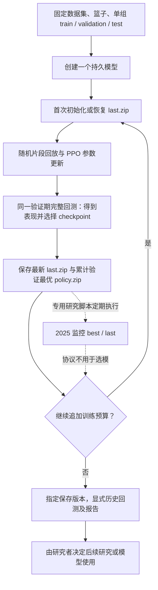
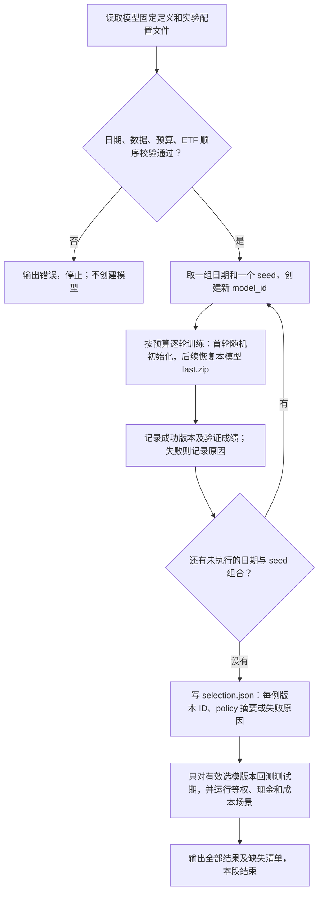
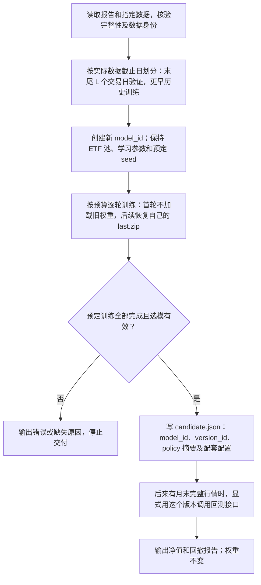

# 强化学习评估与最终模型生命周期设计（SDD）

## 1. 文档状态与目标

- 日期：2026-10-06（Asia/Shanghai）。
- 状态：设计稿，供审阅；不表示下述功能已实现或研究已通过。
- 代码基线：`ae0f4a74ddf995c97a34c1310e96a20233b387c4`，工作区 `D:/Projects/quanto`，分支 `training`。
- 用户要求：根据已有论文形成客观、简洁的方案，把讨论过的八项修改写成工程可执行的规格，明确与现有流程的差异，并解释最终交易模型如何产生。
- 本次澄清：ETF 池及顺序由模型直接定义；明确模型定义、训练计划、作业参数、研究规则各自归属，以及每一步的输入输出。逻辑归属不等于允许在现有模型上任意修改。
- 流程表述：第 7 节按实际数据截止日、创建请求、训练调用、保存版本编号和回测请求逐步说明；第 9.2 节分开画历史评估与最终模型训练，不用“新协议”“冻结候选”代替程序操作。
- 差量复核：R1—R8 已逐项对照实现与相关测试；第 5 节区分保留能力和实际缺口，第 6.3 节只列真实改动，不把论文中的原则当作从零开发清单。
- 本轮交付：本设计文档及本地 Git 提交；不改产品代码、不启动真实训练、不连接券商、不 push。
- 目标：把单模型反复续训的能力，组织成有固定规则、完整记录的跨期研究，并衔接最终候选模型的训练、冻结和后续新增行情检验。

### 1.1 成功标准

工程师能从本文确定：每一步的输入与输出、哪些数据用于更新参数或选择模型、何时允许考察测试成绩、失败如何记录、最终模型来自哪里，以及哪些结论证据不足。实施验收验证程序行为，不把回测盈利作为软件测试通过条件。

### 1.2 范围

按 R1—R8 八个主题检查方案，实际实施仅包含第 5 节列明的缺口；最终模型生成属于 R2 的接口编排，使用版本及后续评价记录属于 R7。现有 PPO、特征、奖励、动作、选模、基准/成本、账户、作业与版本系统直接复用。

本版不建设行情分类、综合质量分、自动参数搜索、模型集成、跨折连续账户、研究管理新页面、实时纸面交易守护进程或券商实盘接口。网页仅做“测试日期可选”所必需的表单、类型与显示调整；不重构训练列表。跨数据版本沿用旧权重续训尚未纳入本版实现，能力边界见第 7.1 节；不得把独立重新训练表述为原训练链持续吸收新数据。

## 2. 术语与评价对象

| 术语 | 本文含义 |
| --- | --- |
| 训练集 | 用于 PPO 交互采样和参数更新的历史区间 |
| 验证集 | 已经产生真实历史行情上的模拟回测成绩；这些成绩用于选择 checkpoint，因此参与模型选择 |
| 测试集 | 在本次模型选择冻结后使用的区间；若据其结果改规则或挑模型，就转为后续研究的开发信息 |
| 前瞻新增行情检验 | 模型与决策规则冻结后，使用后来出现的行情检验；本版通过显式导入新快照并回测完成，不等同于实际成交 |
| episode | 一次随机历史片段回放，重置模拟账户；不是新增市场历史 |
| rollout / update | PPO 收集环境步数并更新参数的内部过程；环境步数不等于交易日数 |
| session | 一次有限预算的训练作业；同一模型可以通过成功版本的 `last.zip` 继续训练 |
| fold（评估期） | 一组按时间排序的训练、验证、测试区间 |
| case（实验例） | 一个 fold 与一个随机种子的组合，拥有独立模型及训练链 |
| `last.zip` | 最新训练状态，包含参数、优化器及累计步数，供续训使用 |
| `policy.zip` | 按验证规则选中的推断模型；可能来自更早的 session |
| 实验配置（文中也称“协议”） | 一份 `protocol.json`，列出本次实验使用的数据、日期、seed、训练参数、预算及评价规则；`protocol_id` 是这份配置的编号 |
| 另存实验配置（原文“新协议”） | 把修改后的配置保存到新编号的目录，记录原配置编号，保留旧配置及结果；随后按新配置运行，不覆盖旧实验 |
| 保存使用版本（原文“冻结候选”） | 写入明确的 `model_id + version_id + policy.zip` 内容摘要；后续回测读取这个版本，不随模型最新版本变化 |
| 最终候选模型 | 准备用于后续交易集成的一个具体保存版本；`candidate.json` 记录它的编号、配套配置和评价记录，名称本身不表示已达到交易要求 |

验证和测试都会产生回测表现，区别在于成绩是否参与选择。若模型事先固定且不利用评估结果筛选或修改，这次所谓“验证”实际承担测试角色。任何历史回测都不能直接称为实盘收益。

### 2.1 参数归属、存储和修改权限

**ETF 池直接定义在模型上，研究流程只能引用和核验，不能覆盖。** 多时期、多种子的模型可以拥有相同定义，但各自的 `model_id` 和权重独立。这里的“模型定义”是已有模型配置中固定语义字段的归类，不要求新建模型模板平台、数据库表或额外设置页面。

下表同时规定参数属于哪一层、存在哪里以及何时能改。当前 `PolicyTrainingSpec` 把模型定义和训练计划放在同一份配置中保存；本版保留这个存储方式，不为概念分层先做大规模重构。

| 层级 / 责任 | 具体字段或内容 | 保存与修改规则 |
| --- | --- | --- |
| 模型标识 | `model_id`、`name` | 标识一个注册模型；名称不参与网络计算。本版不新增重命名能力。 |
| 模型直接定义：资产 | `backtest.symbols` 的 ETF 清单及顺序 | 每个模型唯一的资产定义来源。增删、替换或重排都必须创建新模型；当天不可交易或历史不足只改变资格掩码，不改池子及输入位置。 |
| 模型直接定义：输入 | `lookback`、特征布局/缩放语义、`feature_version`、匹配的 `price_mode` | 创建时确定，训练和推断一致；同一篮子但特征含义变化也不能直接复用为同一模型。 |
| 模型直接定义：动作与决策 | `action_version`、资产到动作维度的映射、`frequency` | 固定 Hold/目标组合/现金动作语义和周/月决策节奏；流程不能传入另一套动作或改成另一频率。 |
| 模型直接定义：结构与环境语义 | PPO、`MlpPolicy`、`hidden_size` 对应的 actor/critic 结构，奖励公式及环境/执行版本 | 结构、奖励和成交时序语义固定。不能通过修改 case 参数悄悄变更网络或训练目标。 |
| 训练计划：数据与区间 | `dataset_id`、数据哈希、`train_start/end`、`validation_start/end`，可选 `test_start/end` | 描述这次学习/选模使用什么数据，不改变 ETF 定义。当前及本版同模型续训仍冻结训练数据和日期；不同 fold 或最终新训通过新模型承载新计划。测试日期只是计划回测默认值，实际回测请求另行固定。 |
| 训练计划：学习规则 | `episode_sessions`、`n_steps`、`batch_size`、`n_epochs`、`learning_rate`、`gamma`、`gae_lambda`、`ent_coef`、`seed` | 由训练计划确定，创建每个 case 时写入其配置；同一 case 的续训不可修改。研究 seed 列表展开为不同模型的固定 seed，同时同步 `backtest.seed`。 |
| 训练计划：验证和预算默认值 | `selection_metric`、`eval_every_timesteps`、`total_timesteps` | 前两项在同模型训练链内固定；`total_timesteps` 是创建时的单 session 默认预算，不代表不可追加的终身步数上限。 |
| 训练计划：账户与比较基础 | `backtest.initial_cash`、基础 `execution`、`risk`、`metrics` 参数 | 不属于网络输出，是训练/回测账户假设；当前保存在模型 spec 中并随训练计划冻结。推断模型的交付必须携带这些假设，不能只交权重。 |
| 单次训练作业参数 | `additional_timesteps`、`device` | 现有 `/models/{id}/train` 唯一允许覆盖的两项。预算映射为本 session 的 `total_timesteps`；研究 case 仍必须符合预先固定的 session/设备表。 |
| 服务端确定的续训输入 | `base_version_id`、已核验的父产物及 `last.zip` | 服务端取同模型最近成功版本并冻结引用，不由调用方任意指定另一模型权重。初次训练没有父版本。 |
| 显式回测作业参数 | `version_id`、回测 `dataset_id`、`start/end`、`baseline`、`cost_multiplier` | 可按请求固定；不得修改被回测模型的资产/特征/动作定义。除成本倍率外，账户与风控规则沿用所选模型配置；成本压力结果不回写基础训练配置。 |
| 研究流程参数 | `source_model_id`、fold 日期、seed 列表、`window_rule`、session 表、基准/成本场景、生产 seed、证据标记、`forward_plan` | 定义怎样组织多个实验，不是单次网络输入。协议冻结后修改需新协议；其中模型定义快照只读，用于一致性核验。 |
| 学习输出 / 运行输出 | 权重、优化器、累计步数、验证成绩、版本 ID、订单/成交、净值和报告 | 属于运行产物，不是可手工指定的配置。“最佳步数”“测试收益”不能作为请求字段倒填。 |

研究入口选择一个已注册的参照模型 `source_model_id`（可以尚未训练），读取其只读定义快照与摘要。创建各 case 及最终候选时复制这份定义、分别写入训练计划；不改变参照模型、不复制其权重。`source_model_id` 只说明定义来自哪里，不是 PPO 续训父版本。完整请求因现有 API 需要仍会包含 `backtest.symbols`，但它必须逐项等于模型定义快照，不形成第二套可编辑 ETF 池。

概念上属于流程的参数，不代表当前 API 已允许在一个模型内更改它。尤其不能因为训练版本记录了数据哈希，就认为同一模型已经支持换数据集继续训练。

### 2.2 网络、学习过程与账户执行的输入输出

| 环节 | 输入 | 输出 | 是否更新权重 |
| --- | --- | --- | --- |
| 特征构建 | 截至决策时点已可得的行情、当时资格信息、当前账户状态、模型固定定义 | 按固定 ETF 顺序构造的 `float32` observation；当前为 `12 × ETF 数量 + 4` 维 | 否 |
| 策略推断 | observation、明确版本的策略权重 | 离散动作：模式及各 ETF 权重档位；不是成交订单，也不是收益预测 | 否 |
| 动作解码与账户执行 | 离散动作、实际持仓、风控/成本/结算规则及随后可执行行情 | Hold 或目标组合，经风控生成委托与实际成交，更新持仓、现金和逐日净值 | 否 |
| PPO 学习 | 训练期采样得到的状态、动作、奖励等 rollout，以及当前训练状态 | 更新后的网络权重、优化器状态及训练计数 | 是 |
| 验证 / 测试 | 冻结到本次评估的策略权重、规定区间和账户配置 | 净值、收益、回撤等报告；验证结果另供 checkpoint 选择 | 否 |

每只 ETF 的 12 个输入包含历史收益/波动/回撤等行情特征、可用性/入场资格、实际仓位和可卖比例；另 4 个为现金、应收、暂停状态及账户回撤。实际现金、持仓和可交易资格会随时间变化，但模型绑定的 ETF 位置不变化。训练奖励来自扣成本后的账户净值变化；验证/测试也产生表现，但不执行 PPO 参数更新。

## 3. 论文依据与工程决策边界

| 编号 | 一手来源及直接支持的结论 | 本项目采用方式与限制 |
| --- | --- | --- |
| E1 | [Cawley & Talbot, 2010, On Over-fitting in Model Selection and Subsequent Selection Bias in Performance Evaluation](https://www.jmlr.org/papers/v11/cawley10a.html)：优化有限样本上的选择标准也会过拟合，影响性能估计。 | 分离选择和评价，保留所有选择记录；论文不指定交易策略应选 Sharpe 还是收益。 |
| E2 | [Arnott, Harvey & Markowitz, A Backtesting Protocol in the Era of Machine Learning](https://people.duke.edu/~charvey/Research/Published_Papers/SSRN-id3275654.pdf)：记录尝试、考虑成本和数据限制，警惕反复利用样本外结果，追求简洁。链接为作者提供的论文稿。 | 冻结研究条件、完整报告失败与限制；不声称协议或哈希能证明研究者从未看过历史。 |
| E3 | [Cerqueira, Torgo & Mozetič, 2020, Evaluating time series forecasting models](https://kt.ijs.si/igor_mozetic/papers/CerTorMoz-TimeSer-MACH-20.pdf)：在其非平稳序列实验中，多个保持时间顺序的留出检验表现较好。 | 支持多期前向考察；研究主要是单变量预测，不是本项目金融 PPO 的直接有效性证明。 |
| E4 | [Agarwal et al., 2021, Deep Reinforcement Learning at the Edge of the Statistical Precipice](https://arxiv.org/abs/2108.13264)：少量 RL 运行的点估计存在不确定性，应考察运行差异及统计不确定性。 | 完整呈现多种子结果；三个种子的范围不是置信区间，也不能证明跨经济周期稳健。 |

以下属于工程选择：独立 case、JSON 协议、沿用种子 `17/42/83` 的初步检查、固定生产种子、等权与现金对照、成本倍率、报告字段与实现边界。论文没有证明这些具体取值最优。窗口与预算必须显式提供，不通过试遍参数后宣称某个值是“论文推荐”。

## 4. 现有系统事实与问题定位

### 4.1 通用训练及回测能力

1. 创建持久模型，冻结数据集、有序篮子、日期、特征/动作身份、PPO 参数、执行与验证规则；创建本身不开始训练。
2. 每个 session 追加步数；首次初始化 PPO，后续恢复最新成功版本的 `last.zip`。训练账户和片段采样环境重新开始，不保证与一次不中断长训练逐位一致。
3. 在完成 PPO 更新且达到验证门槛时，对同一个验证区间完整回测；session 结束时若还有未评估更新，再执行一次验证。
4. 指标严格更优才替换 `policy.zip`；最新状态写入 `last.zip`。验证最优可以跨 session 保留。
5. 注册模型训练不自动测试；独立 `/investing/train` 入口仍会自动计算测试成绩。
6. 回测必须指定保存版本，并晚于验证截止日；现有作业、数据和模型产物已有身份与完整性校验。
7. `PolicyTrainingSpec` 强制填写训练、验证、测试三段；创建模型和训练预检查还会访问测试期日历及可执行环境。当前无法仅凭截至验证结束的数据直接创建一个“等待未来行情”的最终模型。

依据：[contracts.py](D:/Projects/quanto/src/quanto/investing/contracts.py)、[training.py](D:/Projects/quanto/src/quanto/investing/training.py)、[models.py](D:/Projects/quanto/src/quanto/investing/models.py)、[jobs.py](D:/Projects/quanto/src/quanto/investing/jobs.py)、[evaluation.py](D:/Projects/quanto/src/quanto/investing/evaluation.py)。

### 4.2 已有固定篮子研究大循环

已有 8 ETF 协议固定训练 2022—2023 年、验证 2024 年、监控 2025 年、最终回测 2026-01-01 至 2026-09-30。初始协议是同一模型连续 50 个成功 session，每次追加 512 步；每十轮检查验证最优和最新权重在 2025 年的表现，末轮再检查 2026 年。监控和最终结果按该协议不参与 checkpoint 选择。

50 轮是具体研究协议的设定，通用训练器没有固定 50 轮限制；历史脚本另有专门的扩展运行约束，不能将其当作一般的多期研究能力。

现有协议已披露篮子采用 2026 年评级回溯选择、价格处理和续训限制，2025/2026 的成绩也已查看。新系统应延续这些披露，不能把重新切分日期视作恢复了全新盲测资格。

依据：[历史协议](D:/Projects/quanto/docs/research/2026-10-05-fixed-basket-training/protocol.json)、[历史结果](D:/Projects/quanto/docs/research/2026-10-05-fixed-basket-training/results.json)、[研究运行器](D:/Projects/quanto/scripts/run_fixed_basket_training.py)。

### 4.3 本次需要解决的缺口

现有系统已经具备训练、验证选模、固定版本回测和专用研究工具；缺口是多期任务的统一编排、R3 的测试日期/独立入口处理、跨期汇总、最终模型无需未来数据即可训练，以及将已有偏差披露关联到每个实验结果。当前代码并不能据此被判定为“模型已经过拟合”；本设计降低评价失真的风险，不承诺提高收益。

## 5. 八项审查结论与最小修改范围

**这八条是八个审查主题，不是八项从零新增的功能。** 论文用于检查方法是否合理；代码已经满足的部分保留。以下分别列出现有实现、真正缺口和验收，不能把“保持正确行为”计成新增研发任务。

| 条目 | 已有能力，直接保留 | 本次真正需要做的事 | 改动位置 |
| --- | --- | --- | --- |
| R1 实验配置 | 单模型配置固定、日期/数据/历史长度校验；专用脚本已有哈希及预算预检 | 保存多期配置，在创建任何 case 前检查完整日期 × seed 列表 | 研究编排 |
| R2 批量运行 | 创建/续训/版本回测 API、作业状态；专用脚本已有多 seed 请求和提交恢复 | 串联多个时期和 seed 的任务，建立 case 对应关系，按原规则生成最终模型 | 研究编排 |
| R3 训练测试边界 | 注册模型训练不自动测试；测试价格不参与验证选模 | 测试日期成对可选；训练不再预检测试数据；独立训练入口取消自动测试 | 训练契约、预检查、作业分发及必要网页字段 |
| R4 选模记录 | 严格优胜、同分保留、空 Sharpe、累计历史、最佳来源、last/policy 分离 | 读取现有产物登记选中版本；无效选模不进入策略测试 | 研究编排；不改选模算法 |
| R5 基准成本 | 现金、等权、买入持有、成本倍率及同账户执行 | 批量调用已有回测，检查所需场景齐全 | 研究编排及汇总；不改账户或成本算法 |
| R6 跨期报告 | 逐日净值、现有收益/回撤/年度收益计算 | 从现有产物生成按时期、年份、seed、成本列出的报告，保留缺失结果 | 研究报告；不要求修改单次回测导出 |
| R7 账户和使用版本 | 独立账户、期末估值、指定版本回测、权重哈希、已有偏差披露 | 保存实验/使用版本的引用关系及后续评价规则；汇总已看过的数据并核对历史修订 | 研究记录及报告；不改账户、版本或哈希机制 |
| R8 验证交付 | 已有训练、续训、成本、作业恢复、版本保护及报告测试 | 复用现有测试，只更新被 R3 改变的断言并补真正新增流程的测试 | 测试与说明，不是产品新功能 |

### R1. 保存多期实验配置并复用预检查（依据 E1、E2）

**已有，保留：** 模型 spec 已固定 ETF 顺序、日期、seed 和训练参数；创建时已检查日期顺序、数据覆盖、可执行决策和 lookback。动作对比脚本已有数据哈希、重复 seed、episode 长度和完整 rollout 预算预检，固定篮子脚本已有协议摘要及轮次检查。依据：[模型创建](D:/Projects/quanto/src/quanto/investing/models.py:167)、[训练预检查](D:/Projects/quanto/src/quanto/investing/training.py:29)、[矩阵准备](D:/Projects/quanto/scripts/compare_policy_actions.py:46)。这些能力不重新设计。

**本次只补：** 一份可以表达多个评估时期的配置文件：引用参照模型的只读定义，列出数据快照、各期训练/验证/测试日期、seed、最终 seed、共同学习参数、每轮预算/设备、基准与成本场景。创建 case 前，先对所有组合调用现有校验，再检查跨期条件；失败时不提交任何 case 作业。修改条件另存新编号配置，保留旧配置及结果，具体操作见第 9.2.3 节。

第一版按同一规则构造日期：训练起点固定、训练历史随评估时点扩展，验证段长度为预先指定的交易日数；各期测试日期显式列出且彼此不重叠，最终模型也按此规则划分。规则是本项目的工程选择，不是论文规定的最优窗口。晚期训练可包含已经过去的早期测试数据，但须按预定日期执行。

**验收 AC1：** 新增验证定义摘要一致、禁止覆盖/重排 ETF 池、跨期日期及窗口规则一致、全部组合在提交前检查完毕，并输出 case 数、轮数、总步数和场景数。日期倒序、数据哈希错误、seed 列表内部重复、episode 过长、无有效决策及非整 rollout 预算沿用已有检查；只补它们被多期入口正确调用的验收。同一个 seed 在不同时期重复使用是预定设计，不拒绝。因果特征、上市前不造数据及资格掩码是保留约束，不列为新算法。

### R2. 复用现有接口编排多期任务（依据 E3、E4；最终模型编排为工程选择）

**已有，保留：** 创建模型、首次初始化、同模型 last.zip 续训、明确版本回测及作业状态已具备。固定篮子 runner 已保存提交收据、恢复丢失响应、记录失败且不自动重试；动作对比脚本已有多 seed 创建/训练请求生成及导出结果核验。前者限于一个模型的专项续训，后者限于动作/episode/seed 对比且不实际执行任务。依据：[模型接口](D:/Projects/quanto/src/quanto/investing/models.py:167)、[提交收据与恢复](D:/Projects/quanto/scripts/run_fixed_basket_training.py:276)、[多 seed 请求与汇总](D:/Projects/quanto/scripts/compare_policy_actions.py:46)。

**本次只补：** 外层遍历“时期 × seed”，每个组合创建独立 model_id，使用同一模型定义，按相同轮次预算、设备和验证频率调用已有接口；禁止跨组合传递权重。记录 case 与已有 model/job/version 的对应关系。全部预定训练尝试结束后，读取现有选模产物保存 `selection.json`，再调用已有回测并汇总。最终模型也只是按同一规则计算日期、新建 model_id、逐轮训练和记录版本，不增加训练算法。

相同总步数不能替代相同轮次划分，因为轮末可能触发验证。实际验证位置从现有 history 核验。复用专用 runner 已验证的收据/恢复处理，不新增作业状态系统或假设 API 已有幂等键。响应未知时先核对任务，无法核对则停止该 case；失败/取消/跳过均记录，不删除，不自动重试。显式重试另记 attempt，沿用原 seed、配置及最后成功父版本；不能把正常低分当故障重跑。

**验收 AC2：** 新增多期矩阵对应关系、跨 case 隔离、相同轮次计划、全部训练结束后才允许测试、重复启动能接续原记录。底层同模型并发拒绝、父版本保护和失败状态继续使用现有测试。最终模型从 0 步及随机初始化开始，最终 seed 预先指定且属于研究 seed 列表，不从测试冠军或历史 last.zip 接着训练。

### R3. 解除测试日期依赖并统一独立入口（依据 E1、E2）

**已有，保留：** 注册模型训练已经不自动测试，验证成绩决定 checkpoint；显式回测已经要求晚于验证截止日。现有测试确认改变测试段价格不会改变训练权重和选择结果。因此本条不能写成“原系统没有训练/测试隔离”或已发现测试收益泄漏。依据：[作业分流](D:/Projects/quanto/src/quanto/investing/jobs.py:11)、[测试价格隔离测试](D:/Projects/quanto/tests/unit/test_investing_training.py:125)。

**确需修改：** `PolicyTrainingSpec.test_start/test_end` 当前必填，创建/训练会预检查测试期行情；独立 `/investing/train` 仍自动测试。将测试日期改为成对可选：提供时检查顺序，省略时允许只凭训练/验证数据创建模型。训练所需覆盖到 `validation_end`，只建立 train/validation 环境；测试期的数据覆盖与可执行性留到显式回测检查。`train_policy` 移除自动测试分支，所有训练入口的 `metrics.test` 为空。

研究各期仍由配置提供明确测试日期；最终模型可以不填。网页只调整相关表单、类型、覆盖终点和空值显示；不重构训练列表。既有显式版本回测、验证截止校验和历史产物读取保持。历史已记录的测试成绩不回写，也不保留旧的自动测试路径。

**验收 AC3：** 新增“只有 train/validation 行情也能创建并训练”“只给一个测试日期报错”“独立训练也不调用测试”“无测试日期的网页创建/回测”。复用测试价格不影响选模的现有测试，不重复构建同一隔离算法；显式回测缺数据仍报错。

### R4. 读取已有选模记录，不重写选择算法（依据 E1、E2）

**已有，保留：** `score > best_score` 才替换权重，同分保留；空 Sharpe 以 None 保存，全程无有效分数时标 `selection_valid=false`。累计 `history` 已记录每次验证的 timesteps、updates 和成绩，manifest 已有 `selection_metric`、`best_timesteps`、`best_source_content_id`；续训会保留累计最优 policy.zip。依据：[选择逻辑](D:/Projects/quanto/src/quanto/investing/training.py:95)、[训练产物](D:/Projects/quanto/src/quanto/investing/training.py:178)、[续训与空指标测试](D:/Projects/quanto/tests/unit/test_investing_continuation.py:18)。

**本次只补：** 编排直接读取这些字段生成每例选择记录，验证次数从累计 `len(history)` 计算，不把各 session 的累计次数相加。`best_source_content_id` 为空表示最佳权重产生于当前版本，按现有模型详情的规则解析为当前 manifest 的 content ID；不将空值误判为来源缺失。不新增 trainer 字段或改变选模逻辑。配置固定选模指标；标为无效的 case 保留记录，跳过其策略测试，仍计入预定 case 总数及缺失原因。policy.zip 文件存在不能替代 selection_valid 检查。现金基准的 Sharpe 为空不等于基准失败。

**验收 AC4：** 复用跨轮保留最优、空 Sharpe 及 last/policy 分离测试；同分如现有用例未覆盖，仅补一个有意义的回归用例。新增编排读取正确字段、正确统计累计验证次数，以及无效 case 不测试且不被汇总丢弃的测试。禁止用测试收益或 last.zip 替换验证选中的权重。

### R5. 批量运行已有基准和成本场景（依据 E2）

**已有，保留：** 已支持策略、现金、等权和买入持有回测，均走同一账户。`cost_multiplier` 已作用于佣金率、最低佣金和滑点率；净值已扣成本；等权受资格、现金、成交和风险约束。依据：[基准与账户执行](D:/Projects/quanto/src/quanto/investing/evaluation.py:20)、[成本倍率](D:/Projects/quanto/src/quanto/investing/evaluation.py:84)、[基准成本测试](D:/Projects/quanto/tests/unit/test_investing_training.py:95)。本条不改这些算法。

**本次只补：** 实验配置列出必须运行的场景：同篮子同频率等权、现金、基础成本 1.0 及至少一个事先指定的大于 1.0 的倍率；编排对所选版本按相同日期和账户条件调用现有回测。报告核对场景齐全，展示策略净收益减同期等权净收益的百分点差。已有宽基指数对照不改；其首日归一化/分红口径不能替代这项等权比较。

**验收 AC5：** 新增场景请求条件一致、完整性及结果身份检查。相同条件的基准结果允许复用，但须保留对应关系；缺场景就标不完整。保留现有成本只扣一次、实际不可投资部分留现金的行为；压力场景不参与重新选模。不新建冲击/容量模型。

### R6. 从已有产物组装跨期报告（依据 E2、E4）

**已有，保留：** 策略回测已导出带回撤的 `equity.csv`/`daily_equity.csv` 和 `summary.json`。共享 `build_report` 已计算日收益、回撤、年度收益；固定篮子报告也会从权益核验现有指标。注意：策略回测目前没有直接导出日收益列和年度表，不能把“已有计算”写成“已有全部输出”。依据：[现有导出](D:/Projects/quanto/src/quanto/investing/evaluation.py:103)、[共享收益计算](D:/Projects/quanto/src/quanto/reports/backtest_report.py:76)、[回撤函数](D:/Projects/quanto/src/quanto/backtest/metrics.py:18)、[专用报告核验](D:/Projects/quanto/scripts/report_fixed_basket_training.py:127)。

**本次只补：** 研究报告读取现有逐日权益、初始现金、summary 及版本引用，按同一日收益公式生成年度表；年内回撤调用现有 max_drawdown 函数，基数为上一个已观测交易日权益，首段用初始现金。按时期、seed、成本和年份列出策略/等权净收益、差值与回撤；补实际起止、交易日数和 partial_year。不要求改 evaluation.py 重新导出，也不另写账户、成本或 Sharpe 算法。

同一期同场景列出所有 seed、有效/预定数量、中位数和范围，另列预先指定最终 seed 的结果。失败/缺失保留；不从三种子范围生成置信区间，不拼跨期净值、不平均回撤或 Sharpe 作为整体指标。Sharpe、现金比例、换手和成本直接取已有同口径明细，不增加综合评分。

**验收 AC6：** 新增 case/seed/场景齐全、引用身份一致、策略与基准日期对齐、缺/重复交易日、年度基数、partial_year 和年内回撤调用检查。例：100→110（上年末）→99（本年末），本年收益为 -10%。已有日收益和最大回撤算法复用原测试；不能把不完整数据伪装为完整报告。

### R7. 保持账户和版本机制，只补研究引用与后续评价记录（依据 E1、E2）

**已有，保留：** 每次回测重置账户、各期独立净值、期末收盘估值且不强制平仓；回测已经指定保存版本，manifest 已校验权重等文件哈希。旧研究也已披露 2026 年评级回选和已看过历史结果。依据：[账户重置](D:/Projects/quanto/src/quanto/investing/environment.py:157)、[期末假设](D:/Projects/quanto/src/quanto/investing/evaluation.py:125)、[版本回测](D:/Projects/quanto/src/quanto/investing/models.py:215)、[文件核验](D:/Projects/quanto/src/quanto/learning/artifacts.py:9)、[原研究限制](D:/Projects/quanto/docs/research/2026-10-05-fixed-basket-training/protocol.json:29)。这些都不算新增功能。

**本次只补：** 在研究记录中关联已保存的模型/数据/配置/报告，补齐各期结果是否参与选择、此前是否查看以及选池信息时点。已有来源与限制直接引用；无法核实的记录为 unknown。candidate.json 引用确切 model_id、version_id 和现有 manifest/文件摘要，补保存时间、最终训练计划引用及 forward_plan；不建立第二套权重存储或冻结机制。

forward_plan 在保存使用版本时写明起点、月末累计评价、基准和成本场景。按 Asia/Shanghai 时区，从保存后的下一个完整交易日或更晚的预定日期开始；首个决策遵守原周/月频率。以后显式导入数据并调用现有固定版本回测，每次仍从同一起点和初始账户重算至该月末，无后台调度。临时选窗另列，不能覆盖主评价。

数据比较只新增一项必要检查：后续快照与当初使用快照重叠的历史输入有无修订。有修订则标“修订数据回放”；无修订但缺少逐日时点可得性证据，仅标“保存版本后的行情回放”，不宣称实时成交。不同期的独立账户结果分别列出，不能拼成连续实盘净值或计算跨期 CAGR/最大回撤；这是报告约束，不是账户改造。

**验收 AC7：** 新增研究记录不能遗漏已有偏差、不能将已看过数据重标盲测；使用版本引用固定、历史前缀修订正确标记、回测起点不回填保存当日、临时窗口不混入主评价。同版本不可覆盖与期末估值沿用现有机制/测试。以后使用新训练版本，需要另存引用记录并从新的保存时间开始后续评价，旧结果保留。

### R8. 复用现有测试，只验证真实差量（研发交付要求）

**已有，保留：** 已有真实 PPO 小样本训练、续训恢复、空 Sharpe、测试价格隔离、基准成本、固定版本保护、提交恢复和专用报告测试。依据：[训练](D:/Projects/quanto/tests/unit/test_investing_training.py:20)、[模型版本集成](D:/Projects/quanto/tests/integration/test_investing_models.py:110)、[提交恢复](D:/Projects/quanto/tests/test_fixed_basket_runner.py:48)、[请求矩阵](D:/Projects/quanto/tests/test_compare_policy_actions.py:65)。不把测试体系从零建设列入任务。

**本次只补：** 先核对每个相关测试是否仍符合当前要求。R3 改变的必填测试日期/自动测试断言需要更新；未改变的选模、成本、账户和版本机制直接复用现有用例。对新增的日期 × seed 编排、选模引用、场景/失败完整性、跨年汇总及 candidate/forward_plan 增加测试，再用临时工作区和少量合成数据验证整条流程。只读历史产物用于现有审计要求，不引入兼容旧自动测试行为的分支。

**验收 AC8：** 真实差量均有对应验收，保留行为有现有测试或明确的少量缺口用例；端到端验证复用真实创建/训练/回测接口。网页仅测可选测试日期相关变化。代码实施时各阶段验证后本地提交；本次只审查并修正文档，不提交生产训练作业。

## 6. 数据契约、状态与模块边界

### 6.1 最小产物契约

| 产物 | 必需信息与约束 |
| --- | --- |
| `protocol.json` | `schema_version`、`protocol_id`、可空 `parent_protocol_id`、创建时间、`source_model_id`、只读 `model_definition_snapshot` 及摘要（含模型拥有的有序篮子）、选池信息来源时点、注册数据 ID/hash、共享训练计划、`window_rule`、显式 folds、seed 列表、生产 seed、每段预算/设备、基准、成本场景、已知数据曝光及限制；计算内容摘要 |
| `preflight.json` | 原协议摘要、实际数据覆盖和可交易历史检查、案例数、每例会话计划、总步数、可执行/拒绝原因；无绩效分数 |
| `attempts.jsonl` | `case_id/attempt_id` 到现有 model/job/version 的对应关系及提交收据；状态、父版本、步数和错误从现有作业/产物读取，保留失败/取消/跳过；执行代码来源无法核实时记 unknown |
| `selection.json` | 引用现有 version/content ID、manifest 文件摘要、best_timesteps、最佳来源和验证成绩；验证次数由累计 history 长度派生；不可选/失败例保留原因。引用协议摘要，保存后不修改 |
| 单次回测产物（已有） | 复用 `summary.json`、`equity.csv` 等现有文件及内容摘要；策略回测不新增年度导出接口，训练 manifest 不保存新测试成绩 |
| 研究汇总产物（新增） | 在已有回测引用外补 case/协议对应关系、按同口径派生的日收益与年度表、实际区间和完整性标记 |
| 研究报告 | 预定/已完成/有效/失败数量、逐例逐年数据、种子分布、所有限制；完整性状态与投资判断分开 |
| `candidate.json` | 最终训练计划与研究报告引用、model_id/version_id、现有 manifest/权重摘要引用、保存时间及 forward_plan；seed、数据、配置和截止日从被引用的训练产物核验，不建立第二套模型存储 |

目录按协议、case、attempt、评估场景划分，成功产物不可覆盖。哈希用于核验身份，不替代金融数据质量审计。记录执行代码来源不能只记录准备请求时的 Git commit；无法确认实际 worker 版本时明确 `unknown`，不能宣称已达到完整可复现。

已存在的内容摘要与文件校验通过现有 `read_manifest`/引用核验读取，不重写哈希机制。API 请求使用 `version_id`，注册回测的 summary 中对应字段名为 `policy_id`；编排核验二者相等，并校验 model_id、dataset_id 和数据摘要。累计 history 已包含父版本记录，汇总不能重复拼接计数。

### 6.2 状态约束

研究阶段按 `prepared → training → selection_frozen → evaluated → reported` 推进。`selection_frozen` 可含不可选 case，后续报告必须保留其缺口；只有全部规定 case 和场景成功、且选模有效时才标 `complete`。完整性检查不生成“策略合格”结论。

训练任务沿用现有作业状态。网络返回不确定时先按收据核对已有 model/job；无法核对则记录 `unknown` 并暂停该 case，不能直接再提交。选择冻结前若有人通过其他入口给 case 模型追加了非计划 session，报告拒绝认定该 case 符合协议。选择冻结后模型可以产生后续训练版本，但这些版本不得混入已冻结的 case；旧结果继续绑定原版本，不能因 head 更新而换成新的 `policy.zip`。

结果查看之后可以开展新研究，但需新协议并继承已知曝光记录；不能将换个 ID 当成重获未查看数据。

### 6.3 拟变更文件

以下仅列实际需要实施的差量，不表示本轮已修改产品代码。新增能力先落在两个研究脚本中，沿用现有 API 和产物，不预设额外服务模块、数据库或研究管理平台。

| 文件 | 责任 |
| --- | --- |
| `D:/Projects/quanto/src/quanto/investing/contracts.py` | 测试日期成对可选、训练/验证覆盖与计划测试日期分离 |
| `D:/Projects/quanto/src/quanto/investing/training.py`、`jobs.py`（同目录） | 仅 R3：移除自动测试路径，训练只预检查 train/validation；选择算法与已有 manifest 字段保留 |
| 拟新增 `D:/Projects/quanto/scripts/run_policy_research.py` | 多期配置/预检查、case 与任务收据对应、已有创建/训练/回测 API 编排、读取选模结果、生成最终训练计划及使用版本/后续评价记录；无后台自动调度 |
| 拟新增 `D:/Projects/quanto/scripts/report_policy_research.py` | 读取现有产物及引用，核验 case/seed/场景完整性与日期对齐，生成年度对照、种子和失败报告；复用现有指标函数/口径 |
| `D:/Projects/quanto/web/src/investingTypes.ts`、`components/ModelCreation.tsx`、`components/ModelBacktestForm.tsx`、`pages/ModelDetailPage.tsx`（均在 web/src） | 可选测试日期、正确覆盖终点、无默认测试日期的输入/显示；不改导航或训练列表 |
| `D:/Projects/quanto/tests/unit/test_investing_training.py`、相关集成与网页测试；新增研究脚本测试 | 更新 R3 相关断言，覆盖新增编排/报告/记录；其余测试只因真实缺口或受 R3 接口变化影响而修改，不整套重写 |
| `D:/Projects/quanto/docs/07_ETF自主投资训练指南.md` 与研究使用说明 | 区分验证表现、后续评价、最终候选和新增行情检验 |

`evaluation.py`、`environment.py`、账户/成本引擎、`models.py` 的创建续训版本机制、`learning/artifacts.py` 的哈希机制不在本次必要修改清单中；不得为上述保留能力安排重写任务。报告复用 `backtest/metrics.py`、`reports/backtest_report.py` 的指标函数和定义；已有年度收益计算不另造含义。现有 `run_fixed_basket_training.py` 与 `compare_policy_actions.py` 保留各自专用用途和历史语义，复用适用的独立函数及已验证的收据处理，不另建通用作业框架。

### 6.4 每个流程步骤的输入与输出

这里的定义快照和训练计划是字段分组，不额外引入运行平台。所有请求在进入现有 API 前组装为完整配置；模型定义字段不得被训练计划或 session 参数覆盖。

| 步骤 | 输入 | 执行与权重变化 | 输出 / 下一步消费 |
| --- | --- | --- | --- |
| 选择参照模型 | 已注册 `source_model_id`；模型可尚未训练 | 只读模型配置，不加载已有权重进行学习 | `model_definition_snapshot`、定义摘要及来源引用，供协议和 case 创建使用 |
| 准备协议与预检查 | 定义快照、研究数据 ID/hash、fold/seed、训练计划、session 表、评价规则 | 校验覆盖、预算和身份；不训练、不计算测试成绩 | 不可覆盖的 `protocol.json`、`preflight.json` 和逐 case 请求；有错误则不创建 case |
| 创建 case | 模型定义快照 + 该 case 的训练/验证日期、seed 和训练计划 | 创建独立注册模型，不初始化/训练 PPO；禁止复制参照模型权重 | `case_id → model_id` 对应关系及完整固定配置 |
| 首次训练 | case 模型、原训练数据、首段预算/设备，无父版本 | 初始化 PPO；只在训练段更新参数，验证段评价并选择 | 成功版本：`last.zip`、`policy.zip`、manifest、验证历史、累计步数；失败/取消则保留状态记录 |
| 同数据继续训练 | 同 case 模型与固定计划、服务端核验的最近成功父版本、符合预定 session 表的下一段预算/设备 | 从父 `last.zip` 恢复参数/优化器，重建采样账户，继续更新；验证规则不变 | 新的成功版本 ID，包含最新状态 `last.zip`、累计验证最优 `policy.zip`、父子关系及验证历史；旧版本不覆盖 |
| 保存每例要回测的版本编号 | 全部预定 case 的终态、成功产物与验证历史 | 登记包含验证最优 `policy.zip` 的成功版本 ID，不读取测试收益 | `selection.json`；失败或不可选 case 也有条目，不能拿其占位权重回测 |
| 显式测试与对照 | 选中 `version_id`、核验后的数据快照、测试日期、baseline、cost_multiplier | 固定权重推断和账户模拟，无 PPO 更新 | 按 case/场景保存的回测产物及其文件摘要 |
| 汇总研究 | 协议、全部尝试/选择记录、所有规定场景的产物 | 核验完整性、逐年和种子统计；不挑测试冠军更新模型 | 研究报告及完整性状态，供后续研究判断使用 |
| 新建用于后续使用的模型并训练 | 同一模型定义、研究报告、预先指定的 seed、指定数据快照及其最后完整交易日、据此计算的训练/验证日期 | 创建新 model_id，首次随机初始化；后续 session 从该模型自己的 last.zip 继续，步骤见第 7 节 | 成功训练版本及其中验证最优的 `policy.zip` |
| 保存后续使用的版本编号 | 成功版本 ID、该版本的 policy.zip 内容摘要、配置/数据身份、保存时间及后续回测日期规则 | 写入文件；不调用训练、不改变网络参数 | `candidate.json`；以后用其中的 model_id/version_id 定位权重 |
| 用保存版本回测后来出现的行情 | candidate.json、含后续行情的数据快照、预先规定的起止日及成本场景 | 按保存的版本 ID 加载 policy.zip，调用回测；不调用 PPO 学习 | 该区间的净值、报告和证据标记；权重保持不变 |

已有账户或作业引擎的隐式输入也必须随产物可追溯：执行/风险配置来自选中模型，父版本由服务端确定，当前持仓及现金来自回测账本。调用方不能把这些输入当成模型预测出来的结果，也不能省略其身份后声称完成了可复现评价。

### 6.5 输入冲突的处理示例

- 模型的 ETF 顺序为 `[A, B, C]`，协议或数据加载把输入改为 `[B, A, C]`：拒绝；即使资产数量及集合相同，动作与特征位置也已改变。
- ETF B 当天不可交易：保留 B 的固定输入/动作位置，使用现有资格掩码和执行约束；不临时把模型池改成 `[A, C]`。
- 给 `/models/{id}/train` 传入新的 ETF 列表、学习率、训练截止日或 dataset_id：本版仍拒绝；不能利用“流程参数”这一分类绕过模型创建时冻结的计划。
- 使用同一个固定版本，指定另一段合格行情、`baseline=equal_weight` 或更高成本倍率：作为独立回测请求处理；不修改模型配置或训练成绩。
- 协议保留参照模型定义快照，case 使用新 seed：允许创建独立 case 模型；不允许在已训练 case 上直接换 seed，也不继承参照模型的权重。

## 7. 用于后续交易的模型：逐步执行什么

以下是本版要实现的操作顺序。创建、训练、回测复用现有接口；实验编排、可选测试日期和 `candidate.json` 属于待实现部分。**历史评估用的模型与下面创建的模型拥有相同 ETF 池和网络定义，权重分别训练。**

1. **读取一份已完成的历史评估报告。** 程序核验规定的日期组合、seed 和回测场景是否齐全、选模是否有效。存在缺口则返回缺失清单，停止生成最终模型。报告完整时仍先停止，由使用者查看收益、回撤、成本和限制，再显式启动下面的训练；程序没有内置“达到某个收益就自动上线”的判断。

2. **指定数据文件，把训练日期算出来。** 输入一个已注册的 `dataset_id`，核验其内容摘要，读取实际最后一个完整交易日 `D`。读取实验配置中已确定的训练起点和验证长度 `L`（交易日数）。从训练起点到 `D` 的交易日按时间排序：最后 `L` 个交易日用于验证，其余更早的交易日用于训练；分别写出 `train_start/end` 和 `validation_start/end`。数据不足或没有有效训练片段就报错。特征所需的预热历史可以在训练起点之前；最终模型的 `test_start/end` 留空。

   例如，文件只到 **2026-09-30**，即使操作当天是 **2026-10-06**，`D` 仍是 **2026-09-30**。若配置预先写了 `L=60`，最后 60 个交易日用于验证，更早的指定历史用于训练。程序按数据中的交易日日历算边界，不凭“今天”补出行情；60 这里只是计算示例，不是推荐取值。不能把验证段也用于 PPO 更新。

3. **创建新模型，获得新的 `model_id`。** 组装完整 `spec`：复制模型的 ETF 清单及顺序、特征、动作、网络定义；复制实验配置的学习参数、选模规则、每轮预算和账户规则；填入步骤 2 的数据及日期，使用实验开始前已指定的最终 seed。调用现有创建接口，输入为 `{dataset_id, spec}`。创建只登记模型，不开始学习；本模型没有父训练版本，累计训练步数从 0 开始。

4. **按已写好的预算表逐轮训练。** 对新 `model_id` 调用训练接口，输入只有 `{additional_timesteps, device}`，等待该作业结束后再提交下一轮。第一轮用配置 seed 随机初始化 PPO，不加载历史评估模型的 `policy.zip` 或 `last.zip`。从第二轮开始，服务端恢复这个新模型最近成功版本的 `last.zip`，继续更新参数和优化器。在训练段采样学习；按规定频率及轮末在验证段回测，分数严格更好才更新 `policy.zip`。每轮保存一个版本，版本内同时有最新训练状态 `last.zip` 与验证最优 `policy.zip`。失败或取消时记录原因并停止该模型后续轮次；本版不自动重试。

5. **记下后续要使用的确切版本。** 预算表全部完成后，核验最后成功版本的 `selection_valid`。无有效选模结果就报错，不生成交付记录。有有效结果则记下这个版本 ID，后续使用其中的 `policy.zip`；该文件保存的是累计验证最优权重，可能来自更早的一轮。把它的最佳来源及步数一并记录，不改用 `last.zip`。

6. **把版本编号及配套信息写入 `candidate.json`。** 保存 `model_id`、步骤 5 的 `version_id`、现有 manifest/`policy.zip` 的内容摘要引用、实验配置/报告引用、保存时间，以及后续回测的起点、月末累计评价规则、基准和成本场景。模型配置、训练数据及日期直接从被引用的现有产物核验，不重建一份模型存储。文件中引用的权重也必须保留。原文的“冻结候选”就是这一步保存引用；后续加载此文件指定的版本，不重新查询“当前最新版本”。同一模型以后产生新版本时，这份记录及其指向的旧版本仍保持不变。

7. **有后续行情时，调用回测接口评价步骤 6 的版本。** 按市场时区，把保存记录之后的下一个完整交易日或更晚的预定日期设为回测起点。后续自然月结束且数据齐全后，使用者显式导入新数据并调用回测：`model_id` 和 `version_id` 取自 `candidate.json`，`dataset_id` 指向含新行情的快照，`spec` 填预定起点至该月末、基准及成本倍率。先检查历史数据修订等 R7 要求，再加载指定 `policy.zip` 做推断并输出净值/回撤等结果。**这一步不调用训练接口，权重不会学习新行情。** 下次评价仍用同一个起点、版本和初始账户，延长截止日，不把多次累计评价计成多次独立成功。

8. **需要交付时，交付步骤 6 的版本和步骤 7 的报告。** 文件清单包含权重、配置、资产顺序、特征/动作/账户执行规则及评价记录。是否接入交易由使用者决定；本版没有券商下单和自动部署功能。需要换参数、追加训练或用更多数据训练时，按第 9.2.3 节分别处理，不能直接替换旧记录里的权重。

上述步骤明确选择“新建模型，从随机初始化重新训练”。这样产出的权重与历史评估采用相同训练方法；它没有继承任何历史评估模型的学习状态。历史测试日期此时可能进入新模型的训练/验证范围，需要保留这一记录，不能再把那段历史当成新模型未见过的测试数据。

### 7.1 持续学习的能力边界

| 操作 | 本版输入与输出 | 能力状态 |
| --- | --- | --- |
| 同一历史数据继续强化 | 输入同模型最近成功 `last.zip`、相同数据/计划和追加预算；输出新训练版本，保留旧权重及优化器学习状态 | 当前已支持，本版保留；研究内须遵守预定 session 表，研究外追加的版本不能冒充原协议结果 |
| 用新增行情重新训练 | 输入相同模型定义、包含新增行情的新数据及新计划；从初始化开始，输出独立模型与候选 | 本版最终候选流程支持；ETF 池保持一致，但不是旧权重接着学习 |
| 沿用旧权重吸收新增行情 | 概念输入为原训练状态、新快照和新计划，输出同定义下有明确来源的新训练版本 | 当前不支持，本版八项不将其伪装为已覆盖功能；需要另外明确跨数据续训契约后才能实现 |
| 固定模型检查新增行情 | 输入 candidate 和新增行情；输出净值及报告，不改变权重 | 本版 R7 的评价过程，不属于学习 |

若后续增加跨数据续训，ETF 池及顺序、特征和动作语义仍须固定；需另行定义数据兼容性、旧新历史采样、优化器状态、祖先模型接触过的数据截止范围，以及旧新权重在同一个新验证区间的比较。不得沿用旧区间的验证最优分数与新区间成绩直接比较，也不能仅放宽 dataset hash 校验就称为完成持续学习设计。

## 8. 验收矩阵与交付顺序

| 需求 | 已有测试复用 | 新增或更新的验收 |
| --- | --- | --- |
| R1 / AC1 | 日期/覆盖、哈希、episode、seed 与预算预检 | 全矩阵先校验再提交、跨期规则、模型定义只读一致 |
| R2 / AC2 | 单模型并发、续训父版本、失败状态、专用收据恢复 | case 对应关系及隔离、统一轮次计划、编排恢复、最终模型从 0 步创建 |
| R3 / AC3 | 测试价格不影响选模、回测晚于验证结束 | 测试日期成对可选、仅 train/validation 数据可训练、所有入口不自动测试、网页空日期 |
| R4 / AC4 | 空 Sharpe、续训保留旧最优、last/policy 分离 | 编排读取选模结果及累计次数、无效例留在分母；缺少的同分回归用例 |
| R5 / AC5 | 基准同账户、成本倍率、费用计入净值 | 批量请求条件一致、场景齐全、结果可复用且来源正确 |
| R6 / AC6 | 日收益与最大回撤等现有函数 | 多期/seed 汇总、年度边界及 partial_year、日期对齐、缺失结果保留 |
| R7 / AC7 | 固定版本及文件核验、账户重置和期末估值 | 研究/使用版本引用、继承已知偏差、保存后起点、历史修订及临时窗口标记 |
| R8 / AC8 | 现有小规模真实 PPO、模型和作业集成 | 新脚本端到端流程及 R3 网页变化；不引入新测试框架 |

推荐实施顺序：R3 的可选测试日期/独立入口改动及最小网页调整 → R1/R2/R4 的配置、接口编排与现有选模记录读取 → R5/R6 的场景调用与报告 → R2/R7 的最终训练编排、版本引用及后续评价记录 → R8 集成验收和文档。每阶段检查差异、运行相关测试、本地提交；只暂存本阶段内容。

文档完成不等于实现完成。代码实施前应将本规格转为任务级实现计划；本轮的验收是八项覆盖、现状引用、流程一致性和文档差异检查。

本次差量复核运行已有测试 58 项，全部通过：动作比较请求/汇总、固定篮子 runner/报告、续训与选模测试，以及基准成本和测试价格不影响选模用例。使用项目虚拟环境，训练用例仅使用测试临时目录中的合成数据。该结果支持“这些能力已有实现并有测试”，不表示本设计的新增流程已经实现，也不是全仓库测试结论。

## 9. 最终对照：现有与改造后的完整训练大循环

### 9.1 现有大循环

主循环是同一个模型在固定训练数据中反复学习、反复在同一个验证期选择。具体旧研究在预定轮次监控 2025、末轮考察 2026；通用注册模型不会自动测试。独立训练入口的自动测试是另一条现有路径，R3 会统一移除。

### 9.2 改造后的完整大循环

分成两段执行：先跑历史评估并输出报告；使用者看完报告、决定采用这套参数后，再启动最终模型训练。程序不会从历史测试结果中自动挑一个赢家，也不会看见报告生成就自行进入下一段。

#### 9.2.1 历史评估：同一套训练方法，换日期和 seed 重复运行

“一组日期”就是一行明确的训练、验证、测试起止日；seed 是控制初始化和采样随机性的整数。例如配置有 3 组日期、seed 列表有 3 个值，就创建 9 个模型，分别训练，输出 9 份结果或失败记录；它们使用同一 ETF 清单及顺序。每个模型内部按第 7 节步骤 4 的方式训练，使用它自己的训练/验证日期。一次失败不删除该组合，也不阻止其他组合留下结果；报告有缺口时不能进入最终模型生成。

#### 9.2.2 最终模型：新建一个模型训练，再保存一个具体版本供使用

入口是使用者显式启动本段，并传入已完成的实验配置/报告和指定的训练数据 ID。最终 seed、学习参数及预算从原实验配置读取；数据截止日和具体日期按该快照及原规则计算。每个框的字段和操作对应第 7 节，不另加一种训练算法。

前置数据或日期检查失败立即停止，不执行后面的框。训练结束即可保存模型版本；没有后续行情时停在 `candidate.json` 已生成的位置。后续回测采用保存记录之后的预定起点；下个月继续回测同一版本并延长截止日。没有后台自动任务，也没有自动训练、自动换模型或自动下单。使用者需要交付时，取得 `candidate.json` 指定的权重及配套文件和报告。

#### 9.2.3 后续评价、续训和改参数分别怎么做

运行器按配置自动执行预定轮次，生成报告后停止。训练过程中及报告生成后的处理如下；额外任务由使用者明确启动，程序不自行猜测“继续研究”的含义。

| 要做的事 | 程序执行什么 | 旧模型和旧结果如何处理 |
| --- | --- | --- |
| 继续检查同一个保存版本 | 导入更多行情，对 `candidate.json` 中相同版本再次回测，按原规则延长截止日 | 不训练；原权重不变，新增一份回测结果 |
| 尚未跑完预算表，执行下一轮同数据训练 | 对同 model_id 调用训练接口；服务端从最近成功 `last.zip` 恢复 | 生成新版本；已保存供回测的版本和报告不自动换成它 |
| 数据增加了，想让模型学习这些新行情，训练规则保持不变 | 从第 7 节步骤 2 重做：读取新快照、重新算日期、创建新 model_id，从随机初始化训练，再保存新的使用版本 | 原模型及其回测保留；新模型从新的保存时间之后开始后续评价。本版尚不支持把旧权重接到新数据上继续训练 |
| 想改学习率、预算、选模指标或日期划分规则 | 按下面四步另存实验配置，重新执行第 9.2.1 节 | 原配置、模型和结果保留，不能把新参数结果覆盖到旧记录上 |
| 想改 ETF 清单、顺序、特征或动作定义 | 先创建包含新定义的参照模型，再另存实验配置并重新执行第 9.2.1 节 | 旧定义下的模型保持原义，不直接套到新输入/动作位置 |

原文“新协议”的具体操作只有四步：

1. 分配新的 `protocol_id`，建立新目录，复制旧 `protocol.json`；将 `parent_protocol_id` 设为旧配置编号。
2. 写入要改的字段，例如学习率从 `0.0003` 改为 `0.0001`；若改模型定义，更新参照模型引用及其只读定义快照。其余条件保持原值。
3. 记录哪些历史测试日期的成绩已经看过、哪些结果促成了这次修改；不因为换配置编号就把这些数据重新标为未查看。
4. 保存新文件，重新预检查，按其中的每组日期和 seed 创建新模型、训练、回测、出报告；任何旧配置、权重或报告都不覆盖。

其中学习率数值仅用于说明字段修改。原预算已经跑完后，额外追加训练也属于预算变化；不能悄悄增加轮数再称为原实验结果。模型通常允许同数据续训，但一份已经结束的实验只认它原来记录的轮次和版本。

### 9.3 用户能观察到的差异

| 维度 | 当前 | 全部修改完成后 |
| --- | --- | --- |
| 研究基本单位 | 一个固定日期配置的模型及追加训练记录 | 一个固定协议下的多个独立模型与最终候选 |
| 训练与选模算法 | PPO、验证优胜选择、累计最优 policy 与最新 last 分离 | 保持现有算法，读取已有验证历史及最佳来源 |
| ETF 池归属 | 模型直接固定清单及顺序 | 保持不变；协议只读引用，case 和最终候选复制相同定义 |
| 参数分层 | 定义与训练计划保存在同一 spec，会话只允许预算/设备覆盖 | 保留存储与修改约束，显式区分定义、计划、作业和协议责任 |
| 验证含义 | 已有回测表现、验证历史和最佳来源 | 含义及日志不变；研究报告引用已有记录并说明数据用途 |
| 时间覆盖 | 具体研究主要依赖一个验证期 | 多个预先声明的前向区间，分别报告 |
| 随机性 | 单模型支持 seed，动作对比脚本已有多 seed 请求生成 | 多 seed 扩展到多期自动执行及完整报告，最终 seed 事先确定 |
| 训练预算 | 可继续追加；session 切法由操作决定 | 协议内预算、session 划分及设备固定，额外训练另立研究记录 |
| 测试调用 | 注册模型显式执行，独立训练自动执行 | 所有入口统一显式执行，先冻结模型选择 |
| 未来数据 | 创建/训练要求预设测试段可检查 | 最终候选只需已有训练/验证数据，未来行情以后再检验 |
| 持续学习 | 同数据可从 last 续训；跨数据旧权重续训不支持 | 同数据续训保留；新增行情可独立新训；跨数据旧权重续训仍需另行设计 |
| 报告 | 模型/会话与特定历史研究报告 | case、年度、种子、基准、成本和失败完整清单 |
| 基准与成本 | 已支持现金、等权、买入持有和成本倍率 | 算法保持不变；按配置批量调用并检查场景完整性 |
| 跨期账户 | 每次回测独立重置 | 保持独立，明确禁止伪拼连续净值 |
| 最终模型 | 可取某版本回测，缺少统一候选生成协议 | 按数据截止日划分训练/验证，新建模型从随机初始化训练；保存确切版本编号，以后按编号加载 policy.zip |
| 研究反馈 | 研究者决定续训或调整 | 修改参数时另存带新编号的配置文件，记录已看过的测试结果，重新运行；旧文件和结果保留 |
| 实盘能力 | 未接入券商 | 仍不接入券商；新增的是更清晰的模型交付与证据流程 |

最终的结构变化是：从“围绕一个模型继续训练和检查”，扩展为“先用多个历史时间点考察固定训练方法，再按该方法产出当前候选，并持续积累冻结之后的证据”。如果真实历史不足或结果不稳定，报告应如实保留这个结论，流程不会自动制造一个合格模型。
