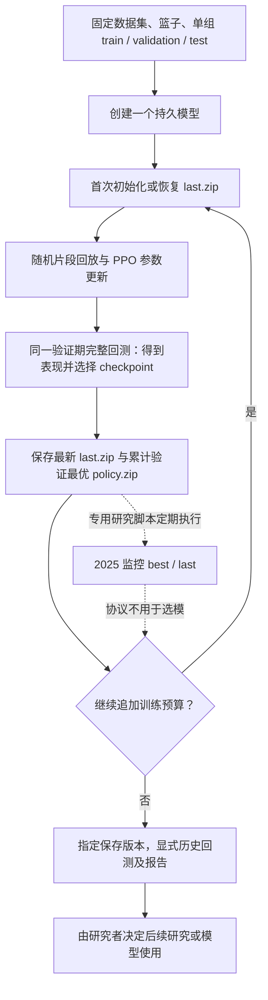
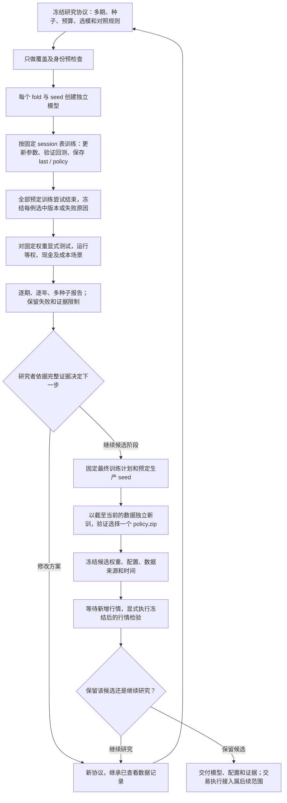

# 强化学习评估与最终模型生命周期设计（SDD）

## 1. 文档状态与目标

- 日期：2026-10-06（Asia/Shanghai）。
- 状态：设计稿，供审阅；不表示下述功能已实现或研究已通过。
- 代码基线：`ae0f4a74ddf995c97a34c1310e96a20233b387c4`，工作区 `D:/Projects/quanto`，分支 `training`。
- 用户要求：根据已有论文形成客观、简洁的方案，把讨论过的八项修改写成工程可执行的规格，明确与现有流程的差异，并解释最终交易模型如何产生。
- 本轮交付：本设计文档及本地 Git 提交；不改产品代码、不启动真实训练、不连接券商、不 push。
- 目标：把单模型反复续训的能力，组织成有固定规则、完整记录的跨期研究，并衔接最终候选模型的训练、冻结和后续新增行情检验。

### 1.1 成功标准

工程师能从本文确定：每一步的输入与输出、哪些数据用于更新参数或选择模型、何时允许考察测试成绩、失败如何记录、最终模型来自哪里，以及哪些结论证据不足。实施验收验证程序行为，不把回测盈利作为软件测试通过条件。

### 1.2 范围

包括八项需求 R1—R8；最终候选模型生成属于 R2，冻结与后续检验属于 R7，不另增模型算法项目。复用现有 PPO、特征、奖励、动作、风控、账户、作业与版本系统。

本版不建设行情分类、综合质量分、自动参数搜索、模型集成、跨折连续账户、研究管理新页面、实时纸面交易守护进程或券商实盘接口。网页仅做“测试日期可选”所必需的表单、类型与显示调整；不重构训练列表。

## 2. 术语与评价对象

| 术语 | 本文含义 |
| --- | --- |
| 训练集 | 用于 PPO 交互采样和参数更新的历史区间 |
| 验证集 | 已经产生真实历史行情上的模拟回测成绩；这些成绩用于选择 checkpoint，因此参与模型选择 |
| 测试集 | 在本次模型选择冻结后使用的区间；若据其结果改规则或挑模型，就转为后续研究的开发信息 |
| 前瞻新增行情检验 | 模型与决策规则冻结后，使用后来出现的行情检验；本版通过显式导入新快照并回测完成，不等同于实际成交 |
| episode | 一次随机历史片段回放，重置模拟账户；不是新增市场历史 |
| rollout / update | PPO 收集环境步数并更新参数的内部过程；环境步数不等于交易日数 |
| session | 一次有限预算的训练作业；同一模型可以通过成功版本的 `last.zip` 继续训练 |
| fold（评估期） | 一组按时间排序的训练、验证、测试区间 |
| case（实验例） | 一个 fold 与一个随机种子的组合，拥有独立模型及训练链 |
| `last.zip` | 最新训练状态，包含参数、优化器及累计步数，供续训使用 |
| `policy.zip` | 按验证规则选中的推断模型；可能来自更早的 session |
| 研究流程 / 最终候选模型 | 前者是一套固定的训练及选择方法；后者是按该方法独立训练后冻结的一组具体权重 |

验证和测试都会产生回测表现，区别在于成绩是否参与选择。若模型事先固定且不利用评估结果筛选或修改，这次所谓“验证”实际承担测试角色。任何历史回测都不能直接称为实盘收益。

## 3. 论文依据与工程决策边界

| 编号 | 一手来源及直接支持的结论 | 本项目采用方式与限制 |
| --- | --- | --- |
| E1 | [Cawley & Talbot, 2010, On Over-fitting in Model Selection and Subsequent Selection Bias in Performance Evaluation](https://www.jmlr.org/papers/v11/cawley10a.html)：优化有限样本上的选择标准也会过拟合，影响性能估计。 | 分离选择和评价，保留所有选择记录；论文不指定交易策略应选 Sharpe 还是收益。 |
| E2 | [Arnott, Harvey & Markowitz, A Backtesting Protocol in the Era of Machine Learning](https://people.duke.edu/~charvey/Research/Published_Papers/SSRN-id3275654.pdf)：记录尝试、考虑成本和数据限制，警惕反复利用样本外结果，追求简洁。链接为作者提供的论文稿。 | 冻结研究条件、完整报告失败与限制；不声称协议或哈希能证明研究者从未看过历史。 |
| E3 | [Cerqueira, Torgo & Mozetič, 2020, Evaluating time series forecasting models](https://kt.ijs.si/igor_mozetic/papers/CerTorMoz-TimeSer-MACH-20.pdf)：在其非平稳序列实验中，多个保持时间顺序的留出检验表现较好。 | 支持多期前向考察；研究主要是单变量预测，不是本项目金融 PPO 的直接有效性证明。 |
| E4 | [Agarwal et al., 2021, Deep Reinforcement Learning at the Edge of the Statistical Precipice](https://arxiv.org/abs/2108.13264)：少量 RL 运行的点估计存在不确定性，应考察运行差异及统计不确定性。 | 完整呈现多种子结果；三个种子的范围不是置信区间，也不能证明跨经济周期稳健。 |

以下属于工程选择：独立 case、JSON 协议、沿用种子 `17/42/83` 的初步检查、固定生产种子、等权与现金对照、成本倍率、报告字段与实现边界。论文没有证明这些具体取值最优。窗口与预算必须显式提供，不通过试遍参数后宣称某个值是“论文推荐”。

## 4. 现有系统事实与问题定位

### 4.1 通用训练及回测能力

1. 创建持久模型，冻结数据集、有序篮子、日期、特征/动作身份、PPO 参数、执行与验证规则；创建本身不开始训练。
2. 每个 session 追加步数；首次初始化 PPO，后续恢复最新成功版本的 `last.zip`。训练账户和片段采样环境重新开始，不保证与一次不中断长训练逐位一致。
3. 在完成 PPO 更新且达到验证门槛时，对同一个验证区间完整回测；session 结束时若还有未评估更新，再执行一次验证。
4. 指标严格更优才替换 `policy.zip`；最新状态写入 `last.zip`。验证最优可以跨 session 保留。
5. 注册模型训练不自动测试；独立 `/investing/train` 入口仍会自动计算测试成绩。
6. 回测必须指定保存版本，并晚于验证截止日；现有作业、数据和模型产物已有身份与完整性校验。
7. `PolicyTrainingSpec` 强制填写训练、验证、测试三段；创建模型和训练预检查还会访问测试期日历及可执行环境。当前无法仅凭截至验证结束的数据直接创建一个“等待未来行情”的最终模型。

依据：[contracts.py](D:/Projects/quanto/src/quanto/investing/contracts.py)、[training.py](D:/Projects/quanto/src/quanto/investing/training.py)、[models.py](D:/Projects/quanto/src/quanto/investing/models.py)、[jobs.py](D:/Projects/quanto/src/quanto/investing/jobs.py)、[evaluation.py](D:/Projects/quanto/src/quanto/investing/evaluation.py)。

### 4.2 已有固定篮子研究大循环

已有 8 ETF 协议固定训练 2022—2023 年、验证 2024 年、监控 2025 年、最终回测 2026-01-01 至 2026-09-30。初始协议是同一模型连续 50 个成功 session，每次追加 512 步；每十轮检查验证最优和最新权重在 2025 年的表现，末轮再检查 2026 年。监控和最终结果按该协议不参与 checkpoint 选择。

50 轮是具体研究协议的设定，通用训练器没有固定 50 轮限制；历史脚本另有专门的扩展运行约束，不能将其当作一般的多期研究能力。

现有协议已披露篮子采用 2026 年评级回溯选择、价格处理和续训限制，2025/2026 的成绩也已查看。新系统应延续这些披露，不能把重新切分日期视作恢复了全新盲测资格。

依据：[历史协议](D:/Projects/quanto/docs/research/2026-10-05-fixed-basket-training/protocol.json)、[历史结果](D:/Projects/quanto/docs/research/2026-10-05-fixed-basket-training/results.json)、[研究运行器](D:/Projects/quanto/scripts/run_fixed_basket_training.py)。

### 4.3 本次需要解决的缺口

现有系统已经具备训练、验证选模及冻结回测能力；缺口在于跨期研究编排、统一测试边界、完整汇总、最终模型无需未来数据即可训练，以及对研究证据的准确标记。当前代码并不能据此被判定为“模型已经过拟合”；本设计降低评价失真的风险，不承诺提高收益。

## 5. 八项需求规格

### R1. 冻结评估协议与预检查（依据 E1、E2）

**现有：** 单模型身份已冻结；专用研究脚本有协议，但没有统一覆盖多 fold、seed 和最终候选的研究契约。

**修改：** 新增独立研究协议。查看本次测试成绩前，固定数据快照、篮子、各 fold 日期、共享训练配置、种子、生产种子、每个 session 的预算及设备、验证频率、选模规则、基准和成本场景。修改这些条件产生新 `protocol_id`，通过 `parent_protocol_id` 记录研究演变，不覆盖旧内容。

第一版采用一个明确的窗口规则：固定训练起点、随评估时点扩展训练历史，验证段使用协议指定的固定交易日数。`window_rule` 记录训练起点和验证交易日数；显式列出的 fold 日期必须符合该规则，最终训练也按同一规则由当时的数据截止日确定日期。测试日期仍由协议显式给出，尾部不足完整测试期时预先标明。这个规则是控制实现规模的工程选择，不声称优于所有滚动窗口方法。

预检查仅检查数据覆盖、交易日、可用历史、身份和预算，不计算测试收益。训练期前的特征预热历史可以使用；不得读取决策时点之后的特征、收益或归一化信息。上市前行情不补造，沿用现有可交易性及历史长度掩码。

**验收 AC1：** 重叠或倒序区间、重复 seed、空测试区间、数据哈希错误、episode 长于训练段、无有效决策、session 预算不能被 `n_steps` 整除，均在创建模型前拒绝。输出 case 数、session 数、总步数与测试场景数；不提交作业。不同 fold 的测试段不重叠；较晚 fold 使用已过去的较早测试段训练是允许的，但日期规则须预先声明。

### R2. 多期多种子编排与最终候选生成（依据 E3、E4；最终产物为工程设计）

**现有：** 主要围绕一个 model_id 在固定历史中继续学习；动作对比工具可生成请求，但没有完整的跨期研究及候选产出流程。

**修改：** 一个 `fold_id × seed` 对应一个独立 model_id。各 case 从初始化开始，复用现有创建、训练及明确版本回测 API。同一 case 内允许按预定 session 表续训；跨 case 禁止继承权重、优化器或验证最优状态。

仅总步数相同还不够：现有 session 收尾会触发验证，必须固定相同会话划分、设备与验证频率，核验实际验证次数/步数位置。第一版不改成新的全局验证调度器。

执行入口分为 `prepare → train → freeze-selection → evaluate → report`。冻结记录只有在所有预定训练尝试已结束后产生；记录每例选中版本或不可选原因。第一版不自动重试失败训练；显式重试留下独立 attempt 记录并沿用同一 seed、配置及最后成功父版本，不能把已完成的正常低分结果当作故障重跑。失败、取消和跳过例都保留。

研究完成后，可显式创建一个独立的最终候选模型；不从历史测试赢家或某个研究 `last.zip` 接着训练。最终 seed 事先指定且属于研究 seed 列表，最终训练计划关联同一训练规则；具体流程见第 7 节。

**验收 AC2：** 跨例 model_id/父版本混用、预算或 session 划分不一致、未冻结就评估、选择记录与实际权重不一致均拒绝。恢复运行只接续可核验的原任务，不静默重复提交或覆盖成功结果。候选初始累计步数为零，不能指定研究模型为父版本。

### R3. 统一训练与测试边界，解除未来数据依赖（依据 E1、E2）

**现有：** 注册训练不自动测试，独立训练会自动测试；所有训练请求仍强制包含已有测试期。

**修改：** `train_policy` 统一只训练和验证，不提供训练结束自动测试分支；`metrics.test` 保持空值，测试成绩只属于显式回测产物。注册和独立入口行为一致。

`PolicyTrainingSpec.test_start/test_end` 改为成对可选的计划回测日期，缺省为空；填入时校验先后顺序，但训练预检查仅建立 train/validation 环境。训练所需覆盖截至 `validation_end`，不能要求测试期价格存在。测试期可执行性及数据覆盖在显式回测阶段检查。旧产物的已记录日期和成绩保留原义，不回写历史文件；允许读取旧产物是当前历史审计要求，不保留旧的自动测试行为。

研究 fold 的测试日期由研究协议强制提供；最终候选可以不填测试日期。创建表单将测试日期设为可选，配置覆盖终点按验证结束计算；详情显示“尚未指定测试期”，回测表单无计划日期时要求显式输入，不猜日期。

**验收 AC3：** 仅有 train/validation 数据的快照能创建并训练模型；所有训练入口不调用测试评估；改变或去掉未来测试价格，不改变训练权重、验证指标和选中步数（完整数据快照哈希及引用它的产物 ID 可以变化）；仅填一个测试日期时报错。显式测试缺数据时报错，不能伪造未来交易日来绕过验证。

### R4. 固定 checkpoint 选择与完整记录（依据 E1、E2）

**现有：** 已支持验证净对数收益或 Sharpe，严格更优才更新，保存历史；全程 Sharpe 无定义时仍留有快照，但 `selection_valid=false`。

**修改：** 复用选择算法，协议固定指标，不临时切换。记录实际验证位置、指标、候选次数、最佳来源及有效性；同分保留先前最佳版本。`policy.zip` 的存在不等于选择成功。

若某 case 的选模指标全无定义，标记 `unselectable`，保留其训练与验证证据；不执行其策略测试、不计为成功选模，必须出现在总 case 分母及缺失原因中。不得将 Sharpe 空值置零或自动改为收益选模。现金基准的 Sharpe 为空是正常数学结果，不导致基准失败。

**验收 AC4：** 相同分数、全空 Sharpe、后续变差、跨 session 保留旧最佳、latest 与 selected 不同等场景均有明确输出；禁止用 `last.zip` 或测试成绩替换选中权重。

### R5. 公平基准与固定成本场景（依据 E2）

**现有：** 账户评估已有现金、等权、买入持有及成本倍率；部分研究使用等权/买入持有，宽基指数另有自己的归一化口径。

**修改：** 新研究固定主对照为同篮子、同频率等权，辅助对照为现金；复用既有交易日、初始资金、资格掩码、下一开盘执行、结算和风险约束。等权的未成交或不可投部分按真实账户留下现金，不在报告中假设始终满仓。

协议必须包括基础成本 `1.0` 和至少一个预先声明的大于 `1.0` 的压力倍率，倍率作用于现有佣金率、最低佣金和滑点率。策略与对照采用同一场景，重新运行账户；不能只从最终收益中减一个数。该方法仅是成本假设敏感性检查，不代表已建模真实市场容量或冲击。

主相对收益定义为同期策略净收益减同期等权净收益，单位百分点，不称为风险调整 Alpha。宽基指数已有的首日收盘归一化及分红限制保留说明，不用它替代同执行口径的主对照。

**验收 AC5：** 日期、资金、成本、资格与风险配置一致；费用只从账户扣一次；压力场景不用于重新选 checkpoint；缺少规定场景时报告不完整。基准可复用已核验的相同场景结果，但必须保留对应关系。

### R6. 逐年与多种子报告（依据 E2、E4；指标定义沿用账户实现）

**现有：** 已有日净值、主要指标和年度收益计算；研究报告多为特定实验服务，没有通用 case 完整性与逐年对照视图。

**修改：** 每例导出可追溯的日期、净值、收益、回撤和选中模型来源；按 fold、seed、成本场景和年度列出净收益、等权收益、收益差与最大回撤。Sharpe、实际现金比例、换手、执行成本作为明细，不构建综合质量分。

同一 fold/场景内列出所有种子结果，以及有效样本数、中位数和范围；同时列出预定样本数和所有未完成/不可选原因。固定生产 seed 的结果单独可见，不能用三种子平均曲线冒充将部署的单模型表现。跨 fold 仅作逐段比较，不制造独立样本数量或统计显著性结论。

年度收益按日收益连乘；年初基数为前一观测交易日净值，首段起点为初始现金。年度回撤按该年起点重新计算，同时保留整个单 fold 回撤。标明实际起止日、交易日数、`partial_year`；末年未结束或覆盖不完整时不得标完整年度。

**验收 AC6：** `100 → 110（上年末）→ 99（本年末）` 的本年收益为 `-10%`，不是相对 100 的 `-1%`；不平均各年/各 fold 的回撤或 Sharpe 形成整体指标。日期重复、缺失、基准错位、结果身份不一致均不能进入有效汇总；可输出带错误说明的审计报告，不能伪装为完整研究。

### R7. 账户边界、证据状态与最终冻结（依据 E1、E2）

**现有：** 每次回测重置账户；旧研究已披露数据与选池限制，但没有统一的研究/最终候选冻结记录。

**修改：** 各 fold 独立账户、独立净值；期末持仓按现有收盘估值、不强制平仓。不给独立账户结果拼出“连续实盘净值”、跨期 CAGR 或跨期最大回撤。

每个结果分别记录数据用途和已知证据限制：参与选择、仅用于本次后续评价、此前是否查看、篮子依据的信息时点、价格及公司行动限制。无法核实是否查看过时标记 `unknown`，不自动标盲测；原来一次独立检验的记录仍有效保留，但后来据其修改的新方案不能继承相同独立性。

最终候选冻结记录至少包含协议/训练计划、模型和权重哈希、数据哈希、最后可用信息时点、冻结时间、特征/动作/执行版本、篮子顺序、生产 seed、选模来源。按 Asia/Shanghai 时区，新增行情检验从冻结后的下一个完整交易日或更晚的预定日期开始，首个决策仍遵守既定周/月频率，并仅使用当时可得信息。冻结前已经发生的当日行情不得算入。

`forward_plan` 与候选同时冻结：固定起点规则、累计评价节奏、基准、成本场景和结果查看后的版本处理规则。初版评价节奏固定为每个后续自然月结束后，显式重算同一起点至该月末的累计区间，首月不足整月时如实标明；不自动调度。额外临时选择的窗口单列为探索性分析，不能在看到涨跌后修改主检验窗口。

后续数据快照必须核验篮子、价格模式，以及与冻结快照重叠的历史价格/公司行动等输入是否被修订。冻结前历史前缀变化时，结果标为“修订数据回放”，不能混同冻结信息集下的证据。即使历史前缀一致，若后续区间数据缺少逐日时点可得性证据，也只标“冻结后行情回放”；不据此声称已验证实时执行。

本版前瞻能力是冻结以后显式导入新增行情并回测。重算累计区间时仍从同一个冻结后的起点和初始账户开始，只代表同一次延长的检验，不算多次独立成功；分段独立回测不能拼账户。实时信号留存、券商成交及自动上线均不在本版。

**验收 AC7：** 已看过的 2025/2026 研究不标全新盲测；2026 评级回选的篮子不标为当年时点选池证据；改变已冻结权重或在冻结前做前瞻决策均拒绝。同日收盘后冻结不能回填当天决策；历史前缀修订、临时选择评价窗口时按上述规则降级证据。冻结后续训产生新候选、新冻结记录和新的后续检验起点，旧候选不被覆盖。

### R8. 验证、迁移与研发交付（依据 E2；测试细节为工程要求）

**现有：** 已有训练、续训、冻结回测、动作矩阵和报告测试，可以复用；部分测试将独立训练自动测试视为现有行为。

**修改：** 先核对现有测试与 R1—R7 是否一致。更新自动测试和必填测试期相关断言，不为保留旧测试增加兼容分支。添加协议、编排、冻结、最终候选、报告及最小网页回归测试。历史实验和报告不删除、不改写。

**验收 AC8：** 需求与验收矩阵覆盖全部八点；用临时工作区、合成数据及少量真实 PPO 步数验证创建→训练→冻结→显式评价→报告→独立候选的连通性。生产数据只做只读预检查，不擅自提交训练。各阶段验证后独立本地提交，文档区分程序验收与投资表现判断。

## 6. 数据契约、状态与模块边界

### 6.1 最小产物契约

| 产物 | 必需信息与约束 |
| --- | --- |
| `protocol.json` | `schema_version`、`protocol_id`、可空 `parent_protocol_id`、创建时间、注册数据 ID/hash、有序篮子及来源时点、共享训练 spec、`window_rule`、显式 folds、seed 列表、生产 seed、每段预算/设备、基准、成本场景、已知数据曝光及限制；计算内容摘要 |
| `preflight.json` | 原协议摘要、实际数据覆盖和可交易历史检查、案例数、每例会话计划、总步数、可执行/拒绝原因；无绩效分数 |
| `attempts.jsonl` | `case_id/attempt_id`、model/job/version/父版本、提交和完成时间、预算及实际步数、执行代码/库/设备来源、成功/失败/取消/跳过及原因；保留所有尝试 |
| `selection.json` | 对每个预定 case 给出明确选中 version/content ID、权重哈希、best_timesteps、验证成绩与候选次数，或 `unselectable/failed/cancelled/skipped` 原因；引用协议摘要，冻结后不修改 |
| 评估产物 | case、baseline、cost、period、模型/数据/协议身份、`summary.json`、日净值/收益、年度表及文件摘要；训练 manifest 中没有测试成绩 |
| 研究报告 | 预定/已完成/有效/失败数量、逐例逐年数据、种子分布、所有限制；完整性状态与投资判断分开 |
| `candidate.json` | 最终训练计划与研究报告引用、固定生产 seed、独立新模型、选中版本/权重、最后信息时点和冻结时间、`forward_plan`；不是自动实盘许可 |

目录按协议、case、attempt、评估场景划分，成功产物不可覆盖。哈希用于核验身份，不替代金融数据质量审计。记录执行代码来源不能只记录准备请求时的 Git commit；无法确认实际 worker 版本时明确 `unknown`，不能宣称已达到完整可复现。

### 6.2 状态约束

研究阶段按 `prepared → training → selection_frozen → evaluated → reported` 推进。`selection_frozen` 可含不可选 case，后续报告必须保留其缺口；只有全部规定 case 和场景成功、且选模有效时才标 `complete`。完整性检查不生成“策略合格”结论。

训练任务沿用现有作业状态。网络返回不确定时先按收据核对已有 model/job；无法核对则记录 `unknown` 并暂停该 case，不能直接再提交。研究运行期间若有人通过其他入口给 case 模型追加了非计划 session，报告拒绝认定该 case 符合协议。

结果查看之后可以开展新研究，但需新协议并继承已知曝光记录；不能将换个 ID 当成重获未查看数据。

### 6.3 拟变更文件

以下为后续实施范围，不表示本轮创建了这些产品文件。

| 文件 | 责任 |
| --- | --- |
| `D:/Projects/quanto/src/quanto/investing/contracts.py` | 测试日期成对可选、训练/验证覆盖与计划测试日期分离 |
| `D:/Projects/quanto/src/quanto/investing/training.py`、`jobs.py`（同目录） | 移除自动测试路径，训练只预检查 train/validation，补齐选择记录中确实缺少的字段 |
| 拟新增 `D:/Projects/quanto/src/quanto/investing/research.py` | 研究协议校验、case/收据、选择冻结、已有 API 编排和最终候选计划；不新增数据库研究平台 |
| 拟新增 `D:/Projects/quanto/scripts/run_policy_research.py` | 薄命令入口，显式执行各研究阶段与候选生成；无后台自动调度 |
| `D:/Projects/quanto/src/quanto/investing/evaluation.py` | 补齐日收益/年度报告导出及研究引用需要的可核验产物；沿用账户与指标 |
| 拟新增 `D:/Projects/quanto/src/quanto/investing/research_report.py` | 完整性核验、同口径对照、年度和种子报告；JSON/CSV 与可阅读报告 |
| `D:/Projects/quanto/web/src/investingTypes.ts`、`components/ModelCreation.tsx`、`components/ModelBacktestForm.tsx`、`pages/ModelDetailPage.tsx`（均在 web/src） | 可选测试日期、正确覆盖终点、无默认测试日期的输入/显示；不改导航或训练列表 |
| `D:/Projects/quanto/tests/unit/test_investing_training.py`、`test_investing_continuation.py`（同目录），相关集成与网页测试；新增研究协议/报告测试 | R1—R8 行为验收 |
| `D:/Projects/quanto/docs/07_ETF自主投资训练指南.md` 与研究使用说明 | 区分验证表现、后续评价、最终候选和新增行情检验 |

复用 `backtest/metrics.py`、`reports/backtest_report.py` 的已定义指标；不为研究报告另造同名不同义指标。现有 `run_fixed_basket_training.py` 与 `compare_policy_actions.py` 保留各自专用用途和历史语义，只借用可适用的 API/校验能力；不顺手改写历史研究工具。

## 7. 最终可交付模型如何产生

1. **历史研究提供证据。** 按同一协议完成多个 fold/seed；程序报告完整性与表现，不自动挑历史测试冠军。投资判断须同时考虑风险、成本、样本长度和已知偏差；没有论文给本项目一个普适的上线分数线，本版不实现自动准入打分。
2. **固定最终训练计划。** 计划引用研究协议及报告，采用预先指定的生产 seed。特征、动作、PPO 参数、选模规则、预算、会话划分和执行假设一致；数据快照与具体日期允许随着时间更新，窗口构造规则必须已声明。不能看过结果后通过移动验证窗口优化成绩；改变训练规则需要新研究版本。
3. **独立新训。** 创建新的 model_id，使用当时可获得的历史训练段更新权重，使用验证段选择 checkpoint。这里验证已经产生回测表现。旧测试期此时可以进入新的训练/验证数据，但它不再是该新模型的独立测试。
4. **冻结候选。** 使用选中的 `policy.zip`，保存配套 spec、身份、权重摘要和冻结记录。历史试验模型不合并、不投票；其他 seed 用于研究稳定性，不用于事后挑选生产 seed。选模无效或研究记录不完整时不产生本协议名下的可交付候选。
5. **新增行情检验。** 候选可以在尚无未来测试数据时完成训练并冻结，状态为等待后续行情；以后显式对冻结后出现的行情执行回测。新快照、实际期间、成本和结果全部记录。若研究者据此调模型，新模型从新冻结点开始积累后续证据。
6. **交付边界。** 交付一个明确的推断模型、特征/篮子顺序/频率/风控/执行配置及研究报告。后续交易系统可据此集成，但本次不实现券商下单或自动上线。模拟结果与实际成交分开陈述。

这套流程检验“按一套规则能否在多个时期训练出有用模型”，并产出“现在的一组具体权重”。历史多期成绩不等于新权重已经实盘获利；三个随机种子的差异也不能替代新的市场历史。

## 8. 验收矩阵与交付顺序

| 需求 | 必须覆盖的测试输入 | 预期行为 |
| --- | --- | --- |
| R1 / AC1 | 重叠日期、重复 seed、过长 episode、缺行情、哈希不符、非整 rollout 预算 | 创建作业前拒绝，不产生半套任务 |
| R2 / AC2 | 相同总预算但不同 session 切法、跨 case 续训、重复请求、提交结果未知 | 拒绝不等价实验；保留原收据；不重复创建任务 |
| R3 / AC3 | 无测试日期、只给一端、快照仅到验证结束、未来价格变动 | 正常训练或明确字段错误；没有测试调用；已选权重不受未来价格影响 |
| R4 / AC4 | 同分、全空 Sharpe、续训成绩变差、latest 与 selected 不同 | 固定选模规则；空值不改零；无效例不混入成功样本 |
| R5 / AC5 | 不同成本倍率、受限交易、首日基准口径不一致 | 相同账户执行口径、成本不重复扣、缺场景标不完整 |
| R6 / AC6 | 跨年首日、未完年份、缺/重复交易日、缺 seed、回撤跨年 | 年度基数正确，保持缺口，不制造整体回撤/置信区间 |
| R7 / AC7 | 已查看测试、晚于历史的选池信息、冻结后改权重、同日回填、历史前缀修订、临时选窗、独立账户结果 | 正确披露/拒绝伪前瞻；不拼接跨期净值 |
| R8 / AC8 | 临时工作区完整小流程、旧产物读取、网页无测试期 | 后端和前端行为一致，旧结果可审计，无生产作业提交 |

推荐实施顺序：R3 的训练/测试分离及最小网页改动 → R1/R2/R4 的协议、编排和冻结 → R5/R6 的对照与报告 → R2/R7 的最终候选与新增行情检验 → R8 集成验收和文档。每阶段检查差异、运行相关测试、本地提交；只暂存本阶段内容。

文档完成不等于实现完成。代码实施前应将本规格转为任务级实现计划；本轮的验收是八项覆盖、现状引用、流程一致性和文档差异检查。

## 9. 最终对照：现有与改造后的完整训练大循环

### 9.1 现有大循环

主循环是同一个模型在固定训练数据中反复学习、反复在同一个验证期选择。具体旧研究在预定轮次监控 2025、末轮考察 2026；通用注册模型不会自动测试。独立训练入口的自动测试是另一条现有路径，R3 会统一移除。

### 9.2 改造后的完整大循环

每个 N4 内部仍有现有的 episode、PPO 更新、验证选模与同 case 续训小循环。新增的是外层研究控制和最终候选生命周期，不是把多个历史模型合成为一个模型，也不是让测试成绩反向指导同一轮训练。

### 9.3 用户能观察到的差异

| 维度 | 当前 | 全部修改完成后 |
| --- | --- | --- |
| 研究基本单位 | 一个固定日期配置的模型及追加训练记录 | 一个固定协议下的多个独立模型与最终候选 |
| 验证含义 | 已有回测表现，用于保存验证最优版本 | 含义不变，选择次数和使用边界记录更完整 |
| 时间覆盖 | 具体研究主要依赖一个验证期 | 多个预先声明的前向区间，分别报告 |
| 随机性 | 单模型自身的 seed；其他研究另行组织 | 固定多 seed 列表完整呈现，生产 seed 事先确定 |
| 训练预算 | 可继续追加；session 切法由操作决定 | 协议内预算、session 划分及设备固定，额外训练另立研究记录 |
| 测试调用 | 注册模型显式执行，独立训练自动执行 | 所有入口统一显式执行，先冻结模型选择 |
| 未来数据 | 创建/训练要求预设测试段可检查 | 最终候选只需已有训练/验证数据，未来行情以后再检验 |
| 报告 | 模型/会话与特定历史研究报告 | case、年度、种子、基准、成本和失败完整清单 |
| 跨期账户 | 每次回测独立重置 | 保持独立，明确禁止伪拼连续净值 |
| 最终模型 | 可取某版本回测，缺少统一候选生成协议 | 同规则、固定生产 seed 独立新训，验证选中后冻结一份权重 |
| 研究反馈 | 研究者决定续训或调整 | 调整产生新协议，继承已知数据曝光，旧结果不被覆盖 |
| 实盘能力 | 未接入券商 | 仍不接入券商；新增的是更清晰的模型交付与证据流程 |

最终的结构变化是：从“围绕一个模型继续训练和检查”，扩展为“先用多个历史时间点考察固定训练方法，再按该方法产出当前候选，并持续积累冻结之后的证据”。如果真实历史不足或结果不稳定，报告应如实保留这个结论，流程不会自动制造一个合格模型。
