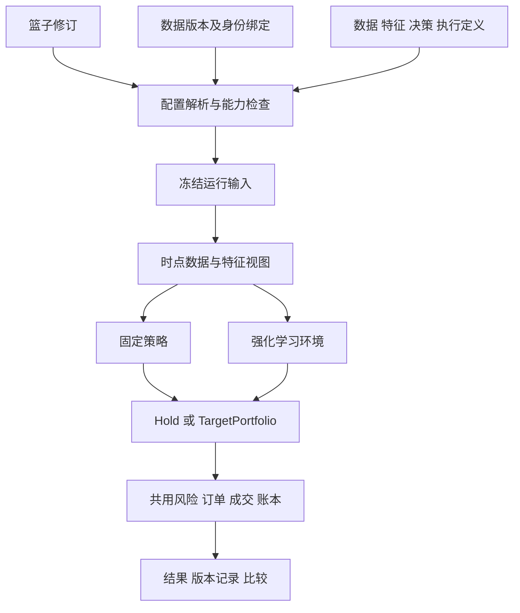

# ETF 与个股共用量化框架设计

日期：2026-10-08。状态：框架设计工程审核完成，用户已要求继续开发计划规划；尚未进入代码实施。审核过程见[框架设计审核记录](../../research/2026-10-08-multi-asset-framework-review.md)，任务拆分见[开发计划](../plans/2026-10-08-multi-asset-framework.md)。

本设计把 quanto 组织为一套研究工作台：用户选定标的篮子，固定策略和强化学习分别形成持仓意图，共用数据可知性、账户风控、成交账本及回测结果。标的类型与决策方法是两个独立维度。框架提供接入契约；个股的经营分析、数据供应商选择、指标公式、交易策略和学习方案由后续独立研究确定。

核查代码基线：`1145dc33574bffab420fa9ba9a338648754a0be6`，当前分支 `stock`。本轮交付设计和审核记录，不修改运行代码、数据库或研究产物。用户已有 `docs/planning-artifacts/prd.md` 不属于本轮交付。

## 1 用户目标和范围

用户自行选择少数公司，量化负责这些标的的买卖与仓位辅助。现有 ETF 研究继续使用；固定策略与强化学习保留独立的配置和生命周期，使用一致的账户语义。

框架建设范围：

- 有类型的证券身份、有版本的手选篮子、数据版本与证券身份的可靠关联。
- 数据需求、时点读取、特征和决策定义的接入契约。
- 按具体配置检查可运行能力；区分研究假设、事实证据及功能尚未实现。
- 固定策略和强化学习共用持仓意图、风控、账户、任务和结果。
- 四域导航下的篮子、配置、训练版本、回测及比较流程。
- 现有 ETF 数据、模型、报告的保留和有证据的重用。

以下内容留给后续独立研究：个股数据源接入、财务字段清单和指标公式、行业特征、固定策略规则、个股观察/动作/奖励方案、个股交易规则的实际数据及参数。框架不自带一个未经研究的“通用个股策略”。

本阶段也不建设全市场自动选股、策略投票、多策略资金分配、券商下单、日常实盘持仓同步、自动调参、通用插件市场或吸收新增行情的在线学习系统。日常辅助可以以后复用决策输出，但不增加本轮验收范围。

市场范围保持 A 股日线、人民币现金账户、多头与现金，不引入杠杆、做空或跨市场结算。篮子首版限定全部 ETF 或全部个股；资产身份支持表达混合成员，但混合篮子的运行明确返回尚未支持，避免在本轮引入组合协同设计。

## 2 当前实现与架构选择

### 2.1 已有基础和真实缺口

| 当前实现 | 依据 | 框架处理 |
|---|---|---|
| `InstrumentId` 已包含交易所、类型和代码，类型含 `stock` | `src/quanto/data/contracts.py` | 沿用，禁止凭代码前缀判定资产类型 |
| 行情请求和数据集组装仍限定 ETF，组装时丢失规范身份并改用裸代码 | `src/quanto/backtest/market_dataset.py` | 改为声明式标的请求，增加不可变身份绑定 |
| 日线数据已有行情、日历、证券、状态、公司行动及辅助表 | `src/quanto/backtest/dataset_schemas.py` | 复用存储和冻结能力，扩展表语义契约 |
| 辅助表校验 `available_at`，但策略上下文尚无统一的辅助数据可知视图 | `src/quanto/backtest/dataset_loaders.py`、`src/quanto/strategies/base.py` | 增加受截止时间约束的数据访问与特征接口 |
| 固定策略和 `DailyETFEnv` 共用 `SessionRunner` | `src/quanto/backtest/engine.py`、`src/quanto/investing/environment.py` | 保留单一账户与执行路径 |
| PPO 已有显式现金动作、净对数收益/DSR、会话续训及最佳版本 | `src/quanto/investing/contracts.py`、`training.py`、`models.py` | 注册为已有 ETF 学习定义，保持其实际语义 |
| 模型续训要求原配置、篮子、数据内容及环境身份相同 | `src/quanto/investing/training.py` | 保留该约束，不把追加步数解释为新增数据学习 |
| 页面已有数据、固定策略、强化学习模型、回测四域 | `web/src/App.tsx` | 维持四域，类型和篮子成为共享配置与筛选条件 |

### 2.2 选择共用内核加显式定义

采用一套账户、执行、任务及结果系统，在接入边界按数据需求、特征定义、决策定义和执行定义表达差异。

按 ETF/个股复制两套系统会分裂账本和比较口径；只增加一个类型开关会让 ETF 假设隐式流入个股。这里选择少量明确的定义对象，由本地可信代码实现并随版本冻结。注册表为代码中的显式映射，不动态安装模块，不扫描任意插件目录。

## 3 对象与版本细则

### 3.1 证券身份

公共身份唯一使用现有 `InstrumentId.key = exchange:instrument_type:code`。名称、简称、供应商代码和六位展示代码都不是身份。指数只能作为本阶段的参考数据角色，不能成为可交易篮子成员。

篮子和公共 API 传规范身份；数据供应商负责将它转换为其请求代码。新注册数据的交易表 `symbol` 使用规范身份。旧数据保留原 `symbol`，通过下节的冻结绑定解释，不能重写其文件以迎合新身份。

### 3.2 AssetBinding 数据集身份绑定

为每个可提交新任务的数据版本登记一个不可变绑定对象，包含：

| 字段 | 约束 |
|---|---|
| `schema_version` | 本契约首版为 1 |
| `dataset_version_id`、`dataset_content_hash` | 指向原数据对象，不能以绑定摘要替换原内容哈希 |
| `assets` | 每项为 `instrument_id`、`local_symbol`、身份来源证据；交易资产双向唯一 |
| `benchmark` | 独立角色，包含规范身份或显式命名的自定义序列身份、收益口径及证据；不加入交易资产的代码反查域 |
| `table_semantics` | 各表的语义 ID/版本、字段与时间规则、证据引用和声明摘要；随绑定冻结，旧数据通过附录登记，不修改原 manifest |
| `binding_hash` | 对版本、原数据引用、映射及证据计算稳定摘要 |

绑定覆盖数据集中所有交易资产。行情、证券、状态、公司行动和按标的组织的辅助表不得出现未绑定的局部代码。一个规范资产不能在同一数据集映射到两个局部代码；两个规范资产也不能共用一个局部代码。

对新数据，映射通常为恒等映射。对旧数据，只能从原市场快照中的 `InstrumentId` 或可审计的导入身份资料建立映射；六位代码和文件标题不足以证明身份。映射错误须登记新的数据版本及绑定，不能编辑原绑定。

公共配置在提交边界一次性解析为该数据集的局部代码。运行中的价格、特征、账户、目标权重、风险情景、订单、成交和事件全部使用同一局部命名域，不允许混用规范键。跨运行比较和导出必须使用规范身份连接；新结果保存绑定完整内容及摘要，不能只有一个可能丢失的本地数据库外键。

### 3.3 篮子与篮子修订

`Basket` 只有稳定 ID、展示名称和当前修订指针。`BasketRevision` 保存不可变的有序 `InstrumentId` 列表、创建时间、人工选择说明及内容摘要。成员非空、无重复、类型明确；篮子不绑定某个数据版本，也不隐含买入权重。

增删成员、重排成员均创建新修订。顺序是强化学习观察和动作身份的一部分；任何解析过程都不能自行排序。修改展示名称不改变修订内容。首版不提供物理删除；被引用的修订永久保留。

修订创建时间如实记录，回溯导入旧选择必须附来源，不能把今天手选的公司记录为过去已经选定。篮子成员不会因为当日不可买、停牌或资料不足而被替换。

### 3.4 其余对象的职责

| 对象 | 绑定内容及可变性 |
|---|---|
| 数据版本 | 已冻结的行情和参考表；允许覆盖篮子的超集，不以当前篮子反向裁掉原证据 |
| 定义版本 | 数据/特征/决策/执行契约、实现来源和摘要；已发布版本不可原位改义 |
| 固定策略修订 | 沿用源码、参数 schema 和修订哈希；新增支持资产与需求声明 |
| 固定策略实验 | 可编辑草稿，CAS 修订；绑定篮子修订、数据版本、定义和参数；提交时冻结 |
| 强化学习模型 | 固定的研究身份；绑定篮子、数据、学习定义及完整训练条件 |
| 训练会话 | 一次追加训练预算，引用父保存版本；失败/取消不发布成功版本 |
| 保存版本 | 沿用成功任务对应的版本 ID、产物内容 ID、`last.zip` 与 `policy.zip` 来源 |
| 回测 | 固定策略的已冻结实验或明确模型保存版本，加显式回测输入；结果不可覆盖 |

不增加一个同时拥有以上所有对象的“万能研究项目”实体。篮子、数据和定义分别复用，实际关联在实验、模型及冻结运行中表达。

### 3.5 引用与解析后的配置

请求中的 `BasketRevisionRef` 固定为 `{basket_id: string, revision: positive_integer}`；服务端解析后加入 `content_hash` 和完整有序成员。不得传 `latest` 代替修订。`DefinitionRef` 固定为 `{kind: string, id: string, version: string}`，其中 kind 为 feature、learning、trading 之一；冻结后附实现摘要。固定策略直接引用已有 `strategy_revision_id`。

`ResolvedConfiguration` 是服务端生成的运行输入，不是新的可编辑实体。它包含原始请求、篮子完整修订、原数据 ID/hash、完整绑定、有序 `(instrument_id, local_symbol)` 对、各定义及有效参数、规范化数据需求、内部 BacktestSpec/学习配置、能力报告。所有引用必须先解析再计算请求摘要；数组保持顺序，映射按键排序，禁止 NaN/Infinity，使用现有确定性 JSON 编码。`request_hash` 只计算规范输入，排除能力报告、摘要字段本身和检查生成时间；能力报告随后引用该摘要，完整冻结文件再计算独立文件哈希，避免摘要自引用。

解析必须逐成员确认数据集绑定存在；缺任何成员均返回 `DATA_REQUIREMENT_UNSATISFIED`，不能取交集继续运行。篮子之外的数据资产保留在数据版本中，但不进入目标权重空间。基准角色单独解析，不消耗篮子名额。

## 4 接入契约

### 4.1 定义的公共字段

每个内置定义声明 `id`、`version`、`implementation_hash`、`supported_instrument_types`、`parameter_schema`。解析后的有效参数与源码依赖一同冻结。未知字段、未知版本、不支持的资产类型均拒绝，不能接受后忽略。

首版定义以本地可信代码注册；网页可以编辑现有固定策略源码和参数，但不增加在线编辑数据读取器、成交代码、RL 环境源码的入口。沿用现有可信代码研究边界，不宣称进程隔离可防御恶意策略。

定义必须进一步提供以下可校验内容，不能只有名称和空的参数字典：

| 定义 | 必需内容 |
|---|---|
| 固定策略修订 | `supported_instrument_types`、严格参数 schema、`resolve_requirements(effective_params)`、固定的共享 `feature_set_ref` 或显式无共享特征、可接受的 trading 定义版本集合 |
| FeatureSetDefinition | 严格参数 schema、`resolve_requirements`、输出 schema、缺失/变换规则、计算实现；参数只能来自宿主定义明确声明的字段映射 |
| LearningDefinition | 严格输入 schema、固定特征引用及参数映射、需求解析、观察/动作空间与编码/解码实现、奖励/环境/算法实现、允许的 trading 定义版本集合 |
| TradingDefinition | 严格执行参数 schema、所需状态/事件/规则表、支持的价格模式及资产类型、费用/资格/事件调用点及实现版本 |

`resolve_requirements` 只依赖定义版本、有效参数、篮子与请求区间，不读取未来值来改变所需字段或选股。返回规范化 `RequirementItem[]`：每项具有稳定 `requirement_id`、表/语义版本、字段契约、范围角色、覆盖/预热、可知性、价格模式、`required`、`missing_policy` 和接受的限制。`missing_policy` 仅为 reject 或由输出 schema 定义的 mask；是否允许沿用旧值、最大数据年龄另由特征定义明确声明。

需求重复且等价时按 ID 合并；同 ID 不同语义、单位、窗口或处理规则直接报错。宿主定义决定特征参数的唯一来源，用户不能在两个表单里分别修改同一个 lookback。已有固定策略 manifest 与上述声明一同冻结，不新增一份可与源码声明冲突的模板数据库。

### 4.2 定义实现的冻结与执行

沿用现有固定策略源码快照和学习作业源码快照。学习作业已有 `LearningService._submit` 复制 `src/quanto` 并记录 source_hashes，worker 从冻结 `root/src` 导入；本设计要求数据读取、特征、学习及执行定义的实现都位于这份受校验源码闭包内，必要非代码资源也显式加入文件清单。第三方依赖版本继续用运行环境清单校验。

提交后工作树中的定义升级不会改变已冻结实现。worker 必须先核对源码/资源摘要和运行依赖，再从快照解析定义；不得查当前工作树的最新版替换旧实现。冻结源码缺失、资源损坏或依赖无法满足时，任务在执行前明确失败并记录原因，不能承诺任意软件升级后旧任务仍能运行。本轮不新增通用环境打包平台。

### 4.3 DataRequirements

需求由实际策略/学习定义和有效参数计算得到，不能仅写“需要基本面”。每项必须说明：表名与语义版本、字段及类型、单位/币种/报告口径、范围角色（篮子成员或参考资产）、时间覆盖与预热需求、可知性要求、允许的价格口径、缺失规则及可接受的数据限制。

必需项缺失阻止任务提交。可选项只有在特征/策略明确规定缺失处理时才允许为空。数据存在、字段齐全、值可用、历史可知性是不同检查项。股票关键状态未知时不能默认正常交易。

需求解析不自动联网、不扩大篮子、不自动挑选替代供应商。数据获取仍是独立作业，完成后再针对配置检查。需求报告可以指导补齐数据，但不能静默改变研究输入。

### 4.4 时点数据视图

数据视图提供只读 `bars(...)` 和 `table(...)` 查询，必须由引擎传入 `signal_cutoff`；策略和 RL 不能自行放大截止时间。表契约显式声明以下时间含义：

- `period_end` 或业务事件时间：事实描述的期间，不表示何时知道。
- `available_at`：该版本信息可供历史决策使用的最早时间，必须有时区。
- `effective_from/effective_to`：证券规则、分类等事实的生效区间，采用左闭右开。
- `revision_id`：同一事实的修订身份；后续修订追加，不能覆盖旧版本。
- `downloaded_at`：本次获取与审计时间，不能替代历史公告/可得时间。

查询先取 `available_at <= signal_cutoff` 的记录，再按表的业务键和修订关系解析当前可知版本。生效时间与可知时间分别判断；冲突修订没有可证明先后关系时拒绝读取，不以行顺序猜测。完整的业务键与修订规则属于表语义版本，不能凭一个 `available_at` 列认定已支持时点数据。

数据绑定冻结所采用的表语义声明及证据，读取器按该版本解析；未知版本阻止运行，不能用当前最新版规则重新解释旧快照。执行该规则的源码实现随作业快照冻结。旧 ETF 的会话可见性声明仍须注明研究假设，不将本次关联声明伪作历史供应商交付证据。

日线首版沿用当前收盘决策边界：交易日上海时间 15:00，转换 UTC 后比较；当日收盘后公告留到后续决策时点使用。公告、辅助事实或规则披露记录只有披露日期没有时刻时，若定义允许，统一在下一交易日 15:00 起可见并记录保守时间规则；不能默认为报告期末或当天零点。缺少可得日期且需求要求历史可知时，阻止运行。

上述披露日期保守规则不适用于 OHLCV 日线 bars。行情具有单独版本化的会话可见性语义：已有 ETF 日线定义使用“当日收盘完成后可读取当日完整日线”的模拟边界，bars 的 date 通过交易日历映射到 session_end，当日收盘观察沿用原值；这是现有研究模型的可见性假设，不伪称供应商在 15:00 已交付数据。新的行情定义若要求真实交付时间，应使用相应证据并独立声明限制。下一交易日 open 仅在该日执行阶段读取，不能出现在前一日的观察中。

前向沿用已公开的值必须由特征定义许可，同时输出数据年龄与缺失标记；禁止未来回填。是否过期及有效期限由具体定义明确给出，不在框架中设置通用财务阈值。

真实发生的分红、结算和停止交易属于账务/执行事实，引擎按事件生效处理；策略看到的相关公告仍受信息截止时间限制。引擎可以验证整段输入覆盖，但不能把下一日行情、最终退市结果等转化为当前决策观察。

### 4.5 FeatureSetDefinition 与 FeatureFrame

特征定义声明所需数据、固定输出字段顺序、每个字段的语义/单位、作用域（每标的或全局）、窗口、缺失处理、变换版本及参数。输出 `FeatureFrame` 包含截止时间、有序局部标的、命名值、有效标记、来源记录时间和定义摘要。

固定策略按字段名读取；RL 观察编码器按冻结顺序编码。持仓、现金、未成交订单和风险状态由账户提供，不存入公共市场特征缓存。特征计算不得自行维护另一本账户。

`FeatureFrame` 的结构固定为 `asof`、`signal_cutoff`、`ordered_symbols`、`per_symbol[local_symbol][field_name]`、`global[field_name]` 及定义/变换摘要。每个值格包含 `value`（有限数值或 null）、`is_valid`、`source_available_at`、`age`、`missing_reason`；age 的单位在字段 schema 中固定。每个篮子成员都有一行，每个声明字段都有一格，缺失不能改变字段数和顺序。组合特征的来源时间取实际所用记录中最晚的可得时间，并保留来源引用用于审计。

缺数据只改变该值的有效性，不代表不可买、不可卖或不在篮子；这些状态来自独立账户/证券视图。RL 编码器必须明确如何编码 null、mask 与年龄；传给算法的数组必须有限且形状固定。已有 ETF 编码器继续产生原数组，新增通用元数据不能静默追加到旧模型观察中。

缩放使用固定公式，或只在训练区间拟合并冻结的变换产物；验证、回测只能 transform。缓存键必须包含数据内容哈希、绑定摘要、特征定义/参数摘要、变换产物摘要和截止时间；不能只按股票代码和日期缓存。

需要拟合的学习方案在创建模型时固定配方、实现、数据和拟合区间，不要求尚未产生的拟合产物。首个训练会话在训练区间拟合，产物与首次成功版本原子发布；失败或取消只留下诊断，不登记可用变换。后续会话从父成功版本读取同一变换，禁止重新拟合；验证和回测也引用该产物。固定公式的变换摘要直接由公式版本和参数确定。固定策略若需预拟合变换，必须显式引用已登记产物及拟合来源，不能在回测区间现场拟合。

首版对已有 ETF 计算只做必要的接口接线和等价验证，不借机改指标公式或重新挑选参数。固定策略允许声明空共享特征集并继续用自己的历史量价计算；未来需要共用的个股特征必须注册同一定义供两路使用，避免公式复制。

### 4.6 FixedStrategyDefinition 与 LearningDefinition

固定策略沿用 `should_evaluate(ctx)`、`on_close(ctx)` 和参数 schema，新增需求及共享特征引用。扩展上下文以提供绑定后的证券属性、只读时点数据和特征；原来的账户、风险和历史窗口语义保持明确。

学习定义将已有环境接入方式表达为：数据/特征需求、观察编码器、动作解码器、奖励版本、决策日程、环境工厂及参数 schema。算法首版仍为现有 SB3 PPO。各版本由可信代码显式组合，表单不能任意拼出未登记的观察/动作/奖励组合。

已有 ETF 学习方案注册为实际可用定义；现有 feature/action/environment/reward 身份以及 DSR 必需的状态输入原样保留。个股学习方案尚未实现时，界面展示缺口，不登记空实现、不把 ETF 方案改名成个股方案。框架不预设个股动作档位、奖励系数或网络结构。

### 4.7 TradingDefinition 与执行事实

交易定义声明支持的资产/价格模式、费用模型、手数和结算语义、订单有效期、状态与公司行动要求、估值限制及执行实现版本。参数中涉及证券规则的值须有适用对象和生效区间；具体个股费率、税种和规则实现留待独立接入。

费用计算、成交资格和事件处理是账户引擎的受控调用点，返回可核对的费用明细、可成交状态/原因及账务事件。策略和学习环境不能自行生成成交或写入现金余额。未知事件类型、未知状态或未支持的退出/清算事件，必须报告具体缺失能力并阻止宣称完成该区间回测。

首版注册现有 ETF 执行语义；用内部合成契约夹具验证按资产解析规则的接口，不把夹具注册为网页可用的个股交易定义。

## 5 按配置检查能力

`CapabilityReport` 是对一次具体请求的结果，不是证券或数据版本上的永久 `ready` 布尔值。请求包括操作类型、篮子修订、数据版本/绑定、定义与参数、研究区间、价格模式和账户条件。

报告包含 `request_hash`、各输入摘要、`operation`、`status`（`ready` 或 `blocked`）、逐项检查、错误代码与字段路径、已声明假设、限制和检查器版本。界面可显示“可运行，含研究假设”，但不能把该标签改成可实盘。

引用尚不能解析时，blocked 报告的 request_hash 为 null 并列明缺失引用；引用已解析但能力不足时仍有规范输入摘要。ready 报告必须有非空摘要。任何预检查报告都不能替代提交时的重新解析；fetch 仅对获取请求计算摘要，不伪造已有数据版本。

至少分别检查 `fetch`、`fixed_backtest`、`train`、`resume`、`policy_backtest`。`fetch` 检查提供者能力，不要求数据事先存在；其余操作只读已登记版本。相同数据可以满足价格策略但不满足需要财报的方案。

| 检查维度 | 阻止情形 |
|---|---|
| 身份 | 绑定不全、摘要错误、规范身份冲突或篮子顺序不匹配 |
| 实现 | 来源、数据读取、特征、策略/学习或执行定义未实现 |
| 数据 | 必需字段/时间/预热覆盖不足、单位或报告口径不兼容 |
| 可知性 | 必需的历史可得时间无法证明、修订歧义、规则生效区间重叠 |
| 账户 | 当前价格模式缺失事件/状态/费用能力，终止资产没有估值和处置定义 |
| 学习 | 观察/动作结构、变换产物、奖励状态或 checkpoint 身份不匹配 |

标准错误码：`IDENTITY_UNRESOLVED`、`BINDING_MISMATCH`、`MIXED_BASKET_UNSUPPORTED`、`DEFINITION_UNAVAILABLE`、`DATA_REQUIREMENT_UNSATISFIED`、`TEMPORAL_EVIDENCE_MISSING`、`EXECUTION_CAPABILITY_MISSING`、`MODEL_IDENTITY_MISMATCH`。一般字段格式错误沿用参数校验错误，不为每个指标新造错误类别。

保存格式有效但尚未具备数据的固定策略草稿是允许的，详情显示阻塞项。正式创建 RL 模型仍要求已解析定义、数据与训练条件通过检查，避免产生没有可执行身份的模型；缺能力的股票篮子可以先保存，尚不能创建其模型。

前端预检查仅用于解释。提交事务必须重新解析引用并校验哈希，冻结同一输入和能力报告；worker 启动再验证冻结对象。排队后篮子的新修订、定义升级或数据获取结果不会改变旧任务的输入及实现，运行依赖不满足则按 4.2 节明确失败。批量提交各项单独检查，遵循现有幂等与批量结果语义。

## 6 共用决策和账户语义

### 6.1 两条路径的输出

两路输出限定为现有 `Hold` 或 `TargetPortfolio`：

- `Hold` 表示策略不主动调整实际份额，不因价格变化自动再平衡；账户风控仍可减仓或清仓，结算和公司行动也照常处理。
- `TargetPortfolio` 是完整目标权重；未列出的已有资产目标为零，空目标代表请求现金。
- 权重有限、非负、合计不超过 1，剩余为现金；目标资产必须属于冻结篮子。
- 理由与诊断用于记录，不能修改执行事实或绕过风险约束。

训练时探索动作和回测时确定性动作使用同一账户过程。固定策略和 RL 对同一账户状态提交同一合法意图，应得到同一风险裁定、订单与净值。

### 6.2 三种节奏

数据按其实际披露/更新节奏变化；日线账户逐交易日推进；常规决策按定义中的周/月等日程触发。已有 ETF 周/月末判断保持完整交易日历语义，不把区间最后一天伪装成决策周期末。首版不增加公告事件触发的 RL 时间步。

每日风险检查独立于常规决策。在没有策略动作的日子仍检查账户限制和交易状态。收盘信号最早在后续交易时点执行，沿用 next-open 模拟及明确的成交假设。

### 6.3 风险与持仓生命周期

总仓位、单标的、行业/分组、压力和回撤约束由账户层执行。请求仓位、批准仓位、实际订单和成交都保留。多条独立实验各有独立账户，不把它们的收益或风险预算自动相加为同一账户。

不可新增与不能卖出分开表达；不能买入不等于清空持仓。持仓不会因失去资格、停牌、篮子页面变更或退市而消失。估值必须有证据和时效边界，不能无限延用最后价格、任意填零或自动换成现金。

执行定义未支持区间内发生的终止上市、清算或特殊权益事件时，预检查给出阻塞；运行时新发现的数据问题使任务明确失败，保留截至何日的诊断，不发布完整成功结果。

### 6.4 两种价格口径

`adjusted_research` 和 `raw_cash` 继续分别表达。研究复权价格不重复入账分红/拆分现金流；原始价格现金模型必须有相应事件与规则证据。两种模式都只是模拟，日线开盘价格不证明实际排队成交能力。

新框架把研究模式中的“全可交易、默认手数和结算”等现有假设纳入 ETF 定义并写入报告，不自动套给个股。真实状态缺失不能在要求事实输入的方案中默认为可买可卖。不同口径的结果可以并列查看，但须标识差异。

## 7 强化学习身份与结果解释

新模型创建时固定：有序规范篮子和对应有序局部代码、篮子修订、原数据哈希与绑定哈希、特征/观察/动作/奖励/环境/执行实现身份、有效参数、变换配方及拟合区间、价格/风险/成本条件、日期划分、验证选模规则、算法及网络配置。需要拟合的变换在首次成功会话后成为保存版本观察身份的一部分，生命周期按 4.5 节执行。

同一模型会话只允许追加步数及选择现有支持设备。改变任一研究身份需要新模型；修改展示名称若将来支持，只影响标签。新数据集用于冻结回测与新数据参与训练是不同操作：回测可以按定义校验新覆盖，续训仍要求原数据内容一致。本轮不新增跨数据版本权重迁移。

不同操作的匹配条件如下；不能用一个“模型兼容”布尔判断替代：

| 条件 | 同模型续训 resume | 指定版本回测 policy_backtest |
|---|---|---|
| 原训练数据与绑定 | ID、原内容哈希、绑定哈希完全一致 | 训练来源继续保留；回测数据 ID/hash/binding 可不同并分别冻结 |
| 篮子 | 原规范/局部有序对、模型关联完全一致 | 选中资产逐项规范身份及局部代码顺序与原模型一致；回测数据可有额外资产 |
| 输入语义 | 原特征/编码/变换、单位、价格/时间语义完全一致 | 同一特征/编码/变换；需求所用字段语义、单位、价格模式、可知规则一致且覆盖/预热满足 |
| 决策和账户 | 原动作/奖励/环境/执行版本、风险和成本不变 | 同版本定义与同风险条件；规则数据可扩展新生效期，执行定义和解释方式不变，不能少状态/事件证据 |
| 日期 | 原训练/评价分区不变 | 回测区间可变化；必须说明与训练/验证区间的关系和评价用途 |
| 允许覆盖参数 | 仅追加步数、设备 | 沿用 baseline 和 cost_multiplier；倍率仅乘定义显式列出的成本项，其余参数不可覆盖，报告列出实际变化 |

回测开始时间不晚于模型验证截止日时，请求必须显式声明 `evaluation_purpose = development_replay`；否则拒绝。晚于截止日可声明 `post_selection_backtest`，此标签只表达时间关系，不保证该区间从未被人或 Agent 看过。所有用途进入报告，不能自动标记为盲测。成本倍率默认 1；现有 ETF 定义保持佣金率、最低佣金和滑点倍率语义，未来交易定义必须声明哪些成本可缩放，法定费用不会因名字叫成本就被默认缩放。

`last.zip` 用于延续参数和优化器，`policy.zip` 用于选定版本的推断。保存版本必须保留最佳权重来自哪次会话及其评价条件；不能把最新训练步数附会为最佳权重实际训练步数。续训重建模拟账户与采样环境，不承诺与不中断训练逐位一致。

评价沿用当前训练段与验证选模，测试段可空。用于挑选参数/模型的近期回测属于开发评价，空测试成绩是未评估，不是零。框架记录用途，不自动强加跨期、多种子研究平台，也不宣称已阻止反复使用测试数据。

对手选篮子的历史回测明确显示选择记录时间及回测区间。系统评价的是给定篮子内的操作结果，不由此推导历史选股能力。季度信息的重复沿用与重复 episode 学习不增加新的历史事实；报告分别列观察交易日数、决策步数和训练更新量。

## 8 持久化与旧对象处理

### 8.1 最小存储增量

在现有工作区数据库增加：

- `baskets`：主键 basket_id，展示名称、当前修订号和创建时间；`basket_revisions`：主键 `(basket_id, revision)`，不可变成员/说明 JSON 和 content_hash。创建篮子与首修订、新修订与头指针更新各在同一事务完成，编辑使用 expected_revision。
- `dataset_asset_bindings`：主键 dataset_version_id，原数据 hash、不可变绑定 JSON 及 binding_hash；同内容登记幂等返回，不同内容冲突拒绝。新数据与绑定在同一注册事务发布；旧数据补充绑定使用独立原子事务。
- `model_framework_bindings`：主键 model_id，原 spec/data 摘要、篮子修订引用、绑定和解析后的定义引用、关联证据；每模型至多一条不可变记录。新模型和关联同时发布；旧模型关联同内容幂等，冲突拒绝，不更改原 spec。

框架创建/关联使用窄用途 `framework_idempotency(scope, key, fingerprint, response_json)` 记录，不将篮子或模型 ID 填进原有仅表示运行结果的 run_ids_json。迁移须避免 SQLite executescript 的隐式提交，外键在 BEGIN 前启用；先初始化被引用的模型表，再创建框架引用表，最后更新版本号。

定义随代码发布，不新建通用插件数据库。固定策略实验沿用 payload/revision，新字段在提交时解析；RL 模型沿用原表和训练会话关系，框架关联单独存放以保护既有 spec。任务冻结输入和新结果增加 `framework_contract_version = multi-asset-v1`、绑定/篮子/定义快照、能力报告及原对象引用。

新增数据库迁移必须有版本号、事务、幂等性和失败回滚验证；实施时在工作区副本上验收，不能利用启动过程静默改写历史产物。只增加注册元数据不等于对某个旧对象完成升级。

SQL 约束保证所有新增引用指向存在对象；应用服务校验引用的内容摘要，不能只有外键无内容核验。首次成功训练的拟合产物保存在版本工件，后续从父版本引用，不通过覆盖 model_framework_bindings 修改模型身份。篮子创建沿用显式幂等键；修订使用 CAS；当前版本指针只是编辑便利，不参与已冻结任务解析。

### 8.2 旧 ETF 的可继续使用要求

旧数据文件、原 manifest、产物内容哈希、策略源码、模型 zip 和报告均不原位修改。历史结果始终可查看；它们缺少新证据时显示具体限制，不补造过去的信息。

能从可信来源确定身份的旧数据，登记新的绑定附录。旧模型关联记录固定 `model_id`、原 dataset ID/hash、原 spec 摘要、定义身份、绑定摘要及校验结论；其公共篮子由原 `backtest.symbols` 按顺序反解，生成不可变篮子修订。关联不提供可编辑的第二套训练配置，原 spec 仍是历史模型训练条件的唯一真源。

新对象必须记录实现摘要。旧 policy manifest 缺少历史源码摘要时，不能伪造它；旧 ETF 关联使用明确的允许语义版本组合，校验原配置/数据/篮子、原 artifact 及已有身份字段，并附“旧版本已知语义＋接线前后固定输入观察/动作/账本等价验证”的证据。能查到原作业源码快照时一并引用。关联记录区分原始证据与本次验证，标明无法证明历史实现逐字节一致的限制；不能仅根据 ETF 名称判定通过。

只有原对象校验和该 ETF 版本组合的等价检查通过，才登记可重用关联；不能证明对应语义的对象继续阻塞。原有数据和模型内容哈希检查不放宽。新会话冻结当前可执行定义摘要、框架关联与原请求；原算法产物格式可以保持，框架凭据由作业快照和版本关联保存。新旧定义使用同一注册入口，旧语义的保留服务于现有实际模型，不扩展成对未知产物的宽松兜底。

采用规范 `symbol` 的新数据集不能仅因公司相同或输入维度一致，就直接喂给使用旧局部代码的 checkpoint。首版不做自动代码投影或权重迁移；旧模型可使用经过核验、仍保持其局部代码语义的数据版本回测，规范键数据用于新模型。

缺少身份/版本证据的对象保持历史可读，并在新提交处返回具体阻塞。不得凭名字自动给它套用 ETF 定义，不保留一条绕开新能力检查的旧提交路径。历史文件读取是持久产物格式支持；不为过时测试保留业务接口、假参数或旧页面。

固定策略实验升级为新草稿修订，记录来源并保留既有运行快照；不改旧 run。新提交 API 使用新契约，网页和 CLI 一并切换，旧提交形状明确报错并说明缺少的字段。历史只读深链保留。

## 9 API 与四域页面

### 9.1 新增窄接口

以下路径为本设计确定的接口边界，全部复用现有会话认证、分页、错误和幂等机制；具体实现不在本轮执行。

| 接口 | 请求与结果 |
|---|---|
| `GET /api/baskets`、`GET /api/baskets/{id}` | 列表、当前修订及可查询修订摘要 |
| `POST /api/baskets` | 名称、有序规范成员、选择说明、幂等键；原子创建篮子和首修订 |
| `POST /api/baskets/{id}/revisions` | `expected_revision`、有序成员、选择说明；CAS 新建修订 |
| `GET /api/baskets/{id}/revisions/{revision}` | 返回不可变修订和摘要 |
| `GET /api/definitions` | 已安装定义、版本、支持类型、参数 schema 和需求说明；不列虚假可执行占位项 |
| `POST /api/capabilities/check` | 具体操作与配置；返回能力报告，不创建任务或联网 |
| `POST /api/datasets/{id}/asset-binding` | 请求引用该数据集已保存的身份来源证据及幂等键；服务端验证后首次登记绑定；不能提交任意映射覆盖旧绑定 |
| `POST /api/investing/models/{id}/framework-binding` | 对旧模型请求检查并关联；只接收幂等键，篮子/定义/绑定均从已核验对象推导，缺证据返回阻塞项 |

身份绑定由受验证的数据注册/迁移流程建立；不开放任意 PATCH 绑定接口。现有 `GET /api/datasets/{id}` 扩展返回绑定、可用来源证据引用和阻塞项；新数据随注册自动建立。旧数据详情提供“检查并关联身份”操作，选择已有来源证据后调用登记接口；查不到证据时展示需重新导入带证券身份资料的数据。框架首版不提供在表单里凭记忆填写一份映射并冒充审计证据的功能。

### 9.2 扩展已有提交

固定策略实验 payload 增加 `basket_revision_ref`、所选定义引用和必要参数，仍使用原数据/策略修订 ID。面向新客户端的 BacktestSpec 输入不再接受第二份自由 `symbols`；服务端从篮子与绑定生成实际有序 `symbols`。风险情景中的资产键也先按规范身份校验和解析。数据需求、有效参数与资产绑定结果进入冻结快照。

新 RL 模型创建增加篮子修订和学习/执行定义引用，保留训练 spec 的算法及日期字段。服务端解析成模型实际 spec 后固定，不允许客户端在 spec 中另写一份不同的标的列表。模型创建不训练；训练 API 继续仅追加预算和设备；模型回测仍必须指定该模型的成功保存版本。

外层请求形状按下表确定，字段均严格校验。`BacktestInput` 是现有 BacktestSpec 除 `symbols` 外的字段；`TrainingInput` 对已有 ETF 是 PolicyTrainingSpec 且 `backtest` 改用 BacktestInput。服务端先解析篮子，填入内部有序 symbols，再调用原执行/训练配置验证器；客户端即使传一份恰好相同的 symbols 也拒绝，避免形成两个输入真源。

| 操作 | 外层字段 |
|---|---|
| 创建/保存固定策略 payload | `framework_contract_version`、`basket_revision_ref`、`dataset_version_id`、`strategy_revision_id`、`trading_definition_ref`、`strategy_params`、`backtest_spec: BacktestInput`、`sample_purpose` |
| 创建 RL 模型 body | `framework_contract_version`、`basket_revision_ref`、`dataset_id`、`learning_definition_ref`、`trading_definition_ref`、`spec: TrainingInput` |
| RL 冻结回测 body | `version_id`、`dataset_id`、`spec`；spec 为原起止日期/baseline/cost_multiplier 加必填 evaluation_purpose；模型由 URL 确定，不再次接收篮子或训练参数 |

未来学习定义可以有自己的严格 spec schema，但必须把名称、账户配置、训练/验证/可选测试日期、会话预算、设备和选模条件解析为框架要求的同名公共元数据；策略专属参数留在定义 schema 内。公共字段不能同时藏在另一份任意参数字典中覆盖。已有 ETF 使用原 PolicyTrainingSpec 作为解析后的执行配置，本轮不重写其算法字段。

特征定义及参数由所选策略/学习定义和该份有效参数派生；表单可以分组展示，但不另发一份 feature 参数覆盖宿主值。TradingDefinition 约束并解释原 backtest execution 参数，不另外保存同名费用参数。若未来方案扩展执行参数，只能在该定义 schema 下扩展一次，并在解析后形成唯一的有效配置。

数据获取请求接收明确规范标的，替代六位代码默认 ETF 的逻辑。来源能力未实现时返回 `DEFINITION_UNAVAILABLE`，不把它当指数调用。请求数据区间与研究绩效区间继续分别表达。

新增窄路由必须在现有 `/{resource}`、`/{resource}/{identity}` 通用路由之前注册或显式纳入资源分派；实现验收覆盖路由优先级，避免 `/definitions` 或 `/baskets` 被旧路由截获。

### 9.3 页面职责

| 主导航 | 页面组织和用户可见行为 |
|---|---|
| 数据 | 原行情数据页改称“数据”；内部为“标的篮子”和“数据版本”；显示类型、覆盖、身份和不同用途的能力缺口 |
| 固定策略 | 选择篮子修订、策略模板、数据、适用定义和参数；草稿可保存，缺项阻止提交并指明原因 |
| 强化学习模型 | 选择篮子与已实现学习方案；保留模型、训练会话、保存版本；缺少个股方案时显示接入缺口 |
| 回测 | 原统一历史；新建回测选择固定策略配置或模型具体版本；详情显示请求/批准/成交与输入条件 |

不增加第五个主导航；篮子从两条决策路径都可选用。列表以资产类型、篮子和决策来源筛选。展示名称和六位代码可用于阅读，内部请求使用规范身份。旧分钟模型历史维持原只读入口，不扩展本轮研究能力。

已有 ETF 的操作闭环是：数据详情核验/登记身份→从明确身份的成员保存篮子→选择策略或学习定义→配置检查→提交。旧模型详情提供关联检查入口，关联生成的篮子只读引用原顺序。新股票篮子可按交易所/类型/代码显式录入为待核验选择；这只保存意图，不证明证券或数据能力已就绪。数据获取/导入作业完成后，返回原配置重新检查；不得因一次 fetch 成功自动启用训练按钮。
## 10 结果与比较

新结果必须包含篮子修订及选择记录、实际有序规范/局部标的映射、数据/定义/源码摘要、能力报告、参数、研究目的、绩效与预热区间、价格/费用/风控条件、模型版本及最佳权重来源。导出的明细附规范身份；绑定缺失的旧结果不得与新结果按裸代码合并。

比较页同时列出同与不同：资产、数据语义、时间、初始资金、成本、风险约束、基准收益口径和研究目的。不同条件可以并列，但不自动给出策略优劣结论。基准是价格指数还是全收益基准须明确；收益差异不能隐去分红口径。

固定策略和 RL 都展示真实账本的净值、成本、换手、回撤和持仓；学习奖励另列，DSR 不标为利润。未成交、风险裁定和数据陈旧情况保留。回测结束按当前规则估值，不为了形成漂亮收益自动强制清仓。

## 11 模块边界和接入交付

| 模块 | 应承担的增量 | 保持边界 |
|---|---|---|
| `quanto.data` | 规范标的请求、表语义/可知性、来源能力 | 不选择交易策略 |
| `quanto.workbench` | 篮子/绑定持久化、配置解析、能力报告、任务冻结 | 不计算策略收益或复制账本 |
| `quanto.factors` | 有版本的共享市场特征定义与只读输出 | 不管理实际仓位 |
| `quanto.strategies` | 固定策略声明和上下文扩展 | 仅产生持仓意图 |
| `quanto.investing` | 学习定义注册、环境接线、模型身份 | 使用共享账户；不另造净值模拟 |
| `quanto.backtest`、`quanto.risk` | 绑定后的规则解析、账户执行和风险裁定 | 不隐含选择公司或替换成员 |
| API/CLI/Web | 同一契约、能力解释和四域流程 | 不维护客户端独有的校验真源 |

后续个股研究会话的接入成果应包含：明确业务目标和适用资产、所需表语义与时点证据、数据接入实现、特征及定义版本、固定策略或学习定义、执行依赖、参数 schema、最小行为验收及适用限制。接入工作可以分批完成，只有齐备的具体配置才显示可运行。

首版框架不要求后续研究提前决定所有财务指标；未实现的指标/事件以缺失能力体现，不能靠开放任意字段和静默默认值模拟“可扩展”。

## 12 实施边界与验收标准

本节规定将来实施的成果和验收，不是代码实施计划。框架设计确认后，才展开任务拆分和开发。

建议按对象与能力契约、两路接线、页面与既有对象处理三个可检查阶段交付，每阶段完成相关验证并单独本地提交。具体文件编辑顺序和命令留给实施计划。

| 编号 | 必须验证的行为 |
|---|---|
| A01 | 同代码不同交易所/类型可区分；规范/局部键混用、绑定不全或错误被拒绝；结果跨运行使用规范身份 |
| A02 | 篮子修订不可变；成员顺序保留；创建新修订不改变 queued/running 任务的旧修订号、有序成员及输入哈希；无重复资产；混合篮子运行明确阻止 |
| A03 | 篮子独立于数据版本；数据可覆盖超集；按请求成员/日期/预热检查，不因额外数据制造资格 |
| A04 | 改动未来财报、后发修订、未来规则不改变此前观察/决策；披露时刻、日期保守规则和有效区间边界正确；ETF 当日收盘观察与原实现相等，次日 open 不进入前日观察 |
| A05 | 必需数据缺失阻止提交；可选缺失按已声明规则处理；首成功会话才发布训练段拟合产物，续训/验证/回测不再拟合；绑定、变换产物或截止时间变化均不能命中旧缓存 |
| A06 | 数据准备成功但策略/执行/学习定义缺失时仍被阻止；网页、API、CLI 与 worker 的条件一致 |
| A07 | 固定策略与 RL 提交相同意图时，共用账本产生相同裁定/成交；Hold 不主动再平衡但仍可被风控减仓；请求与批准意图可区分 |
| A08 | 停牌/不可新增/不可卖区分；持仓不会消失；不支持的终止和权益事件阻止完整成功结果 |
| A09 | 研究复权与原价现金语义不混用；费用/事件仅入账一次；未知真实状态不会默认可成交 |
| A10 | 已实现 ETF 观察/动作/奖励、下一开盘执行、训练会话及 best/last 行为保持；DSR 状态不丢失 |
| A11 | 增删/重排标的、更换数据内容/特征/奖励/风险条件不能冒充原模型续训；失败/取消不覆盖旧版本 |
| A12 | 有证据的旧 ETF 数据/模型可关联后继续原语义训练/回测；原文件/哈希不变；缺证据明确阻塞 |
| A13 | 原报告、模型历史和只读深链可查看；迁移可重复、失败可回滚、用户数据不被悄悄修正 |
| A14 | 四域内完整完成 ETF 选篮子→配置→训练或固定策略→回测→比较；个股篮子能保存且清楚显示未接入能力 |
| A15 | 合成证券、异步披露、费用/状态等内部夹具证明接口可接入股票差异；夹具不出现在真实研究方案列表 |
| A16 | 作业冻结包含绑定、定义实现和能力报告；工作树升级后仍加载被冻结实现；快照缺失/损坏或依赖变化在执行前失败，不回落最新版；路由不会被通用路径截获 |
| A17 | 新覆盖数据可用于同身份模型回测；同裸代码不同规范资产必须拒绝；续训数据/绑定仍须原值；规范键新数据不自动投影给旧模型 |
| A18 | 定义/数据/篮子引用被规范化为唯一配置；客户端重复 symbols 或重复覆盖参数被拒绝；原始版本引用、解析结果及能力请求哈希一致 |

验证前先检查已有测试是否仍表达当前要求。更新因导航、输入契约或对象组织变化而过时的断言；对已有 ETF 账户行为、真实模型版本和不可变产物的保护属于当前需求，应保留有意义的回归检查。不以保存旧测试为由新增兼容接口。

文档设计阶段只做代码事实核查、契约一致性、链接与格式检查、独立工程审核；产品测试和上述验收在实际实现后进行，不能提前声称通过。

## 13 本设计确定与后续研究保留的内容

已确定的框架约束包括：公共规范身份与冻结绑定、有序不可变篮子、共享账户和持仓意图、时点数据与特征契约、按操作检查能力、模型身份固定、原产物保护、四域导航和验收边界。

具体个股表字段、财务公式、参数阈值、数据提供者、特定交易规则值，以及个股观察/动作/奖励/网络方案，是后续接入定义应提交的内容。它们不影响本框架对象和接口的确定，也不构成本轮需要猜测填写的空白。

本轮设计达到定稿条件：独立审核的阻断问题全部有明确处理，现状与设计不混写，契约没有矛盾，框架验收不依赖先发明个股策略。达到后提交设计文档和审核记录，交用户确认，再进入实施计划阶段。
